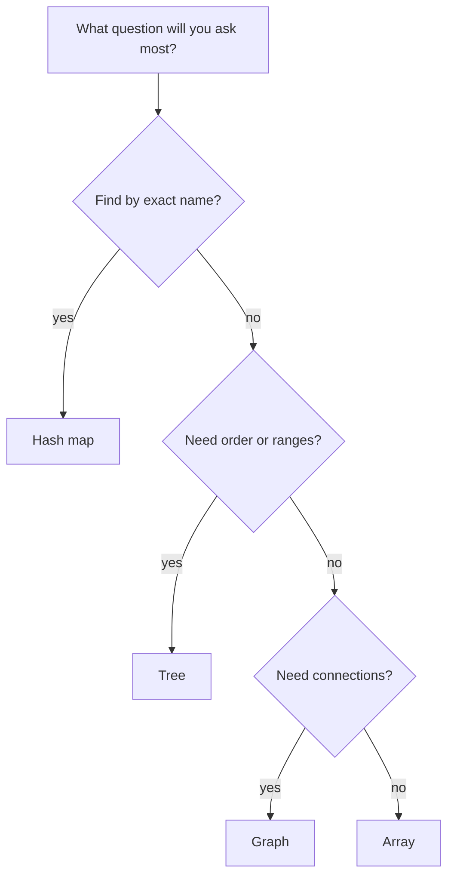

> [!crumbs] [[00 Start Here|🏠 Home]] › [[Part 1 System Design|Part 1]] › [[Foundations]] › [[Core Concepts]] › Data Structures

> [!tldr] In one sentence
> A data structure is a way of **arranging data so that the questions you ask most often are fast to answer**.

## 🧠 Think of it like…

> [!analogy] A library
> Pile a million books on the floor and finding one takes all week. Put them on shelves in order, add a catalog, and you find any book in a minute.

Same books; only the arrangement changed. A data structure is that arrangement for a computer's data.

## What it is

A **data structure** is a pattern for storing data in memory. A handful cover most needs:

- **Array** — a numbered row of boxes. You can jump straight to box 5.
- **Hash map** (or hash table) — a coat check. Hand over a ticket, get your coat straight back.
- **Tree** — sorted, branching data, like a tournament bracket. Each step skips whole branches.
- **Graph** — dots joined by lines, like a subway map. It answers "what connects to what?"

An **algorithm** is a step-by-step recipe that works on the data, like "search" or "sort". **Big O** is shorthand for how its work grows as the data grows.[^1]

## Why it matters

- **Speed at scale.** An unsorted list must be checked item by item. In a sorted list, binary search halves the list each step: about 20 checks for a million items.[^2]
- **Some lookups are almost free.** Finding a value in a plain list is O(n): the work grows with the list. Finding a key in a hash map is O(1) on average, the same cost at any size.[^3]
- **Everything else is built from them.** A database's **index**, the lookup table that finds rows fast, is usually a tree. PostgreSQL creates a tree-shaped index called a B-tree by default.[^4]

## How it works

Start with the questions, not the data: pick the shape that makes the most common lookup cheap.

Every choice is a **trade-off**. A hash map keeps no order, so "the ten highest scores" is slow. A tree keeps order, but each lookup takes a few steps. Adding to the front of an array shifts every box after it.[^3]

Some structures trade accuracy for size. A Bloom filter answers "is it here?" with "definitely not" or "probably yes". The database Cassandra uses one to skip files that can't hold your data.[^5]

## A real-world example

Facebook stores its social network as a **graph**. In a system called TAO, users, check-ins, places and comments are nodes. Friendships, "tagged in" and "wrote this" are edges between them.[^6]

In 2013, TAO handled **a billion reads and millions of writes every second**.[^6] Reads were 99.8% of requests, so the design favors fast "everything linked to this node" lookups.[^6]

## Myths and pitfalls

- **❌ Myth:** Data structures only matter in coding interviews. **✅ Reality:** Databases are built on them. PostgreSQL alone offers six index types, each a different structure.[^4]
- **❌ Myth:** A hash map is always instant. **✅ Reality:** That's the average case. If many keys collide in the same slot, each lookup can slow to a full scan.[^3]
- **❌ Myth:** A faster computer fixes a slow algorithm. **✅ Reality:** If work grows with the square of the data, ten times the data means a hundred times the work.[^1]
- **❌ Myth:** A data structure must give exact answers. **✅ Reality:** A Bloom filter accepts a small error rate to save memory.[^5]

## Check yourself

> [!question]- Why does binary search need the list to be sorted?
> It throws away half by comparing with the middle item. That only works if smaller items sit on one side and larger on the other.

> [!question]- An app looks up users by their exact username millions of times a day. Which structure fits best?
> A hash map. Exact-key lookups are its strength, at about the same cost at any size.

> [!question]- What does O(n) tell you about an operation?
> Its work grows in step with the data: twice the items, roughly twice the time.

## Key terms

- **Algorithm** — a step-by-step recipe for solving a problem, like searching or sorting.
- **Array** — a numbered row of items you can reach directly by position.
- **Hash map** — a structure that jumps straight from a key to its value.
- **Tree** — sorted, branching data where each step skips large parts of the rest.
- **Graph** — items (nodes) joined by links (edges).
- **Big O** — shorthand for how an algorithm's work grows as its input grows.

> [!deepdive] Ready for the technical take?
> Amortized vs. worst-case costs, hash table load factors, B-trees and skip lists, graph storage at Facebook, Bloom filter tuning.
> → [[Data Structures (Deep Dive)]]

## Related

- [[Databases]] — indexes are trees that make queries fast.
- [[Caching]] — a cache is, at heart, a giant hash map.
- [[NoSQL Databases]] — key-value and graph stores expose these shapes directly.
- [[Embeddings & Vector Databases]] — special structures for finding similar items, not exact ones.
- [[Estimation]] — Big O thinking helps size a system early.

> [!nav] Keep going
> ← [[Concurrency]] · [[Core Concepts|🧠 Core Concepts]] · [[Operating Systems]] →
> 🔬 Technical take: [[Data Structures (Deep Dive)]] · 🗺️ [[Glossary]]

## 📚 Sources

[^1]: 📖 [Big O notation](https://en.wikipedia.org/wiki/Big_O_notation) — Wikipedia. Encyclopedia. Checked 2026-11.
[^2]: 📖 [Binary search](https://en.wikipedia.org/wiki/Binary_search) — Wikipedia. Encyclopedia. Checked 2026-11.
[^3]: 📄 [Time complexity of operations on built-in types](https://docs.python.org/3/builtins/time-complexity.html) — Python documentation. Official docs. Checked 2026-11.
[^4]: 📄 [Index Types](https://www.postgresql.org/docs/current/indexes-types.html) — PostgreSQL documentation. Official docs. Checked 2026-11.
[^5]: 📄 [Bloom Filters](https://cassandra.apache.org/doc/latest/cassandra/managing/operating/bloom_filters.html) — Apache Cassandra documentation. Official docs. Checked 2026-11.
[^6]: 🔬 [TAO: Facebook's Distributed Data Store for the Social Graph](https://www.usenix.org/system/files/conference/atc13/atc13-bronson.pdf) — Bronson et al., USENIX ATC 2013. Paper. Checked 2026-11.
