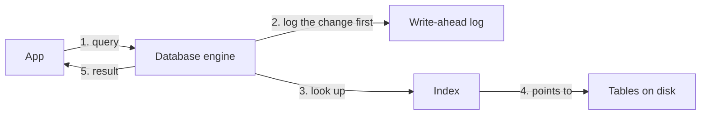

> [!crumbs] [[00 Start Here|🏠 Home]] › [[Part 1 System Design|Part 1]] › [[Foundations]] › [[Core Concepts]] › Databases

> [!tldr] In one sentence
> A database is a system that **stores data safely and lets you query it later**, even when many people read and change it at once.

## 🧠 Think of it like…

> [!analogy] A bank's records office
> Every form goes in a labeled drawer, and an index card box says which drawer holds what. Before any file is touched, the clerk writes the change in a logbook. And a transfer is either fully recorded or not at all.

The drawers are **tables** and the card box is an **index**. The logbook rebuilds the files after a fire. The all-or-nothing rule is a **transaction**.

## What it is

A **database** stores data so it survives crashes and can be searched quickly. The software that runs it, like PostgreSQL or MySQL, is often called a database too.

In the most common kind, a relational database, data lives in **tables**: rows for each record, columns for each detail. The **schema** is the plan that names those tables and columns and says what each may hold. You ask questions with **queries**, usually written in a language called SQL.

Other kinds store documents, key-value pairs or graphs instead.

## Why it matters

- **Data must outlive the app.** Once a database confirms a change, it promises the change is permanently recorded, even if the machine crashes a moment later.[^1]
- **Many users, one truth.** Many people can read and write at once without seeing each other's half-finished work.[^1]
- **Fast answers.** Without help, finding one customer means scanning every row. An **index** lets the database jump almost straight to it.[^2]

## How it works

**Indexes.** An index works like a book's index: look up the term, then flip straight to the right page.[^2] PostgreSQL's default index is a sorted tree called a B-tree.[^3]

**Transactions.** Moving $100 from Alice to Bob takes two steps: subtract from Alice, add to Bob. A transaction bundles them so both happen or neither does. Nobody else sees the in-between state.[^1]

**The log.** Before changing its main files, the database writes each change to a **write-ahead log** and makes sure it reaches disk. After a crash, it replays the log to recover anything that wasn't yet saved in the main files.[^4]

These guarantees are known as **ACID**: atomicity (all or nothing), consistency (rules are never broken), isolation (transactions don't trip over each other) and durability (committed means saved).[^5]

## A real-world example

Notion, the note-taking app, ran on **a single PostgreSQL database for about five years**.[^6] As it grew, the database server's processor kept maxing out and its background cleanup process began to stall.[^6]

In 2021 the team split the data into **480 logical pieces across 32 physical databases**, grouped by workspace, because most queries stay inside one workspace.[^6] The switch took about five minutes of planned downtime.[^6] Splitting data like this is called sharding.

## Myths and pitfalls

- **❌ Myth:** More indexes always make a database faster. **✅ Reality:** Every index must be updated on each write, so unused ones only slow things down.[^2]
- **❌ Myth:** If the app sent the data, it's saved. **✅ Reality:** It's saved only once the transaction commits and the database acknowledges it.[^1]
- **❌ Myth:** One database server can grow until its disk is full. **✅ Reality:** Performance and upkeep often degrade well before that, which is why Notion sharded.[^6]
- **❌ Myth:** "Consistent" in ACID means everyone sees the newest data instantly. **✅ Reality:** It means rules like "balance can't go negative" always hold. Seeing fresh data is a separate question.[^5]

## Check yourself

> [!question]- Why does a payment use a transaction?
> So the money can't vanish halfway. Both steps happen, or neither does, even if the server crashes in between.

> [!question]- What does an index cost you?
> Extra storage, and extra work on every insert, update and delete, because the index must stay in sync with the table.

> [!question]- What is a schema?
> The plan for the data: which tables exist, which columns they have, and what kind of value each column holds.

## Key terms

- **Database** — a system that stores data durably and answers queries about it.
- **Table** — a grid of rows (records) and columns (fields).
- **Schema** — the plan that defines tables, columns and their types.
- **Query** — a question you ask the database, usually in SQL.
- **Index** — a lookup structure that finds rows without scanning everything.
- **Transaction** — a group of changes that succeed or fail together.
- **ACID** — atomicity, consistency, isolation, durability: a database's core promises.

> [!deepdive] Ready for the technical take?
> B-trees vs. LSM trees, write-ahead logging, MVCC, isolation levels and anomalies, and Notion's sharding.
> → [[Databases (Deep Dive)]]

## Related

- [[SQL Databases]] — relational databases in depth.
- [[NoSQL Databases]] — document, key-value and wide-column stores.
- [[Sharding]] — splitting data across machines, as Notion did.
- [[Replication]] — copies of a database for safety and read speed.
- [[Caching]] — a fast layer that protects the database from repeat reads.

> [!nav] Keep going
> ← [[Networking]] · [[Core Concepts|🧠 Core Concepts]] · [[Requirements]] →
> 🔬 Technical take: [[Databases (Deep Dive)]] · 🗺️ [[Glossary]]

## 📚 Sources

[^1]: 📄 [Transactions](https://www.postgresql.org/docs/current/tutorial-transactions.html) — PostgreSQL documentation. Official docs. Checked 2026-11.
[^2]: 📄 [Indexes: Introduction](https://www.postgresql.org/docs/current/indexes-intro.html) — PostgreSQL documentation. Official docs. Checked 2026-11.
[^3]: 📄 [Index Types](https://www.postgresql.org/docs/current/indexes-types.html) — PostgreSQL documentation. Official docs. Checked 2026-11.
[^4]: 📄 [Write-Ahead Logging (WAL)](https://www.postgresql.org/docs/current/wal-intro.html) — PostgreSQL documentation. Official docs. Checked 2026-11.
[^5]: 📖 [ACID](https://en.wikipedia.org/wiki/ACID) — Wikipedia. Encyclopedia. Checked 2026-11.
[^6]: 📝 [Herding elephants: Lessons learned from sharding Postgres at Notion](https://www.notion.com/blog/sharding-postgres-at-notion) — Garrett Fidalgo, Notion, 2021. Engineering blog. Checked 2026-11.
