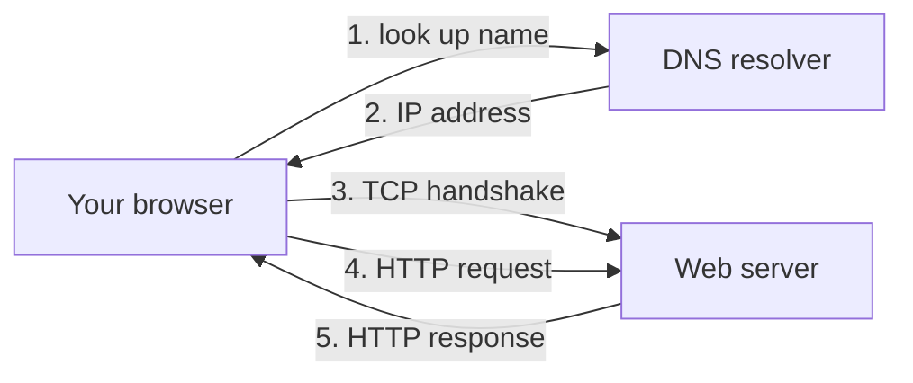

> [!crumbs] [[00 Start Here|🏠 Home]] › [[Part 1 System Design|Part 1]] › [[Foundations]] › [[Core Concepts]] › Networking

> [!tldr] In one sentence
> Networking is how computers **find each other and exchange messages**, using shared rules called protocols.

## 🧠 Think of it like…

> [!analogy] The postal service
> A letter needs an address, not just a name. You can send a postcard and hope, or pay for tracked mail that is re-sent if lost. And the reader must know your language.

The street address is an **IP address**; the address book is **DNS**. Postcards and tracked mail are **UDP** and **TCP**. The shared language is **HTTP**.

## What it is

A **protocol** is an agreed set of rules for talking. The Internet stacks several, each doing one job:[^1]

- **IP** (Internet Protocol) moves small chunks of data, called packets, from one address to another. It makes no promise they arrive.[^1]
- **TCP** turns those packets into a reliable, in-order stream, re-sending anything lost.[^2]
- **UDP** just sends messages, with no delivery guarantee, and very little overhead.[^3]
- **HTTP** is the language browsers and servers use to request and return web pages and data.[^4]
- **DNS** turns names like `www.amazon.com` into the numeric IP addresses computers need.[^5]

You may hear of the **OSI model**, a seven-layer teaching diagram published in 1984. The real Internet follows the simpler TCP/IP model, which was developed separately.[^6]

## Why it matters

- **Every design is a network design.** Servers, databases and caches all talk over networks, and every hop adds delay.
- **Latency is often the bottleneck.** Latency is the time a message takes to travel. **Bandwidth** is how much data flows per second. A bigger pipe doesn't make one trip faster.
- **First contact is slow.** A first request needs a DNS lookup, a TCP handshake and a security handshake before any data flows. Later requests reuse the open connection and skip those steps.[^7]

## How it works

1. **Find the address.** Your browser asks a DNS resolver for the site's IP address. The resolver asks a chain of servers on your behalf, then remembers the answer for a while.[^5]
2. **Open a connection.** Your computer and the server swap three short messages, a "handshake", to agree how to number the data.[^2]
3. **Ask and answer.** The browser sends an HTTP request, such as "GET the home page". The server replies with a status code like 200 (OK) and the content.[^4]

Underneath, data travels as many small packets. TCP numbers each byte, so the receiver can reorder them and request anything missing.[^2]

## A real-world example

Google found that TCP's setup steps were slowing down search and video, so it built **QUIC**, a new protocol on top of UDP. It merges the connection and security handshakes, and often sends data with no setup wait at all.[^8]

QUIC cut Google Search latency by 8% for desktop users and YouTube rebuffering by 18%.[^8] By 2017 it carried an estimated **7% of all Internet traffic**.[^8] It later became an Internet standard and now carries HTTP/3.[^9]

## Myths and pitfalls

- **❌ Myth:** A faster Internet plan makes every page load faster. **✅ Reality:** More bandwidth doesn't shorten each round trip. Pages with many small requests are limited by latency.[^10]
- **❌ Myth:** UDP is unreliable, so nobody serious uses it. **✅ Reality:** DNS runs over UDP, and QUIC builds its own reliability on top of it.[^11][^8]
- **❌ Myth:** The Internet is built on the seven OSI layers. **✅ Reality:** OSI is a reference model. The Internet's own protocol suite was designed separately and has four layers.[^6][^1]
- **❌ Myth:** Every visit looks up the site's address again. **✅ Reality:** DNS answers are cached for a set time, called the TTL, so repeat visits skip the lookup.[^11]

## Check yourself

> [!question]- What is the difference between latency and bandwidth?
> Latency is how long one message takes to arrive. Bandwidth is how much data flows per second.

> [!question]- Why would a video call prefer UDP over TCP?
> A late video frame is useless, so re-sending it wastes time. UDP skips the waiting and re-sending that TCP insists on.

> [!question]- What does DNS do, in one sentence?
> It translates names like a website's domain into the numeric IP addresses computers use.

## Key terms

- **IP address** — the numeric address of a device on a network.
- **DNS** — the Internet's address book, turning names into IP addresses.
- **TCP** — a protocol that delivers data reliably and in order.
- **UDP** — a lightweight protocol that sends messages without delivery guarantees.
- **HTTP** — the request-and-response language of the web.
- **Latency** — the time a message takes to travel.
- **Bandwidth** — how much data a connection carries per second.

> [!deepdive] Ready for the technical take?
> Handshake round trips, TCP congestion control, head-of-line blocking, QUIC and HTTP/3, and DNS caching.
> → [[Networking (Deep Dive)]]

## Related

- [[Load Balancing]] — spreads incoming connections across many servers.
- [[CDN]] — moves content closer to users to cut latency.
- [[API Design]] — what the messages between services should look like.
- [[Encryption]] — how TLS keeps those messages private.

> [!nav] Keep going
> ← [[Operating Systems]] · [[Core Concepts|🧠 Core Concepts]] · [[Databases]] →
> 🔬 Technical take: [[Networking (Deep Dive)]] · 🗺️ [[Glossary]]

## 📚 Sources

[^1]: 📄 [RFC 1122: Requirements for Internet Hosts](https://www.rfc-editor.org/rfc/rfc1122.html) — IETF, 1989. Standard. Checked 2026-11.
[^2]: 📄 [RFC 9293: Transmission Control Protocol (TCP)](https://www.rfc-editor.org/rfc/rfc9293.html) — IETF, 2022. Standard. Checked 2026-11.
[^3]: 📄 [RFC 768: User Datagram Protocol](https://www.rfc-editor.org/rfc/rfc768.html) — IETF, 1980. Standard. Checked 2026-11.
[^4]: 📄 [Overview of HTTP](https://developer.mozilla.org/en-US/docs/Web/HTTP/Guides/Overview) — MDN Web Docs. Official docs. Checked 2026-11.
[^5]: 📄 [What is DNS?](https://aws.amazon.com/route53/what-is-dns/) — Amazon Web Services. Official docs. Checked 2026-11.
[^6]: 📖 [OSI model](https://en.wikipedia.org/wiki/OSI_model) — Wikipedia. Encyclopedia. Checked 2026-11.
[^7]: 📄 [Understanding latency](https://developer.mozilla.org/en-US/docs/Web/Performance/Guides/Understanding_latency) — MDN Web Docs. Official docs. Checked 2026-11.
[^8]: 🔬 [The QUIC Transport Protocol: Design and Internet-Scale Deployment (PDF)](https://courses.cs.washington.edu/courses/cse550/21au/papers/CSE550.quic.pdf) — Langley et al., ACM SIGCOMM 2017. Paper. Checked 2026-11.
[^9]: 📄 [RFC 9114: HTTP/3](https://www.rfc-editor.org/rfc/rfc9114.html) — IETF, 2022. Standard. Checked 2026-11.
[^10]: 📘 [Primer on Web Performance](https://hpbn.co/primer-on-web-performance/) — Ilya Grigorik, *High Performance Browser Networking*, O'Reilly. Book. Checked 2026-11.
[^11]: 📄 [RFC 1035: Domain Names, Implementation and Specification](https://www.rfc-editor.org/rfc/rfc1035.html) — IETF, 1987. Standard. Checked 2026-11.
