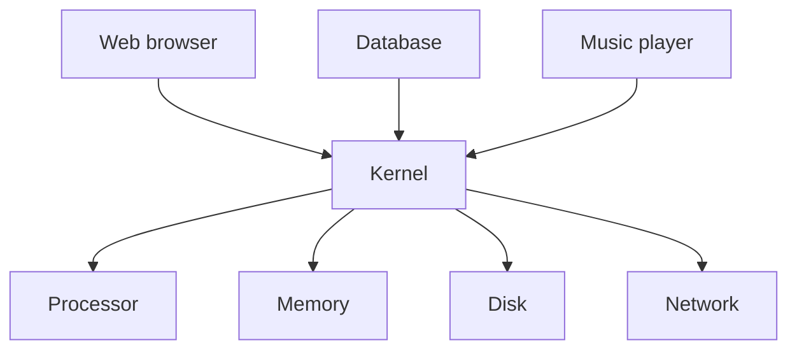

> [!crumbs] [[00 Start Here|🏠 Home]] › [[Part 1 System Design|Part 1]] › [[Foundations]] › [[Core Concepts]] › Operating Systems

> [!tldr] In one sentence
> An operating system is the software that **shares one computer between many programs**, so each one can run as if it had the machine to itself.

## 🧠 Think of it like…

> [!analogy] A hotel
> Each guest gets a private, locked room. Everyone shares the elevators, taking turns. For anything beyond their room, guests call the front desk instead of wandering into the boiler room.

Guests are programs and rooms are their private **memory**. The elevators are the processor, shared in quick turns. The front desk is the operating system.

## What it is

An **operating system (OS)** sits between programs and hardware. Windows, macOS, Android and Linux are examples.

Its core is the **kernel**, the part with full control of the hardware. Each running program is a **process**, with its own memory and state. To use the disk, network or more memory, a process asks the kernel through a **system call**, a formal request. A typical OS offers a few hundred.[^1]

A classic textbook sums up the job in three ideas:[^1]

- **Virtualization:** making one processor and one memory look like many private ones.
- **Concurrency:** juggling many things at once without mixing them up.
- **Persistence:** storing files so they survive a crash or power cut.

## Why it matters

- **Every server runs on one.** The web server, database and cache in any design are processes managed by an OS.
- **It keeps crashes contained.** Each process gets its own memory, so a buggy program can't scribble over another one's data.[^2]
- **Containers are built from its features.** Docker, the popular tool for packaging apps, relies on Linux **namespaces**, which give each container its own private view of the system.[^3]

## How it works

**Sharing the processor.** A timer interrupts the running program every few milliseconds, letting the OS pause one program and resume another. The switches are so fast that everything seems to run at once.[^4]

**Sharing memory.** Each process sees a private address space, a numbered range of memory that looks like the whole machine. The OS maps it onto real memory and blocks any reach outside it.[^2]

**Storing files.** The **file system** organizes data on disk into files and folders. Programs ask it to open, write and close files; it handles the device details.[^1]

## A real-world example

Every Android phone runs Linux underneath. Google's documentation states that the Android kernel is based on an upstream Linux long-term support release, with Android-specific changes added on top.[^5]

The kernel family that powers countless servers also sits in your pocket, doing the same job: sharing one processor, memory and storage among many apps.

## Myths and pitfalls

- **❌ Myth:** The OS is the desktop and icons. **✅ Reality:** That is the user interface. The real work happens in the kernel, out of sight.
- **❌ Myth:** A computer can run only as many programs as it has cores. **✅ Reality:** The OS takes turns so quickly that hundreds of programs appear to run at the same time.[^4]
- **❌ Myth:** Once a program "saves" a file, it is safely on disk. **✅ Reality:** The OS often holds new data in memory first. Programs that can't lose data, like databases, call a special function to force it onto the disk.[^6]
- **❌ Myth:** A container is a tiny virtual computer. **✅ Reality:** A container is a set of ordinary processes. Namespaces give it its own view of process IDs, network and mount points.[^7]

## Check yourself

> [!question]- What is the difference between a program and a process?
> A program is code on disk. A process is one running copy of it, with its own memory and state.

> [!question]- How can one processor core run many programs "at once"?
> It doesn't, literally. A timer lets the OS switch between programs every few milliseconds, which is fast enough to look simultaneous.

> [!question]- Why can't one app read another app's memory?
> Each process has its own private address space. The OS and hardware translate every memory access and block any reach outside that space.

## Key terms

- **Operating system (OS)** — software that shares a computer's hardware among programs.
- **Kernel** — the core of the OS, with full control of the hardware.
- **Process** — a running program with its own private memory.
- **System call** — a program's formal request to the kernel.
- **Virtual memory** — the trick that gives each process its own private view of memory.
- **File system** — the part of the OS that organizes data on disk into files.

> [!deepdive] Ready for the technical take?
> User and kernel mode, context switches, page tables and TLBs, epoll, cgroups and namespaces, and fsync.
> → [[Operating Systems (Deep Dive)]]

## Related

- [[Concurrency]] — threads and processes running side by side.
- [[Networking]] — the kernel sends and receives every network packet.
- [[Databases]] — built on the file system, and careful about when data truly hits disk.
- [[Cloud & Infrastructure]] — virtual machines and containers are OS features at scale.

> [!nav] Keep going
> ← [[Data Structures]] · [[Core Concepts|🧠 Core Concepts]] · [[Networking]] →
> 🔬 Technical take: [[Operating Systems (Deep Dive)]] · 🗺️ [[Glossary]]

## 📚 Sources

[^1]: 📘 [Introduction to Operating Systems](https://pages.cs.wisc.edu/~remzi/OSTEP/intro.pdf) — Arpaci-Dusseau, *Operating Systems: Three Easy Pieces*, ch. 2. Book. Checked 2026-11.
[^2]: 📘 [The Abstraction: Address Spaces](https://pages.cs.wisc.edu/~remzi/OSTEP/vm-intro.pdf) — Arpaci-Dusseau, *Operating Systems: Three Easy Pieces*, ch. 13. Book. Checked 2026-11.
[^3]: 📄 [What is Docker?](https://docs.docker.com/get-started/docker-overview/) — Docker documentation. Official docs. Checked 2026-11.
[^4]: 📘 [Mechanism: Limited Direct Execution](https://pages.cs.wisc.edu/~remzi/OSTEP/cpu-mechanisms.pdf) — Arpaci-Dusseau, *Operating Systems: Three Easy Pieces*, ch. 6. Book. Checked 2026-11.
[^5]: 📄 [Kernel overview](https://source.android.com/docs/core/architecture/kernel) — Android Open Source Project. Official docs. Checked 2026-11.
[^6]: 📄 [fsync(2)](https://man7.org/linux/man-pages/man2/fsync.2.html) — Linux manual page. Official docs. Checked 2026-11.
[^7]: 📄 [namespaces(7)](https://man7.org/linux/man-pages/man7/namespaces.7.html) — Linux manual page. Official docs. Checked 2026-11.
