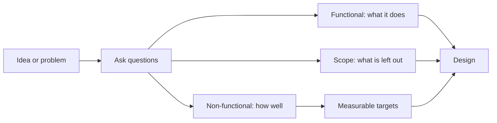

> [!crumbs] [[00 Start Here|🏠 Home]] › [[Part 1 System Design|Part 1]] › [[Foundations]] › [[Design Basics]] › Requirements

> [!tldr] In one sentence
> Requirements are the agreed list of **what a system must do** and **how well it must do it**, written down before anyone starts building.

## 🧠 Think of it like…

> [!analogy] Hiring a builder
> Before the builder pours concrete, you agree on the rooms you need and the standards they must meet: three bedrooms, warm in winter, ready by June. Change your mind after the walls go up and it costs a fortune.

Software works the same way. The rooms are the **functional requirements**: the features. The comfort and deadline rules are the **non-functional requirements**: how fast, reliable and safe it must be.

## What it is

Requirements come in two kinds.[^1][^2]

- **Functional requirements** say what the system should *do*: "Users can post a photo."
- **Non-functional requirements (NFRs)** say what the system should *be*: fast, reliable, secure, easy to change. They are also called quality attributes.[^1]

A third ingredient is **scope**: what you will and won't build this time.

To make "fast" or "reliable" testable, teams turn them into numbers. Google's engineers use three related terms:[^3]

- An **SLI (service level indicator)** is a measurement, such as the share of requests that succeed.
- An **SLO (service level objective)** is the target for that measurement, such as "99.9% of requests succeed."
- An **SLA (service level agreement)** is a promise to customers with a consequence, like a refund, if the target is missed.

## Why it matters

- **You build the right thing.** A chat app for 50 friends and one for 50 million people need very different designs.
- **You can tell when you are done.** "Pages load quickly" can't be checked. "Most pages load in under a second" can.
- **You avoid gold-plating.** Requirements say how good is good enough. Google argues that 100% reliability is almost never the right goal.[^4]

## How it works

1. **Ask before you design.** What are the core features? How many people will use it, and how fast will that grow?[^5]
2. **Split must-haves from nice-to-haves.** Pick the two or three features that matter most and park the rest.
3. **Put numbers on the qualities.** Say "99% of searches answer within 200 milliseconds", not "fast". Google warns that absolutes like "always available" are unrealistic and expensive.[^3]
4. **Write it down and agree.** Every later choice, from [[Estimation]] to [[Trade-offs]], leans on it.

## A real-world example

Amazon S3, a cloud file storage service, publishes an SLA. If S3 Standard's monthly uptime drops below 99.9%, customers get 10% of that month's bill back; below 99%, 25%; below 95%, all of it.[^6]

Teams usually aim a little higher inside. Google gives the example of a 99.9% SLA backed by an internal 99.95% SLO, so problems show up before customers are owed anything.[^7]

## Myths and pitfalls

- **❌ Myth:** Requirements are just a feature list. **✅ Reality:** Qualities like speed and reliability usually shape the architecture.[^1]
- **❌ Myth:** Aim for 100% uptime. **✅ Reality:** One more step of reliability may cost 100 times more than the step before.[^4]
- **❌ Myth:** An average response time is a fine target. **✅ Reality:** Averages hide the slow requests. Targets like "99% of requests under X" protect the unlucky users.[^3]
- **❌ Myth:** Requirements are fixed forever. **✅ Reality:** Google suggests starting with a loose target and tightening it as you learn.[^3]

## Check yourself

> [!question]- Is "users can reset their password" a functional or a non-functional requirement?
> Functional: it is something the system does. "Resets finish within a minute" would be non-functional.

> [!question]- What is the difference between an SLO and an SLA?
> An SLO is the target a team aims for. An SLA is a promise to customers that carries a consequence, such as a refund, when it is missed.

> [!question]- Why not simply require 100% reliability?
> It is extremely expensive, users can't tell the difference past a point, and it slows down new features.

## Key terms

- **Functional requirement** — something the system must do.
- **Non-functional requirement (NFR)** — a quality the system must have, such as speed or security.
- **Scope** — the agreed boundary of what will and won't be built.
- **SLI** — a measurement of how well the service is doing.
- **SLO** — the target value for that measurement.
- **SLA** — a promise to customers, with a penalty if it is broken.
- **Nines** — shorthand for availability: 99.9% is "three nines".

> [!deepdive] Ready for the technical take?
> SLI specifications, percentile targets, error budgets, the cost of each nine, and how Amazon's requirements shaped Dynamo.
> → [[Requirements (Deep Dive)]]

## Related

- [[Estimation]] — turns "10 million users" into servers, storage and bandwidth.
- [[Trade-offs]] — requirements tell you which side of each trade-off to pick.
- [[High-Level Design]] — the first sketch built to meet the requirements.
- [[Metrics]] — how SLIs get measured in production.
- [[Fault Tolerance]] — how systems actually reach their reliability targets.
- [[Business Goals & Requirements]] — the same idea applied to AI systems.

> [!nav] Keep going
> ← [[Databases]] · [[Design Basics|💡 Design Basics]] · [[Estimation]] →
> 🔬 Technical take: [[Requirements (Deep Dive)]] · 🗺️ [[Glossary]]

## 📚 Sources

[^1]: 📖 [Non-functional requirement](https://en.wikipedia.org/wiki/Non-functional_requirement) — Wikipedia. Encyclopedia. Checked 2026-11.
[^2]: 🎓 [A Framework for Mobile System Design Interviews](https://bytebytego.com/courses/mobile-system-design-interview/a-framework-for-mobile-sd-interviews) — ByteByteGo. Course. Checked 2026-11.
[^3]: 📘 [Service Level Objectives](https://sre.google/sre-book/service-level-objectives/) — Site Reliability Engineering, Google. Book. Checked 2026-11.
[^4]: 📘 [Embracing Risk](https://sre.google/sre-book/embracing-risk/) — Site Reliability Engineering, Google. Book. Checked 2026-11.
[^5]: 🎓 [A Framework For System Design Interviews](https://bytebytego.com/courses/system-design-interview/a-framework-for-system-design-interviews) — Alex Xu, ByteByteGo. Course. Checked 2026-11.
[^6]: 📄 [Amazon S3 Service Level Agreement](https://aws.amazon.com/s3/sla/) — Amazon Web Services. Official docs. Checked 2026-11.
[^7]: 📝 [SRE fundamentals: SLIs, SLAs and SLOs](https://cloud.google.com/blog/products/devops-sre/sre-fundamentals-slis-slas-and-slos) — Google Cloud Blog. Article. Checked 2026-11.
