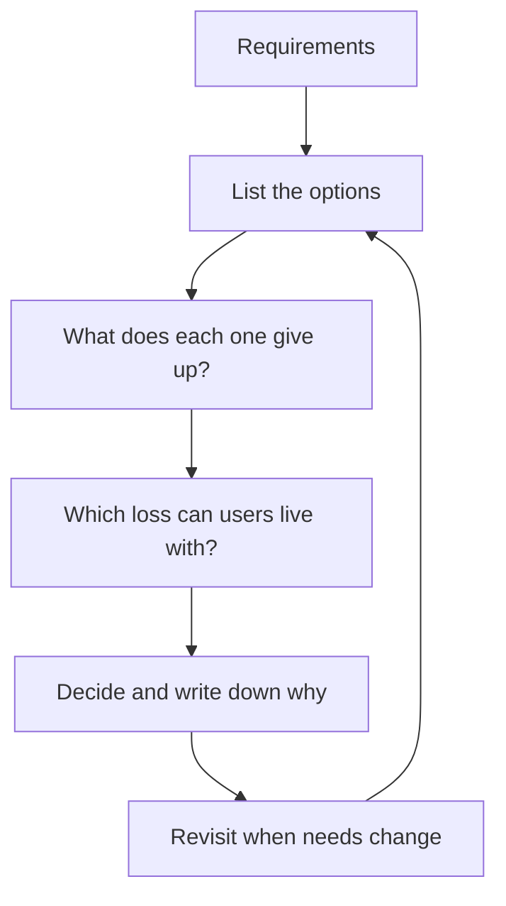

> [!crumbs] [[00 Start Here|🏠 Home]] › [[Part 1 System Design|Part 1]] › [[Foundations]] › [[Design Basics]] › Trade-offs

> [!tldr] In one sentence
> Every design choice **gives something up to get something else**, and good design means **choosing what to give up on purpose**, based on what users actually need.

## 🧠 Think of it like…

> [!analogy] Choosing a car
> A sports car is fast but has no trunk. A minivan carries the whole family but won't win a race. No car is best at everything, so you pick the one that fits the trips you take.

Systems are the same. Speed, cost, reliability and always-correct data pull against each other. A **trade-off** is the deal you make between them, and your **requirements** say which deal is right.

## What it is

A trade-off is any decision where improving one quality costs you another. Even "best" depends on the goal: Jeff Dean of Google notes it might mean simplest, fastest or easiest to extend.[^1]

A few trade-offs come up again and again:

- **Consistency vs availability.** Should every user always see the latest data, or should the system keep answering when its parts can't talk to each other? During a network break, you can't fully have both; this is the [[CAP Theorem]].[^2]
- **Latency vs throughput.** **Latency** is how long one request waits; **throughput** is total work done per second. Batching requests raises throughput, but each one waits longer.[^3]
- **Cost vs reliability.** Each extra bit of reliability costs more than the last.[^4]

## Why it matters

- **There is no free lunch.** A design with no downsides just hasn't had them found yet.
- **The right answer depends on context.** Amazon's cloud guidance says to weigh cost, reliability and performance against business needs: a test environment can skimp on reliability; a critical system can't.[^5]
- **Explaining trade-offs is the job.** In reviews and interviews, saying what you gave up, and why, matters as much as the choice.

## How it works

1. **List the real options.** Usually two or three.
2. **Name the cost of each:** slower, pricier, harder to run, briefly wrong.
3. **Check against the requirements.** A bank balance must be exact; a likes counter can lag.
4. **Prefer choices you can undo.** Amazon's Jeff Bezos calls hard-to-reverse choices **one-way doors**, worth slow care, and reversible ones **two-way doors**, worth deciding fast.[^6]
5. **Write down why**, not just what.

## A real-world example

Amazon decided that adding an item to your shopping cart must **never fail**, even when servers or networks are broken. To get that, it accepted a cost: during rare failures, two versions of a cart can exist, and the system later merges them. Sometimes that means an item you deleted reappears.[^7]

Its database service DynamoDB turns the same trade-off into a setting. By default, reads may be slightly out of date. You can ask for always-latest reads, but they cost twice as much.[^8]

## Myths and pitfalls

- **❌ Myth:** Every problem has one best design. **✅ Reality:** "Best" depends on the goal and the requirements.[^1]
- **❌ Myth:** You must always choose between consistency and availability. **✅ Reality:** Only while the network is broken, which is rare. Otherwise you get both, though keeping copies in sync costs speed.[^2][^9]
- **❌ Myth:** A trade-off is made once for the whole system. **✅ Reality:** It can differ per feature, or even per request.[^2][^8]
- **❌ Myth:** More reliability is always worth it. **✅ Reality:** Past a point, the cost climbs steeply and users can't tell the difference.[^4]

## Check yourself

> [!question]- A bank balance and a video's view counter: which one needs always-latest data?
> The bank balance. A wrong balance causes real harm; a view counter a few seconds behind bothers nobody.

> [!question]- Why does batching raise throughput but also raise latency?
> Grouping items cuts the overhead per item, so more gets done, but each item waits for the batch to fill.

> [!question]- What is a "two-way door" decision?
> One you can easily reverse. Make those quickly; save slow, careful debate for hard-to-reverse "one-way doors".

## Key terms

- **Trade-off** — gaining one quality by giving up some of another.
- **Consistency** — every user sees the same, latest data.
- **Availability** — the system keeps answering requests, even during failures.
- **Latency** — how long a single request takes.
- **Throughput** — how many requests are handled per second.
- **Eventual consistency** — copies may differ briefly but catch up soon.
- **One-way / two-way door** — a decision that is hard / easy to reverse.

> [!deepdive] Ready for the technical take?
> CAP and PACELC done properly, quorum math, batching and hedged requests, durability versus speed, and how to record decisions.
> → [[Trade-offs (Deep Dive)]]

## Related

- [[CAP Theorem]] — the most famous trade-off, in full.
- [[Requirements]] — the yardstick that decides each trade-off.
- [[Replication]] — copies of data are where consistency trade-offs appear.
- [[Caching]] — trades freshness for speed.
- [[Message Queues]] — trade instant answers for smoother, safer processing.
- [[Cost Optimization]] — the cost side of every trade-off, applied to AI systems.

> [!nav] Keep going
> ← [[Estimation]] · [[Design Basics|💡 Design Basics]] · [[Monoliths]] →
> 🔬 Technical take: [[Trade-offs (Deep Dive)]] · 🗺️ [[Glossary]]

## 📚 Sources

[^1]: 🎥 [Software Engineering Advice from Building Large-Scale Distributed Systems](https://static.googleusercontent.com/media/research.google.com/en//people/jeff/stanford-295-talk.pdf) — Jeff Dean, Google, Stanford CS295 talk slides. Talk. Checked 2026-11.
[^2]: 📝 [CAP Twelve Years Later: How the "Rules" Have Changed](https://www.infoq.com/articles/cap-twelve-years-later-how-the-rules-have-changed/) — Eric Brewer, InfoQ. Article. Checked 2026-11.
[^3]: 📄 [Optimize Confluent Cloud Clients for Throughput](https://docs.confluent.io/cloud/current/client-apps/optimizing/throughput.html) — Confluent documentation. Official docs. Checked 2026-11.
[^4]: 📘 [Embracing Risk](https://sre.google/sre-book/embracing-risk/) — Site Reliability Engineering, Google. Book. Checked 2026-11.
[^5]: 📄 [Definitions](https://docs.aws.amazon.com/wellarchitected/latest/framework/definitions.html) — AWS Well-Architected Framework. Official docs. Checked 2026-11.
[^6]: 📄 [2015 Letter to Shareholders](https://www.sec.gov/Archives/edgar/data/1018724/000119312516530910/d168744dex991.htm) — Jeff Bezos, Amazon.com, SEC filing. Official docs. Checked 2026-11.
[^7]: 🔬 [Dynamo: Amazon's Highly Available Key-value Store](https://www.allthingsdistributed.com/files/amazon-dynamo-sosp2007.pdf) — DeCandia et al., SOSP 2007, sections 2 and 4. Paper. Checked 2026-11.
[^8]: 📄 [DynamoDB read consistency](https://docs.aws.amazon.com/amazondynamodb/latest/developerguide/HowItWorks.ReadConsistency.html) — Amazon DynamoDB Developer Guide. Official docs. Checked 2026-11.
[^9]: 🔬 [Consistency Tradeoffs in Modern Distributed Database System Design](https://www.odbms.org/2012/01/consistency-tradeoffs-in-modern-distributed-database-system-design/) — Daniel Abadi, IEEE Computer, February 2012 (abstract on ODBMS.org). Paper. Checked 2026-11.
