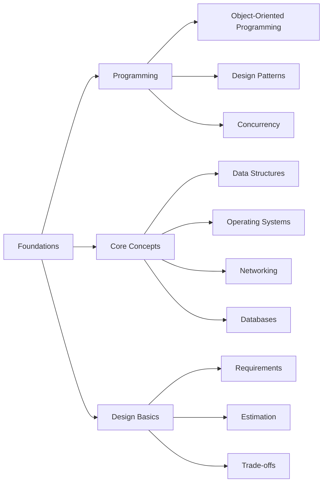

> [!crumbs] [[00 Start Here|🏠 Home]] › [[Part 1 System Design|Part 1]] › Foundations

> [!hub] 📖 Foundations
> The building blocks every system stands on: code, computers, networks and how to think about a design.

## Topics

### 💻 [[Programming]]
How software is organized and how it does many things at once.

| Topic | In one line | Technical take |
| --- | --- | --- |
| [[Object-Oriented Programming]] | Organizing code as objects that bundle data with the actions on it. | [[Object-Oriented Programming (Deep Dive)\|🔬 Deep dive]] |
| [[Design Patterns]] | Named, reusable solutions to problems that keep coming up in code. | [[Design Patterns (Deep Dive)\|🔬 Deep dive]] |
| [[Concurrency]] | Doing many things at once without the pieces tripping over each other. | [[Concurrency (Deep Dive)\|🔬 Deep dive]] |

### 🧠 [[Core Concepts]]
What every engineer knows about how computers store, run and move information.

| Topic | In one line | Technical take |
| --- | --- | --- |
| [[Data Structures]] | Ways of arranging data so the right questions are fast to answer. | [[Data Structures (Deep Dive)\|🔬 Deep dive]] |
| [[Operating Systems]] | The layer that shares one computer between many programs. | [[Operating Systems (Deep Dive)\|🔬 Deep dive]] |
| [[Networking]] | How computers find each other and exchange messages. | [[Networking (Deep Dive)\|🔬 Deep dive]] |
| [[Databases]] | Systems that store data safely and let you query it later. | [[Databases (Deep Dive)\|🔬 Deep dive]] |

### 💡 [[Design Basics]]
The habits of mind of a system designer: ask, estimate, choose.

| Topic | In one line | Technical take |
| --- | --- | --- |
| [[Requirements]] | Pinning down what the system must do and how well, before building. | [[Requirements (Deep Dive)\|🔬 Deep dive]] |
| [[Estimation]] | Quick math that tells you how big the problem really is. | [[Estimation (Deep Dive)\|🔬 Deep dive]] |
| [[Trade-offs]] | Every design choice gives something up; good design picks knowingly. | [[Trade-offs (Deep Dive)\|🔬 Deep dive]] |

## The shape of it

> [!tip] How to read these
> Every topic has a **🌱 basics** note (no jargon, about 5 minutes) and a **🔬 deep dive** (the technical take). Start with the basics; open the deep dive when you want more.
