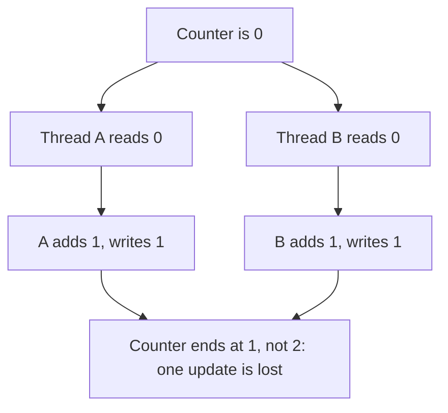

> [!crumbs] [[00 Start Here|🏠 Home]] › [[Part 1 System Design|Part 1]] › [[Foundations]] › [[Programming]] › Concurrency

> [!tldr] In one sentence
> Concurrency is a program **handling many tasks in the same stretch of time**, while making sure those tasks don't corrupt shared data or get stuck waiting on each other.

## 🧠 Think of it like…

> [!analogy] A busy restaurant kitchen
> One cook can keep soup, bread and a salad going by switching between them. Three cooks truly work at the same moment. But if two grab the same pan, or each holds the tool the other needs, dinner stops.

Juggling many tasks is **concurrency**. Doing several at the same instant, on separate processor cores (the independent engines inside a chip), is **parallelism**. The shared pan is shared data, where most concurrency bugs start.

## What it is

The Go programming language's blog, quoting Rob Pike, puts it simply: concurrency is about *dealing with* lots of things at once, parallelism is about *doing* lots of things at once.[^1]

Programs get concurrency in two main ways:

- **Threads** — separate lines of work inside one program, all sharing its memory.
- **Async (asynchronous) code** — one line of work that starts slow jobs, like reading a file, and does other work until results come back. Node.js, a popular tool for running JavaScript on servers, serves many users this way from one thread.[^2]

## Why it matters

A server often **waits**: for the network, the disk or a database. Concurrency fills that waiting time with other users' work.

In one Java example, a pool of 200 threads finished about 200 one-second tasks per second. Java's newer, cheaper "virtual threads" pushed the same job to about 10,000 per second.[^3]

## How it works

The danger is **shared data**. Even "add one to a counter" is three steps for a computer: read the value, add one, write it back.[^4] If two threads interleave those steps, one update can vanish:

This is a **race condition**: the result depends on which thread happens to go first, so it may work many times and then fail.[^4]

The usual fix is a **lock** (or mutex): a token only one thread can hold at a time.

Locks bring their own trap, the **deadlock**: thread 1 holds lock X and waits for Y, while thread 2 holds Y and waits for X. Both wait forever.[^5]

## A real-world example

The Therac-25 was a radiation therapy machine controlled by software. Between June 1985 and January 1987, it was involved in six accidents with massive overdoses.[^6]

Investigators Nancy Leveson and Clark Turner traced one failure to a keyboard task running at the same time as the treatment task, sharing a variable. A quick edit during the machine's 8-second magnet setup could be missed, so the screen and the machine disagreed. Two patients at one clinic died.[^7]

## Myths and pitfalls

- **❌ Myth:** More threads always means faster. **✅ Reality:** The parts that can't run in parallel set a hard limit. If 5% of a job must run one step at a time, even unlimited processors give at most a 20× speedup.[^8]
- **❌ Myth:** Concurrency and parallelism are the same thing. **✅ Reality:** One structures many tasks; the other runs them at the same instant.[^1]
- **❌ Myth:** If the tests pass, there is no race. **✅ Reality:** Races depend on timing, so they may hide for a long time before striking.[^4]
- **❌ Myth:** Async code runs everything in parallel. **✅ Reality:** In Node.js your code runs on one thread, so one slow step makes every other user wait.[^9]

## Check yourself

> [!question]- What is the difference between concurrency and parallelism?
> Concurrency is handling many tasks over the same period, often by switching. Parallelism is running several at the same instant on different cores.

> [!question]- Why can two threads adding to the same counter lose an update?
> Each addition is read, change, write. If both read the old value before either writes, the second write erases the first.

> [!question]- Two threads each hold one lock and wait for the other's. What is this called?
> A deadlock. Both wait forever.

## Key terms

- **Thread** — an independent line of work inside a program, sharing its memory.
- **Parallelism** — running tasks at the same instant on separate processor cores.
- **Async** — starting slow work and doing other things until its result arrives.
- **Race condition** — a bug where the result depends on which task happens to run first.
- **Lock (mutex)** — a token that lets only one thread at a time use some data.
- **Deadlock** — tasks stuck forever, each waiting for something another holds.

> [!deepdive] Ready for the technical take?
> Memory models and data races, the four conditions for deadlock, Amdahl's law, Python's GIL, event loops versus virtual threads, and Go's channels.
> → [[Concurrency (Deep Dive)]]

## Related

- [[Operating Systems]] — the layer that creates threads and decides who runs when.
- [[Databases]] — transactions are concurrency control for stored data.
- [[Message Queues]] — passing work between tasks instead of sharing data.
- [[AI Scalability & Distributed Systems]] — the same ideas, spread across many GPUs and machines.

> [!nav] Keep going
> ← [[Design Patterns]] · [[Programming|💻 Programming]] · [[Data Structures]] →
> 🔬 Technical take: [[Concurrency (Deep Dive)]] · 🗺️ [[Glossary]]

## 📚 Sources

[^1]: 📝 [Concurrency is not parallelism](https://go.dev/blog/waza-talk) — Andrew Gerrand on Rob Pike's talk, The Go Blog. Article. Checked 2026-11.
[^2]: 📄 [The Node.js Event Loop](https://nodejs.org/en/learn/asynchronous-work/event-loop-timers-and-nexttick) — Node.js. Official docs. Checked 2026-11.
[^3]: 📄 [JEP 444: Virtual Threads](https://openjdk.org/jeps/444) — OpenJDK. Official docs. Checked 2026-11.
[^4]: 📄 [Thread Interference](https://docs.oracle.com/javase/tutorial/essential/concurrency/interfere.html) — Oracle, The Java Tutorials. Official docs. Checked 2026-11.
[^5]: 📄 [Deadlock](https://docs.oracle.com/javase/tutorial/essential/concurrency/deadlock.html) — Oracle, The Java Tutorials. Official docs. Checked 2026-11.
[^6]: 🔬 [An Investigation of the Therac-25 Accidents](https://web.mit.edu/6.033/2004/wwwdocs/papers/Therac_1.html) — Leveson and Turner, IEEE Computer, July 1993. Paper. Checked 2026-11.
[^7]: 🔬 [An Investigation of the Therac-25 Accidents, Part II](https://web.mit.edu/6.033/2004/wwwdocs/papers/Therac_2.html) — Leveson and Turner, IEEE Computer, July 1993. Paper. Checked 2026-11.
[^8]: 📖 [Amdahl's law](https://en.wikipedia.org/wiki/Amdahl%27s_law) — Wikipedia. Encyclopedia. Checked 2026-11.
[^9]: 📄 [Don't Block the Event Loop (or the Worker Pool)](https://nodejs.org/en/learn/asynchronous-work/dont-block-the-event-loop) — Node.js. Official docs. Checked 2026-11.
