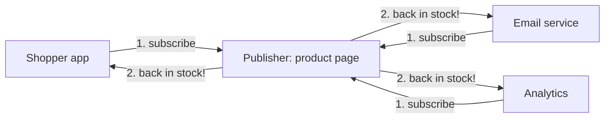

> [!crumbs] [[00 Start Here|🏠 Home]] › [[Part 1 System Design|Part 1]] › [[Foundations]] › [[Programming]] › Design Patterns

> [!tldr] In one sentence
> A design pattern is a **named, proven solution** to a problem that keeps coming up when you design software: a blueprint you adapt, not code you copy.

## 🧠 Think of it like…

> [!analogy] Chess openings
> Chess players don't invent every game from scratch. They learn named openings, each a tried answer to a common situation, and adapt it to the game in front of them.

Design patterns are the openings of programming. Say "use an **observer** here" and another developer pictures the whole arrangement, plus lessons other teams learned the hard way.

## What it is

A design pattern is a reusable answer to a recurring design problem, not a finished piece of code. An algorithm is like a recipe, with exact steps. A pattern is like a blueprint: it shows the result and its parts, and you decide how to build it.[^1]

The idea comes from architecture. In 1977 the architect Christopher Alexander and his colleagues published *A Pattern Language*, with **253 patterns** for designing towns and buildings.[^2] In 1994, four software engineers (Erich Gamma, Richard Helm, Ralph Johnson and John Vlissides) published *Design Patterns*, a catalog of **23 patterns** for object-oriented code (code built from objects that bundle data with actions).[^3] Readers nicknamed them the **Gang of Four**, or GoF.[^4]

Patterns are usually grouped into three families:[^5]

- **Creational** — how objects get made. Example: a **factory**, which creates the right kind of object for you.
- **Structural** — how objects fit together into bigger structures.
- **Behavioral** — how objects talk to each other and share the work. Example: an **observer**.

## Why it matters

- **Shared vocabulary.** One word replaces a page of explanation.
- **Proven trade-offs.** Each GoF pattern explains when it applies and what it costs, not only how it works.[^3]
- **Easier change.** Most patterns let one part change without forcing changes everywhere else.

## How it works

Take the **observer** pattern. One object, the publisher, keeps a list of subscribers. When something happens, it notifies everyone on the list. Subscribers can join or leave at any time.[^6]

It works like a magazine subscription: the publisher mails each new issue, so you never check the store.[^6] New subscribers can join without any change to the publisher.[^6]

## A real-world example

Every web browser uses the observer pattern. When a page needs to react to a click, it calls **addEventListener**, which asks the browser to call a piece of code each time that event happens.[^7] One button can have many listeners, each doing its own job.[^7]

Patterns also age. Java shipped a ready-made Observable class, then marked it outdated in Java 9. Its documentation says its event model was "quite limited" and notifications came in no set order.[^8]

## Myths and pitfalls

- **❌ Myth:** The more patterns, the better the design. **✅ Reality:** Beginners often force patterns where simple code would do. As the saying goes, "if all you have is a hammer, everything looks like a nail."[^9]
- **❌ Myth:** Patterns are code you paste in. **✅ Reality:** They are blueprints. The same pattern looks different in every program.[^1]
- **❌ Myth:** Patterns are the same in every language. **✅ Reality:** Some exist to work around missing language features. Peter Norvig found 16 of the 23 GoF patterns simpler or invisible in the languages Lisp or Dylan.[^10]
- **❌ Myth:** A singleton is a harmless shortcut. **✅ Reality:** A **singleton** (a class allowed only one instance, reachable from anywhere) acts like a global variable and makes code hard to test.[^11]

## Check yourself

> [!question]- How is a design pattern different from an algorithm?
> An algorithm is an exact list of steps, like a recipe. A pattern is a blueprint you adapt to your situation.

> [!question]- What are the three families of GoF patterns?
> Creational (how objects are made), structural (how they fit together) and behavioral (how they communicate and share responsibilities).

> [!question]- A weather app must update its phone widget, its map and its alerts whenever new data arrives. Which pattern fits?
> Observer. The data source publishes; the widget, map and alerts subscribe.

## Key terms

- **Design pattern** — a named, reusable solution to a common design problem.
- **Gang of Four (GoF)** — the four authors of the 1994 book that cataloged 23 patterns.
- **Creational, structural, behavioral** — the three families of patterns.
- **Factory** — a pattern where one piece of code decides which kind of object to create.
- **Observer** — a publisher notifies a list of subscribers when something happens.
- **Singleton** — a class that allows only one instance, shared everywhere.

> [!deepdive] Ready for the technical take?
> Factory, singleton, observer and strategy in code, dependency injection, why patterns shrink in modern languages, and how to use them in interviews.
> → [[Design Patterns (Deep Dive)]]

## Related

- [[Object-Oriented Programming]] — the building blocks most patterns arrange.
- [[Low-Level Design]] — the interview round where patterns come up most.
- [[Message Queues]] — the observer idea scaled up to whole systems.

> [!nav] Keep going
> ← [[Object-Oriented Programming]] · [[Programming|💻 Programming]] · [[Concurrency]] →
> 🔬 Technical take: [[Design Patterns (Deep Dive)]] · 🗺️ [[Glossary]]

## 📚 Sources

[^1]: 📝 [What's a design pattern?](https://refactoring.guru/design-patterns/what-is-pattern) — Refactoring.Guru. Article. Checked 2026-11.
[^2]: 📖 [A Pattern Language](https://en.wikipedia.org/wiki/A_Pattern_Language) — Wikipedia. Encyclopedia. Checked 2026-11.
[^3]: 📘 [Design Patterns: Elements of Reusable Object-Oriented Software](https://www.informit.com/store/design-patterns-elements-of-reusable-object-oriented-9780201633610) — Gamma, Helm, Johnson, Vlissides; Addison-Wesley. Book. Checked 2026-11.
[^4]: 📝 [History of patterns](https://refactoring.guru/design-patterns/history) — Refactoring.Guru. Article. Checked 2026-11.
[^5]: 📝 [Classification of patterns](https://refactoring.guru/design-patterns/classification) — Refactoring.Guru. Article. Checked 2026-11.
[^6]: 📝 [Observer](https://refactoring.guru/design-patterns/observer) — Refactoring.Guru. Article. Checked 2026-11.
[^7]: 📄 [EventTarget: addEventListener() method](https://developer.mozilla.org/en-US/docs/Web/API/EventTarget/addEventListener) — MDN Web Docs. Official docs. Checked 2026-11.
[^8]: 📄 [Class Observable](https://docs.oracle.com/javase/9/docs/api/java/util/Observable.html) — Oracle, Java SE 9 API documentation. Official docs. Checked 2026-11.
[^9]: 📝 [Criticism of patterns](https://refactoring.guru/design-patterns/criticism) — Refactoring.Guru. Article. Checked 2026-11.
[^10]: 🎥 [Design Patterns in Dynamic Languages (slides)](https://norvig.com/design-patterns/design-patterns.pdf) — Peter Norvig, Object World, 1996. Talk. Checked 2026-11.
[^11]: 📝 [Singleton](https://refactoring.guru/design-patterns/singleton) — Refactoring.Guru. Article. Checked 2026-11.
