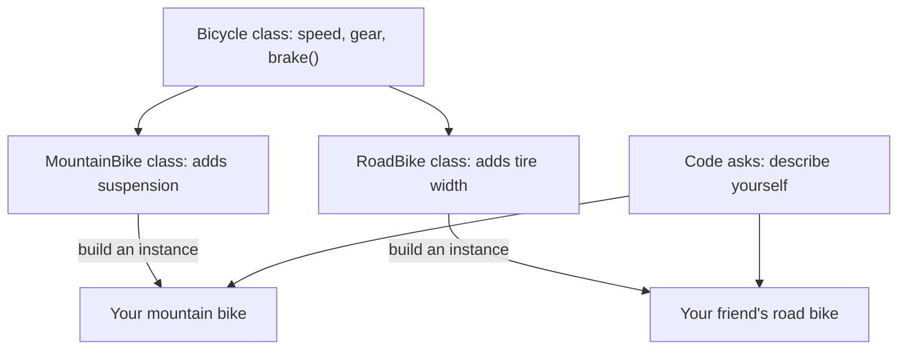

> [!crumbs] [[00 Start Here|🏠 Home]] › [[Part 1 System Design|Part 1]] › [[Foundations]] › [[Programming]] › Object-Oriented Programming

> [!tldr] In one sentence
> Object-oriented programming organizes a program as a set of **objects**, each one bundling some data with the actions that work on that data.

## 🧠 Think of it like…

> [!analogy] A coffee machine
> You press "espresso" and coffee comes out. You never touch the boiler or the pump. A factory builds thousands of machines from one design, and each keeps track of its own water and beans.

The factory's design is a **class**. Each machine is an **object**. The buttons are its public actions and the plumbing is its private data, so the maker can redesign the inside without retraining you.

## What it is

An **object** is a bundle of code that holds its **state** (the facts it knows right now) and its **behavior** (what it can do).[^1] A bicycle object might hold its speed and gear, and offer actions like "change gear" or "brake".[^1]

A **class** is the template for making objects of one kind. On its own it does nothing; the real objects built from it are called **instances**.[^2]

Four ideas come up again and again:

- **Encapsulation** — an object keeps its details private and lets others in only through its public actions.[^2]
- **Inheritance** — a new class starts from an existing one and adds to it, like a mountain bike class reusing a general bicycle class.[^3]
- **Polymorphism** (a word borrowed from biology, meaning "many forms") — different objects answer the same request in their own way.[^4]
- **Abstraction** — code works with a general idea ("a list") without caring which exact kind it has.[^5]

## Why it matters

Big programs are written by many people over many years. Objects help in four ways:[^1]

- **Modularity.** Each object can be written and fixed on its own.
- **Information hiding.** Others see only the public actions, so the insides can change safely.
- **Reuse.** You can build on objects other people already tested.
- **Swappable parts.** A faulty object can be replaced, like a broken bolt instead of the whole machine.

Encapsulation also blocks mistakes. A bicycle with six gears can simply refuse a request for gear nine.[^1]

## How it works

The general **Bicycle** class holds what every bike shares. Two specific classes **inherit** from it and add their own features.[^3] From those you build actual bikes, each with its own speed and gear.

Code can ask any bike to "describe yourself" without checking its kind. Each runs its own version. That is polymorphism.[^4]

## A real-world example

Java's standard toolkit includes a general **List**: an ordered collection of items. It ships with two built-in kinds, **ArrayList** and **LinkedList**, which store items differently inside.[^5]

Java's own shuffle and swap tools work on any list, whatever its kind.[^5] So a team can switch to whichever kind performs better without rewriting the code that uses it.

## Myths and pitfalls

- **❌ Myth:** OOP means building big family trees of classes. **✅ Reality:** Inheritance is optional. The Go language allows an object-oriented style with no class hierarchy at all.[^6]
- **❌ Myth:** "Private" data is locked away. **✅ Reality:** Sometimes it is only a convention. Python's docs say nothing in the language can enforce data hiding.[^7]
- **❌ Myth:** OOP fits every problem. **✅ Reality:** C++'s creator calls it "not a panacea". It shines when a problem has real hierarchies.[^8]
- **❌ Myth:** Every OOP language works the same way. **✅ Reality:** JavaScript links objects to other objects (prototypes). Its class features are layered on top of that model.[^2]

## Check yourself

> [!question]- What is the difference between a class and an object?
> A class is the template. An object is one real thing built from it, with its own current data. One class can produce many objects.

> [!question]- Why hide an object's data behind its actions?
> So other code can't put it into a broken state, and so its insides can change later without breaking its users.

> [!question]- A drawing app has circles, squares and triangles. Where does polymorphism help?
> Each shape answers "draw yourself" in its own way. The app asks every shape to draw without checking which kind it is.

## Key terms

- **Object** — a bundle of data plus the actions that work on it.
- **Class** — the template used to create objects of one kind.
- **Encapsulation** — keeping details private behind public actions.
- **Inheritance** — one class reusing and extending another.
- **Polymorphism** — different objects answering the same request in their own way.
- **SOLID** — five well-known rules of thumb for designing classes.

> [!deepdive] Ready for the technical take?
> Dynamic dispatch, classes vs. prototypes, multiple inheritance, composition vs. inheritance, and the SOLID principles.
> → [[Object-Oriented Programming (Deep Dive)]]

## Related

- [[Design Patterns]] — proven ways to arrange objects for common problems.
- [[Low-Level Design]] — the interview round where you design classes.
- [[Data Structures]] — the lists and maps that objects often wrap.
- [[Microservices]] — the same "hide the insides" idea, applied to whole services.

> [!nav] Keep going
> [[Programming|💻 Programming]] · [[Design Patterns]] →
> 🔬 Technical take: [[Object-Oriented Programming (Deep Dive)]] · 🗺️ [[Glossary]]

## 📚 Sources

[^1]: 📄 [What Is an Object?](https://docs.oracle.com/javase/tutorial/java/concepts/object.html) — Oracle, The Java Tutorials. Official docs. Checked 2026-11.
[^2]: 📄 [Object-oriented programming](https://developer.mozilla.org/en-US/docs/Learn_web_development/Extensions/Advanced_JavaScript_objects/Object-oriented_programming) — MDN Web Docs. Official docs. Checked 2026-11.
[^3]: 📄 [What Is Inheritance?](https://docs.oracle.com/javase/tutorial/java/concepts/inheritance.html) — Oracle, The Java Tutorials. Official docs. Checked 2026-11.
[^4]: 📄 [Polymorphism](https://docs.oracle.com/javase/tutorial/java/IandI/polymorphism.html) — Oracle, The Java Tutorials. Official docs. Checked 2026-11.
[^5]: 📄 [The List Interface](https://docs.oracle.com/javase/tutorial/collections/interfaces/list.html) — Oracle, The Java Tutorials. Official docs. Checked 2026-11.
[^6]: 📄 [Frequently Asked Questions (FAQ)](https://go.dev/doc/faq) — The Go Programming Language. Official docs. Checked 2026-11.
[^7]: 📄 [Classes](https://docs.python.org/3/tutorial/classes.html) — The Python Tutorial, Python Software Foundation. Official docs. Checked 2026-11.
[^8]: 📝 [Bjarne Stroustrup's FAQ](https://www.stroustrup.com/bs_faq.html) — Bjarne Stroustrup. Article. Checked 2026-11.
