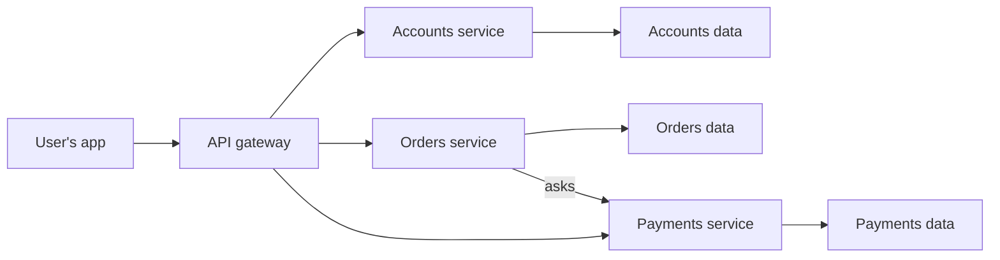

> [!crumbs] [[00 Start Here|🏠 Home]] › [[Part 1 System Design|Part 1]] › [[Architecture]] › [[Architecture Styles]] › Microservices

> [!tldr] In one sentence
> Microservices split an app into **many small programs, each owning one job**, that work together by sending messages over the network.

## 🧠 Think of it like…

> [!analogy] A food court instead of one restaurant
> The pizza stand, the sushi bar and the juice counter each have their own staff, kitchen and fridge. The sushi bar can change its menu or close for repairs while everyone else keeps serving.

Each stand is a microservice, with its own team, code and data. Customers still get a whole meal, but no single kitchen does everything.

## What it is

A **microservice** is a small program that handles one business task, such as payments, search or user accounts. A full app is a suite of these services, each **deployed on its own** (put live for users without touching the others).[^1]

Services talk through an **API** (a fixed menu of requests one program accepts from another), usually over the network.[^2] Each service keeps **its own data** instead of sharing one big database.[^1]

The style borrows ideas from **service-oriented architecture (SOA)**,[^2] an older approach for connecting a company's business applications.[^3] Microservices apply similar thinking inside a single application.[^3]

## Why it matters

- **Teams move on their own.** A small team owns a service from creation to maintenance.[^2] AWS calls these **two-pizza teams**: small enough for two pizzas to feed.[^2]
- **Scale only what is busy.** If search is overloaded, you add more search servers, not more of everything.[^4]
- **Failures stay smaller.** One service can crash or roll back without taking down the whole system.[^5]
- **The price is complexity.** Network calls are slower than calls inside one program and can fail. Keeping data consistent across services is hard.[^6]

## How it works

A request first reaches a **gateway**, a front door that forwards it to the right service.[^7] Services then call each other as needed, through [[API Design|APIs]] or [[Message Queues|message queues]].

A **service mesh** puts a small helper program, called a proxy, beside each service.[^8] The proxies handle encryption, retries and traffic measurement, so the services don't have to.[^8]

## A real-world example

In August 2008, a database corruption stopped Netflix from shipping DVDs for three days.[^9] That pushed it to rebuild for the cloud. Over seven years it moved from one big program to **hundreds of microservices**, finishing in early 2016.[^9] Availability rose toward its goal of 99.99% uptime.[^9]

Uber shows the other side. By 2020 it ran about **2,200 critical microservices**. Finding the cause of one problem could mean tracing about 50 services owned by 12 teams.[^5]

## Myths and pitfalls

- **❌ Myth:** Microservices are always better than one big app. **✅ Reality:** They add a cost that only pays off when a system is very complex. Most systems should start as one program.[^10]
- **❌ Myth:** Smaller services mean less complexity. **✅ Reality:** The complexity moves into the network, the deploys and the monitoring.[^6]
- **❌ Myth:** Microservices are just SOA renamed. **✅ Reality:** SOA connects applications across a company, often through a central hub. Microservices split up one application.[^3]
- **❌ Myth:** If you split the code, the teams are independent. **✅ Reality:** If services must still be deployed together, you have a "networked monolith" with the downsides of both.[^5]

## Check yourself

> [!question]- What makes a service a microservice rather than just a module?
> It runs as its own program, is deployed on its own, owns its own data and is reached over the network through an API.

> [!question]- Why don't microservices usually share one database?
> Shared tables tie services together, so one team's change could break another. Owning its data lets each service change on its own.

> [!question]- A startup with five engineers wants 30 microservices. Good idea?
> Usually not. The overhead would slow them down. One well-organized app is faster to build and easier to split later.

## Key terms

- **Microservice** — a small program that does one business job and is deployed on its own.
- **API** — a fixed set of requests one program accepts from another.
- **API gateway** — the front door that routes each request to the right service.
- **Service-oriented architecture (SOA)** — an older style for connecting a company's applications as reusable services.
- **Service mesh** — helper proxies beside each service that handle security, retries and monitoring.
- **Two-pizza team** — a team small enough for two pizzas to feed, owning one service.

> [!deepdive] Ready for the technical take?
> Fowler's nine characteristics, database-per-service and sagas, retries and backoff, service meshes, Uber's DOMA and the numbers behind them.
> → [[Microservices (Deep Dive)]]

## Related

- [[Monoliths]] — the single-program style most microservice systems grow out of.
- [[Serverless]] — even smaller units of code, run without managing servers.
- [[API Design]] — how services agree on what they ask each other.
- [[Message Queues]] — a way for services to talk without waiting on each other.
- [[Distributed Tracing]] — following one request across many services.
- [[AI Architecture Layers]] — AI systems split into services in the same way.

> [!nav] Keep going
> ← [[Monoliths]] · [[Architecture Styles|🧱 Architecture Styles]] · [[Serverless]] →
> 🔬 Technical take: [[Microservices (Deep Dive)]] · 🗺️ [[Glossary]]

## 📚 Sources

[^1]: 📝 [Microservices](https://martinfowler.com/articles/microservices.html) — James Lewis and Martin Fowler. Article. Checked 2026-11.
[^2]: 📄 [Implementing Microservices on AWS](https://docs.aws.amazon.com/whitepapers/latest/microservices-on-aws/microservices-on-aws.html) — Amazon Web Services whitepaper. Official docs. Checked 2026-11.
[^3]: 📄 [What is service-oriented architecture (SOA)?](https://www.ibm.com/think/topics/soa) — IBM. Official docs. Checked 2026-11.
[^4]: 📄 [Monolithic vs Microservices - Difference Between Software Development Architectures](https://aws.amazon.com/compare/the-difference-between-monolithic-and-microservices-architecture/) — Amazon Web Services. Official docs. Checked 2026-11.
[^5]: 📝 [Introducing Domain-Oriented Microservice Architecture](https://www.uber.com/blog/microservice-architecture/) — Adam Gluck, Uber Engineering. Engineering blog. Checked 2026-11.
[^6]: 📝 [Microservice Trade-Offs](https://martinfowler.com/articles/microservice-trade-offs.html) — Martin Fowler. Article. Checked 2026-11.
[^7]: 📝 [Pattern: API Gateway / Backends for Frontends](https://microservices.io/patterns/apigateway.html) — Chris Richardson, microservices.io. Article. Checked 2026-11.
[^8]: 📄 [What is Istio?](https://istio.io/latest/docs/overview/what-is-istio/) — Istio documentation. Official docs. Checked 2026-11.
[^9]: 📝 [Completing the Netflix Cloud Migration](https://about.netflix.com/en/news/completing-the-netflix-cloud-migration) — Netflix. Engineering blog. Checked 2026-11.
[^10]: 📝 [MicroservicePremium](https://martinfowler.com/bliki/MicroservicePremium.html) — Martin Fowler. Article. Checked 2026-11.
