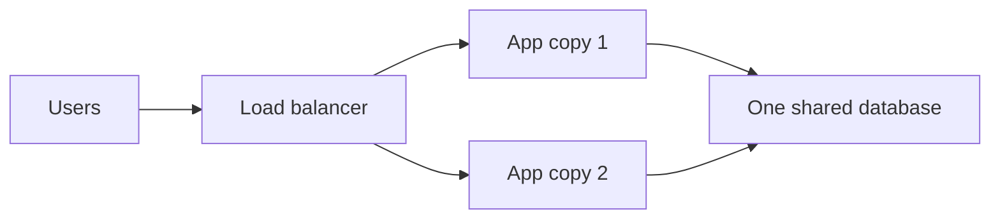

> [!crumbs] [[00 Start Here|🏠 Home]] › [[Part 1 System Design|Part 1]] › [[Architecture]] › [[Architecture Styles]] › Monoliths

> [!tldr] In one sentence
> A monolith is an app built as **one program that does everything**, shipped and run as a single unit.

## 🧠 Think of it like…

> [!analogy] A family restaurant with one kitchen
> One kitchen cooks starters, mains and desserts. The cooks share the same stove, fridge and pantry. Changing the menu means closing the whole kitchen briefly.

The kitchen is the monolith. Every feature of the app lives in the same program and shares the same **database** (the place where all the app's data is stored).

## What it is

A **monolith** packs all of an application's features into a **single deployable unit**: one program, usually backed by one database.[^1] Logging in, searching, paying and sending emails all live in the same codebase (the set of files that make up the program).[^2]

"Monolith" is not an insult. It is often the simplest way to start a new product.[^3]

A **modular monolith** is a tidier version. It is still one program, but the code is split into clear sections, such as orders, shipping and billing, with strict rules about how they talk to each other.[^4]

## Why it matters

- **Simple to start.** One codebase, one test setup, one place to deploy. Little planning is needed up front.[^2]
- **Fast inside.** Parts of the program call each other directly, with no trip over the network.[^1]
- **Easy to keep data correct.** With one database, an order and its payment can be saved together or not at all.[^1]
- **Hard to grow forever.** As the team and code grow, one change can break something unrelated, and every release ships the whole app.[^2]

## How it works

Every copy of the app is identical and contains every feature. To handle more users, you run more copies behind a [[Load Balancing|load balancer]], a traffic cop that spreads visitors across them.[^5]

The catch is that you must copy **everything**, even if only one feature is busy.[^2] If search is overloaded but checkout is quiet, you still pay for extra checkout capacity.

When hundreds of people share one codebase, they step on each other.[^4] Teams then either **draw firm boundaries inside the monolith** or split it into [[Microservices|separate services]].

## A real-world example

Shopify, the online store platform, runs one of the largest Ruby on Rails codebases anywhere. More than a thousand developers have worked on it.[^4] By 2020 it held over **2.8 million lines of code**.[^6]

Instead of breaking it into many services, Shopify chose a **modular monolith**. It reorganized the code around business areas like orders and inventory, and built tools that block code from reaching across those boundaries.[^4][^6]

## Myths and pitfalls

- **❌ Myth:** Monoliths are outdated. **✅ Reality:** Martin Fowler notes that almost every successful microservice story started as a monolith that grew too big.[^3]
- **❌ Myth:** A monolith can't handle real traffic. **✅ Reality:** You can run many copies behind a load balancer to share the load.[^5]
- **❌ Myth:** Splitting into services always saves money. **✅ Reality:** Amazon's Prime Video team cut one tool's costs by 90% by pulling its pieces back into a single process.[^7]
- **❌ Myth:** One program means messy code. **✅ Reality:** Without clear sections it can become a tangle, but a modular monolith keeps the parts separate.[^4]

## Check yourself

> [!question]- What makes an app a monolith?
> All its features are built, shipped and run as one program, usually sharing one database.

> [!question]- Why do many teams start with a monolith?
> It is the simplest thing to build, test and deploy. Early on, learning fast matters most.

> [!question]- Your search feature is overloaded but the rest of the app is quiet. What does a monolith force you to do?
> Run more copies of the whole app, not just search, paying for capacity most features don't need.

## Key terms

- **Monolith** — an app whose features all live in one program, shipped as one unit.
- **Deploy** — putting a new version of the software live for users.
- **Codebase** — the full set of source files that make up a program.
- **Modular monolith** — a monolith split into clearly separated sections with strict rules between them.
- **Load balancer** — a traffic cop that spreads visitors across copies of an app.
- **Microservices** — the opposite style: many small programs, each doing one job.

> [!deepdive] Ready for the technical take?
> Scaling axes, ACID transactions, boundary tooling like Packwerk, Stack Overflow's numbers, the Prime Video reversal and the Strangler Fig migration.
> → [[Monoliths (Deep Dive)]]

## Related

- [[Microservices]] — what you get when you split a monolith into many small services.
- [[Serverless]] — another way to run code, without managing servers at all.
- [[Load Balancing]] — how many copies of a monolith share the traffic.
- [[Databases]] — the single store most monoliths share.
- [[Trade-offs]] — choosing a style is a trade between simplicity and independence.
- [[Deployment & Serving]] — AI apps face the same "one unit or many" choice.

> [!nav] Keep going
> ← [[Trade-offs]] · [[Architecture Styles|🧱 Architecture Styles]] · [[Microservices]] →
> 🔬 Technical take: [[Monoliths (Deep Dive)]] · 🗺️ [[Glossary]]

## 📚 Sources

[^1]: 📝 [Pattern: Monolithic Architecture](https://microservices.io/patterns/monolithic.html) — Chris Richardson, microservices.io. Article. Checked 2026-11.
[^2]: 📄 [Monolithic vs Microservices - Difference Between Software Development Architectures](https://aws.amazon.com/compare/the-difference-between-monolithic-and-microservices-architecture/) — Amazon Web Services. Official docs. Checked 2026-11.
[^3]: 📝 [MonolithFirst](https://martinfowler.com/bliki/MonolithFirst.html) — Martin Fowler. Article. Checked 2026-11.
[^4]: 📝 [Deconstructing the Monolith: Designing Software that Maximizes Developer Productivity](https://shopify.engineering/deconstructing-monolith-designing-software-maximizes-developer-productivity) — Kirsten Westeinde, Shopify Engineering. Engineering blog. Checked 2026-11.
[^5]: 📝 [The Scale Cube](https://microservices.io/articles/scalecube.html) — Chris Richardson, microservices.io. Article. Checked 2026-11.
[^6]: 📝 [Under Deconstruction: The State of Shopify's Monolith](https://shopify.engineering/shopify-monolith) — Philip Müller, Shopify Engineering. Engineering blog. Checked 2026-11.
[^7]: 📝 [Prime Video Switched from Serverless to EC2 and ECS to Save Costs](https://infoq.com/news/2023/05/prime-ec2-ecs-saves-costs) — Rafał Gancarz, InfoQ. Article. Checked 2026-11.
