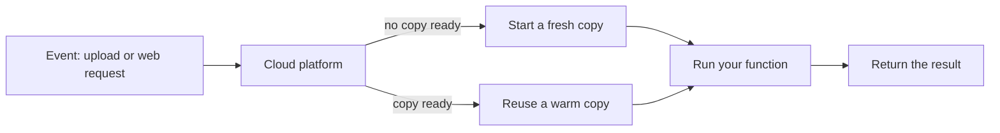

> [!crumbs] [[00 Start Here|🏠 Home]] › [[Part 1 System Design|Part 1]] › [[Architecture]] › [[Architecture Styles]] › Serverless

> [!tldr] In one sentence
> Serverless lets you **run code without owning or managing any servers**: the cloud provider runs it when needed, and you **pay only for what you use**.

## 🧠 Think of it like…

> [!analogy] Taking a taxi instead of owning a car
> A car costs money every day, even parked in the garage, and you handle the repairs. A taxi shows up when you call, takes you where you need to go, and you pay for that one ride.

Owning servers is like owning the car. Serverless is the taxi. Servers still exist, but someone else keeps them running, and the meter only runs while your code does.

## What it is

**Serverless** is a way to run software where the cloud provider handles the machines: setup, security updates and adding capacity.[^1]

The best-known form is **functions as a service (FaaS)**. You write a small piece of code, a **function**, that does one task. Then you tell the platform which **event** should trigger it, such as a file upload or a web request.[^2] AWS Lambda is a common example.[^2]

Serverless also covers ready-made cloud services, like hosted databases and login systems, that you use without running them yourself.[^2]

## Why it matters

- **No servers to babysit.** Nobody on your team patches machines or plans capacity.[^1]
- **Pay per use.** You pay for each request and for how long your code runs. Idle code costs nothing.[^3]
- **Handles spikes on its own.** If a crowd shows up at once, the platform runs more copies of your function, then scales back down.[^2]
- **Great for bursty work.** Traffic that jumps around suits serverless, because you don't pay for idle machines waiting for the next rush.[^2]

## How it works

When an event arrives, the platform finds or creates a small, isolated space to run your function.[^4] Creating a new one is called a **cold start**. It adds a delay, from under a tenth of a second to over a second.[^4]

After the function finishes, the platform keeps that space around for a while. The next request can reuse it, a **warm start**, which is faster.[^4] Cold starts happen in under 1% of requests for typical production workloads.[^4]

Functions are **stateless**: they can't count on remembering anything between runs.[^2] Anything worth keeping goes into a database or file storage.

## A real-world example

The BBC rebuilt its website on Amazon's cloud. About **half the site is rendered with AWS Lambda**, with roughly 2,000 function runs every second.[^5] Most runs finish in under 150 milliseconds.[^5]

The BBC's head of architecture argued that it avoids paying for idle servers kept ready for breaking-news spikes.[^5] Critics questioned the cost at that scale, which shows the trade-off is real.[^6]

## Myths and pitfalls

- **❌ Myth:** Serverless means there are no servers. **✅ Reality:** There are plenty. You just don't manage them.[^1]
- **❌ Myth:** Serverless is always cheaper. **✅ Reality:** For steady, heavy work it can cost more. Amazon's Prime Video team cut one tool's costs by 90% by moving it off serverless.[^7]
- **❌ Myth:** Functions can run forever. **✅ Reality:** A standard AWS Lambda function stops after at most 15 minutes.[^8]
- **❌ Myth:** You can switch cloud providers easily. **✅ Reality:** Serverless code often leans on one provider's services, so moving can mean rewriting.[^2]

## Check yourself

> [!question]- What is a cold start?
> The delay when the platform has to set up a fresh space for your function before running it, because no warm copy is ready.

> [!question]- Why must serverless functions be stateless?
> The platform may run each request on a different copy and can throw copies away at any time. Anything that must last goes into separate storage.

> [!question]- A video tool processes thousands of streams nonstop, all day. Is serverless a good fit?
> Probably not. Steady, heavy work keeps the meter running nonstop, so reserved servers are often cheaper.

## Key terms

- **Serverless** — running code where the provider manages all the servers and bills per use.
- **FaaS (functions as a service)** — running small, event-triggered functions on a provider's platform.
- **AWS Lambda** — Amazon's serverless function service.
- **Event / trigger** — something that happens, like an upload or a web request, that starts a function.
- **Cold start** — the extra delay when a function needs a fresh environment.
- **Stateless** — not remembering anything between runs.
- **Vendor lock-in** — being tied to one provider because moving away is costly.

> [!deepdive] Ready for the technical take?
> The Lambda execution lifecycle, Firecracker microVMs, GB-second pricing, concurrency quotas and the data-shipping critique.
> → [[Serverless (Deep Dive)]]

## Related

- [[Microservices]] — serverless functions are often used to build small services.
- [[Monoliths]] — the opposite end: one program on servers you run.
- [[Message Queues]] — a common trigger that feeds work to functions.
- [[Object Storage]] — where stateless functions keep files.
- [[Cloud & Infrastructure]] — how AI systems choose between servers and serverless.
- [[Cost Optimization]] — pay-per-use pricing is a big lever on AI bills.

> [!nav] Keep going
> ← [[Microservices]] · [[Architecture Styles|🧱 Architecture Styles]] · [[SQL Databases]] →
> 🔬 Technical take: [[Serverless (Deep Dive)]] · 🗺️ [[Glossary]]

## 📚 Sources

[^1]: 📄 [What is AWS Lambda?](https://docs.aws.amazon.com/lambda/latest/dg/welcome.html) — AWS Lambda Developer Guide. Official docs. Checked 2026-11.
[^2]: 📝 [Serverless Architectures](https://martinfowler.com/articles/serverless.html) — Mike Roberts, martinfowler.com. Article. Checked 2026-11.
[^3]: 📄 [AWS Lambda Pricing](https://aws.amazon.com/lambda/pricing/) — Amazon Web Services. Official docs. Checked 2026-11.
[^4]: 📄 [Understanding the Lambda execution environment lifecycle](https://docs.aws.amazon.com/lambda/latest/dg/lambda-runtime-environment.html) — AWS Lambda Developer Guide. Official docs. Checked 2026-11.
[^5]: 📝 [BBC makes switch to AWS, serverless for new website architecture, observers grumble about the HTML](https://www.theregister.com/2020/11/04/bbc_embraces_aws_serverless/) — Tim Anderson, The Register. Article. Checked 2026-11.
[^6]: 📝 [BBC Online Going Serverless](https://www.infoq.com/news/2020/11/bbc-aws-serverless/) — Renato Losio, InfoQ. Article. Checked 2026-11.
[^7]: 📝 [Prime Video Switched from Serverless to EC2 and ECS to Save Costs](https://infoq.com/news/2023/05/prime-ec2-ecs-saves-costs) — Rafał Gancarz, InfoQ. Article. Checked 2026-11.
[^8]: 📄 [Lambda quotas](https://docs.aws.amazon.com/lambda/latest/dg/gettingstarted-limits.html) — AWS Lambda Developer Guide. Official docs. Checked 2026-11.
