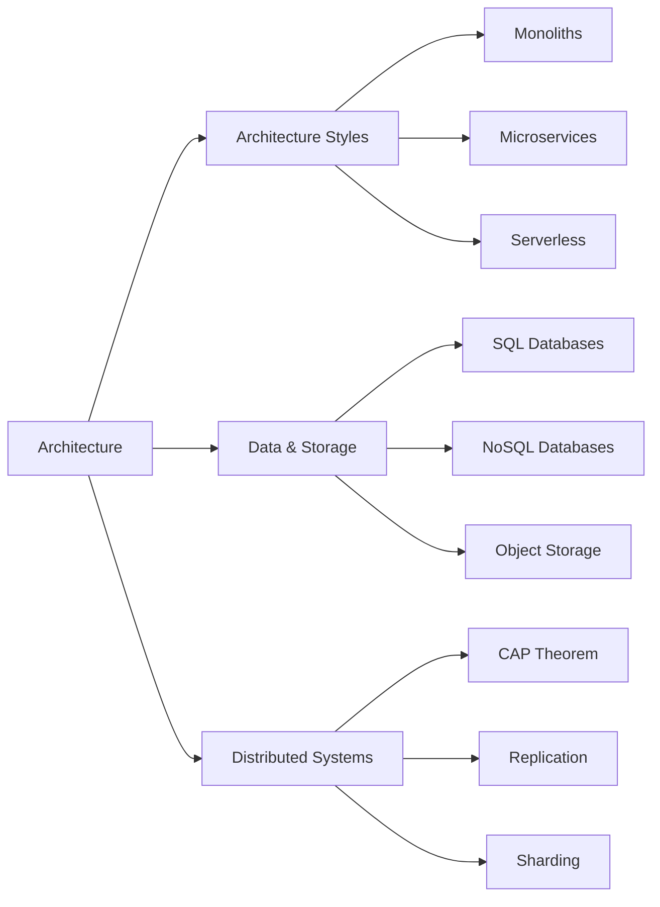

> [!crumbs] [[00 Start Here|🏠 Home]] › [[Part 1 System Design|Part 1]] › Architecture

> [!hub] 🏛️ Architecture
> How a system is cut into parts, where its data lives, and how many machines share the work.

## Topics

### 🧱 [[Architecture Styles]]
The big shapes a system can take, from one program to many tiny functions.

| Topic | In one line | Technical take |
| --- | --- | --- |
| [[Monoliths]] | One program that does everything, deployed as a single unit. | [[Monoliths (Deep Dive)\|🔬 Deep dive]] |
| [[Microservices]] | Many small services, each owning one job, talking over the network. | [[Microservices (Deep Dive)\|🔬 Deep dive]] |
| [[Serverless]] | Running code without managing servers; you pay per use. | [[Serverless (Deep Dive)\|🔬 Deep dive]] |

### 🗄️ [[Data & Storage]]
The main families of storage and what each is good at.

| Topic | In one line | Technical take |
| --- | --- | --- |
| [[SQL Databases]] | Tables with strict structure, joined and queried with SQL. | [[SQL Databases (Deep Dive)\|🔬 Deep dive]] |
| [[NoSQL Databases]] | Flexible databases built for scale and specific access patterns. | [[NoSQL Databases (Deep Dive)\|🔬 Deep dive]] |
| [[Object Storage]] | Cheap, near-infinite storage for files like images, videos and backups. | [[Object Storage (Deep Dive)\|🔬 Deep dive]] |

### 🕸️ [[Distributed Systems]]
What changes when one computer is not enough and many must act as one.

| Topic | In one line | Technical take |
| --- | --- | --- |
| [[CAP Theorem]] | When the network breaks, a system must choose: stay correct or stay up. | [[CAP Theorem (Deep Dive)\|🔬 Deep dive]] |
| [[Replication]] | Keeping copies of data on several machines so one can fail. | [[Replication (Deep Dive)\|🔬 Deep dive]] |
| [[Sharding]] | Splitting data across machines so no one machine holds it all. | [[Sharding (Deep Dive)\|🔬 Deep dive]] |

## The shape of it

> [!tip] How to read these
> Every topic has a **🌱 basics** note (no jargon, about 5 minutes) and a **🔬 deep dive** (the technical take). Start with the basics; open the deep dive when you want more.
