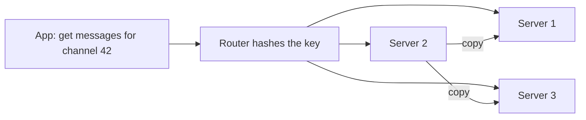

> [!crumbs] [[00 Start Here|🏠 Home]] › [[Part 1 System Design|Part 1]] › [[Architecture]] › [[Data & Storage]] › NoSQL Databases

> [!tldr] In one sentence
> NoSQL databases trade the strict tables of SQL for **simpler, more flexible shapes of data** that spread easily across many machines and answer the questions you planned for very fast.

## 🧠 Think of it like…

> [!analogy] A coat check
> You hand over your coat and get ticket #57. Show the ticket and it's back in seconds. But you can't ask the attendant "show me every red coat": the room is organized by ticket, not by color.

A key-value NoSQL database works the same way. You store data under a **key** and fetch it by that key, fast, even among billions of items. The catch: you decide up front which questions you'll ask.

## What it is

NoSQL means "not only SQL". These databases suit specific data shapes and use **flexible schemas**, not structure locked in advance.[^1] The name took off at a 2009 meetup in San Francisco about new databases like Cassandra and MongoDB.[^2]

There are four main families:

- **Key-value stores** keep pairs of a unique key and a value, like the coat check. Amazon DynamoDB is one.[^1]
- **Document databases** store nested, JSON-like records, such as MongoDB.[^1] Documents in one collection needn't share fields.[^3]
- **Wide-column databases** group rows by a key and spread the groups across machines, like Apache Cassandra.[^1][^4]
- **Graph databases** store things as nodes linked by relationships, suiting social networks and road maps, like Neo4j.[^5]

## Why it matters

- **They grow sideways.** Instead of one bigger server, you add more ordinary ones; data splits across them.[^1]
- **They adapt as the app changes.** You can add a new field without rewriting existing records.[^3]
- **They stay fast at enormous scale.** On Prime Day 2026, DynamoDB peaked at **192 million requests per second** while answering in single-digit milliseconds.[^6]

## How it works

Every record has a **partition key**, such as a user ID. The database runs it through a hash function, which turns it into a number that picks the server.[^7] Reads jump straight to that server.

Each record is usually **copied to several servers**, so losing one doesn't lose data. Some systems confirm a write before every copy has it; the rest catch up moments later. That is called **eventual consistency**, and it's how Amazon kept its shopping cart always accepting writes.[^8]

The big shift is in design. SQL stores each fact once and joins at question time. NoSQL **designs around your questions**: data read together is stored together, even if that means copying it.[^3][^4]

## A real-world example

Discord stores chat messages in a wide-column database. In 2017, 12 Cassandra servers held billions of messages; by 2022, **177 servers held trillions**.[^9] Messages are grouped by channel and time window, so a channel's history sits together.[^9] After moving to a faster database called ScyllaDB, Discord needed only 72 servers, and slow message loads (the worst 1%) dropped from 40–125 ms to about 15 ms.[^9]

## Myths and pitfalls

- **❌ Myth:** NoSQL means no structure at all. **✅ Reality:** The structure moves into your keys and code, and MongoDB can still enforce a fixed shape.[^3]
- **❌ Myth:** NoSQL can't do transactions. **✅ Reality:** Many can. A MongoDB document always updates all-or-nothing,[^10] and DynamoDB transactions cover up to 100 items.[^11]
- **❌ Myth:** NoSQL is faster at everything. **✅ Reality:** Only for the questions you designed for. Cassandra has no joins, so a new question often needs a new table.[^4]
- **❌ Myth:** Spreading data over many servers keeps the load even. **✅ Reality:** One very popular key can overload its server. Discord saw a single "hot" partition slow down the whole cluster.[^9]

## Check yourself

> [!question]- What decides which server holds a record?
> Its partition key. The database hashes it into a number that maps to one server.

> [!question]- What does eventual consistency mean for a user?
> Right after a change, another copy might briefly show the old value. Within moments all copies agree.

> [!question]- You need new reports combining customers, orders and products every week. SQL or NoSQL?
> Probably SQL: ad-hoc questions across many kinds of data are its strength. NoSQL shines when questions are known and scale is huge.

## Key terms

- **NoSQL** — databases that don't use the classic relational table model.
- **Key-value store** — saves and fetches values by a unique key.
- **Document database** — stores flexible, nested, JSON-like records.
- **Partition key** — the field that decides where a record lives.
- **Eventual consistency** — copies may briefly disagree but soon match.
- **Hot partition** — one key so busy it overloads its server.

> [!deepdive] Ready for the technical take?
> Dynamo's design, consistent hashing, quorum reads and writes, document modeling, DynamoDB capacity math and hot partitions.
> → [[NoSQL Databases (Deep Dive)]]

## Related

- [[SQL Databases]] — the relational alternative.
- [[Sharding]] — the splitting NoSQL builds in.
- [[CAP Theorem]] — why some systems pick availability over instant agreement.
- [[Replication]] — copies that keep data safe.
- [[Embeddings & Vector Databases]] — a purpose-built store for AI search.

> [!nav] Keep going
> ← [[SQL Databases]] · [[Data & Storage|🗄️ Data & Storage]] · [[Object Storage]] →
> 🔬 Technical take: [[NoSQL Databases (Deep Dive)]] · 🗺️ [[Glossary]]

## 📚 Sources

[^1]: 📄 [What is NoSQL?](https://aws.amazon.com/nosql/) — Amazon Web Services. Official docs. Checked 2026-11.
[^2]: 📝 [NosqlDefinition](https://martinfowler.com/bliki/NosqlDefinition.html) — Martin Fowler. Article. Checked 2026-11.
[^3]: 📄 [Data Modeling](https://www.mongodb.com/docs/manual/data-modeling/) — MongoDB documentation. Official docs. Checked 2026-11.
[^4]: 📄 [Introduction to data modeling](https://cassandra.apache.org/doc/latest/cassandra/developing/data-modeling/intro.html) — Apache Cassandra documentation. Official docs. Checked 2026-11.
[^5]: 📄 [What is a graph database](https://neo4j.com/docs/getting-started/graph-database/) — Neo4j documentation. Official docs. Checked 2026-11.
[^6]: 📝 [All the numbers: Amazon Prime Day 2026 powered by AWS](https://aws.amazon.com/blogs/aws/all-the-numbers-amazon-prime-day-2026-powered-by-aws/) — AWS News Blog, 2026. Engineering blog. Checked 2026-11.
[^7]: 📄 [Core components of Amazon DynamoDB](https://docs.aws.amazon.com/amazondynamodb/latest/developerguide/HowItWorks.CoreComponents.html) — Amazon DynamoDB Developer Guide. Official docs. Checked 2026-11.
[^8]: 🔬 [Amazon's Dynamo](https://www.allthingsdistributed.com/2007/10/amazons_dynamo.html) — Werner Vogels, All Things Distributed (SOSP 2007 paper). Paper. Checked 2026-11.
[^9]: 📝 [How Discord Stores Trillions of Messages](https://discord.com/blog/how-discord-stores-trillions-of-messages) — Discord Engineering. Engineering blog. Checked 2026-11.
[^10]: 📄 [Transactions](https://www.mongodb.com/docs/manual/core/transactions/) — MongoDB documentation. Official docs. Checked 2026-11.
[^11]: 📄 [Constraints in Amazon DynamoDB](https://docs.aws.amazon.com/amazondynamodb/latest/developerguide/Constraints.html) — Amazon DynamoDB Developer Guide. Official docs. Checked 2026-11.
