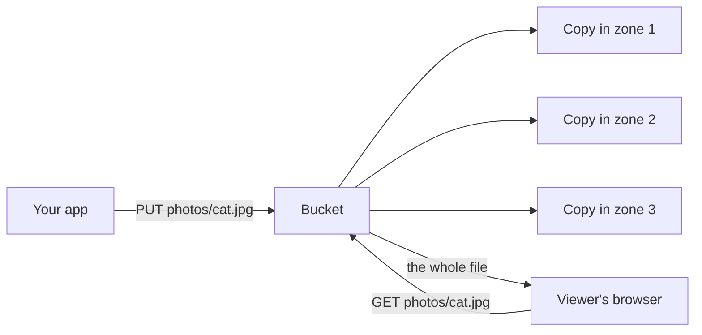

> [!crumbs] [[00 Start Here|🏠 Home]] › [[Part 1 System Design|Part 1]] › [[Architecture]] › [[Data & Storage]] › Object Storage

> [!tldr] In one sentence
> Object storage keeps whole files, called objects, in huge containers called buckets, each found by a unique name, so you can store **almost unlimited** photos, videos and backups cheaply.

## 🧠 Think of it like…

> [!analogy] A giant warehouse with labeled boxes
> You drop off a box with a unique label and leave. You never see the shelves. To get it back, you give the label, whether the warehouse holds ten boxes or ten billion.

In object storage the warehouse is a **bucket**, the label is a **key**, and the box is an **object**: your file plus a packing slip describing it. You never manage disks or folders.

## What it is

An **object** is a file plus **metadata**, name-value labels that describe it, such as its type. A **bucket** is a container for objects. Each object has a **key**, its unique name inside the bucket.[^1] Every object gets its own web address.[^1]

It differs from the storage on your laptop. **File storage** arranges files in a tree of folders. **Block storage** splits data into fixed-size chunks, like a raw disk. Object storage hides all that behind a simple "put" and "get".[^2]

Even folders are an illusion: in Amazon S3, "photos/2024/cat.jpg" is one long name, and prefixes "are not directories".[^3]

Amazon S3 is the best-known service. Microsoft's version is Azure Blob Storage, where "blob" means any chunk of unstructured data like text, images or video.[^4]

## Why it matters

- **Practically limitless.** Store any number of objects in a bucket and never plan disk space.[^1]
- **Very hard to lose.** Standard S3 keeps data in at least three separate locations, called Availability Zones, and is designed for **99.999999999% durability**, "eleven nines".[^5]
- **Cheap, and cheaper when cold.** S3 costs a little over 2 cents per gigabyte per month.[^6] Archive tiers cost less but can take minutes to hours to fetch from.[^5]

## How it works

1. Your app uploads a file under a key, and the service stores it in several places before saying "done".[^1][^5]
2. Anyone with permission asks for that key and gets the whole file back.[^1]
3. To change a file, you upload a whole new version. You can't edit part of it in place.[^1]

Buckets are **private by default**. You choose who can read them.[^1] You can also set **lifecycle rules** that move old files to cheaper storage classes, or delete them, automatically.[^1]

## A real-world example

Amazon S3 launched on March 14, 2006 with about one petabyte of space on roughly 400 storage servers. Twenty years later it stores **more than 500 trillion objects** and serves **over 200 million requests per second**.[^6] Its price fell about 85% over the same time, from 15 cents to just over 2 cents per gigabyte.[^6] It holds everything from website images and app data to backups, archives and data lakes.[^1]

## Myths and pitfalls

- **❌ Myth:** Object storage is just a hard drive in the cloud. **✅ Reality:** You can't edit part of a file or lock it. You replace whole objects.[^1][^2]
- **❌ Myth:** S3 folders are real folders. **✅ Reality:** They are just the start of a long name, called a prefix.[^3]
- **❌ Myth:** My bucket is public unless I lock it down. **✅ Reality:** Buckets start private, and public access is blocked by default. Data is exposed only when someone opens it up.[^1]
- **❌ Myth:** Archive storage is the same, only cheaper. **✅ Reality:** The deepest archive tiers must be restored first, which takes hours.[^5]

## Check yourself

> [!question]- What three things identify an object in S3?
> The bucket it lives in, its key (its unique name), and, if versioning (keeping old copies) is turned on, its version ID.

> [!question]- Why is object storage a poor fit for a bank's account balances?
> Balances change constantly and need locking and transactions. Object storage only replaces whole files, so a database fits better.

> [!question]- What is a data lake?
> One central store for all kinds of raw data, kept for later analysis. It usually lives in object storage.

## Key terms

- **Object** — a file plus metadata, stored as one unit.
- **Bucket** — a container that holds objects.
- **Key** — an object's unique name inside its bucket.
- **Metadata** — name-value labels describing an object.
- **Storage class** — a price and speed tier, from frequent to deep archive.
- **Durability** — how unlikely the service is to lose your data.
- **Data lake** — a central store of raw data of every kind, kept for later analysis.[^7]

> [!deepdive] Ready for the technical take?
> Strong consistency, erasure coding, request-rate limits per prefix, multipart uploads, presigned URLs and how Dropbox built its own.
> → [[Object Storage (Deep Dive)]]

## Related

- [[CDN]] — caches objects close to users.
- [[SQL Databases]] — holds the records that point to your objects.
- [[NoSQL Databases]] — key-value stores share the "get by key" model.
- [[Data Engineering & Pipelines]] — data lakes feed analytics and AI.
- [[Cloud & Infrastructure]] — object storage is a core cloud building block.

> [!nav] Keep going
> ← [[NoSQL Databases]] · [[Data & Storage|🗄️ Data & Storage]] · [[CAP Theorem]] →
> 🔬 Technical take: [[Object Storage (Deep Dive)]] · 🗺️ [[Glossary]]

## 📚 Sources

[^1]: 📄 [What is Amazon S3?](https://docs.aws.amazon.com/AmazonS3/latest/userguide/Welcome.html) — Amazon S3 User Guide. Official docs. Checked 2026-11.
[^2]: 📖 [Object storage](https://en.wikipedia.org/wiki/Object_storage) — Wikipedia. Encyclopedia. Checked 2026-11.
[^3]: 📄 [Organizing objects using prefixes](https://docs.aws.amazon.com/AmazonS3/latest/userguide/using-prefixes.html) — Amazon S3 User Guide. Official docs. Checked 2026-11.
[^4]: 📄 [Introduction to Blob (object) Storage](https://learn.microsoft.com/en-us/azure/storage/blobs/storage-blobs-introduction) — Microsoft Learn. Official docs. Checked 2026-11.
[^5]: 📄 [Understanding and managing Amazon S3 storage classes](https://docs.aws.amazon.com/AmazonS3/latest/userguide/storage-class-intro.html) — Amazon S3 User Guide. Official docs. Checked 2026-11.
[^6]: 📝 [Twenty years of Amazon S3 and building what's next](https://aws.amazon.com/blogs/aws/twenty-years-of-amazon-s3-and-building-whats-next/) — AWS News Blog, 2026. Engineering blog. Checked 2026-11.
[^7]: 📄 [What is a data lake?](https://aws.amazon.com/what-is/data-lake/) — Amazon Web Services. Official docs. Checked 2026-11.
