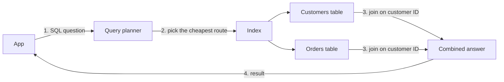

> [!crumbs] [[00 Start Here|🏠 Home]] › [[Part 1 System Design|Part 1]] › [[Architecture]] › [[Data & Storage]] › SQL Databases

> [!tldr] In one sentence
> A SQL database stores information in **tables of rows and columns**, links those tables together, and lets you ask questions about them in a language called SQL.

## 🧠 Think of it like…

> [!analogy] A shop's linked spreadsheets
> A shop keeps one sheet of customers and another of orders. An order row doesn't repeat the customer's address. It just says "customer #42", and you look up #42 on the customer sheet when you print the invoice.

A SQL database is those spreadsheets with a strict librarian who refuses entries that break the rules, like an order for a customer who doesn't exist.

## What it is

A **relational database** keeps data in tables. Each table holds one kind of thing, like customers. Each row is one record; each column is one detail, like a price.[^1]

Tables connect through **keys**. A **primary key** is a column that uniquely identifies each row, like a customer number. A **foreign key** is a column that points to the primary key of another table. That is how an order "knows" its customer.[^1]

You talk to the database in **SQL** (Structured Query Language), a standard language for adding, changing and finding data. It grew out of IBM, where Edgar F. Codd proposed related tables in 1970.[^2] Well-known SQL databases include Oracle, MySQL, Microsoft SQL Server and PostgreSQL.[^3]

## Why it matters

- **Correct data.** Rules called **constraints** stop bad data at the door: no missing required fields, no duplicate IDs, and no orders pointing at customers who don't exist.[^4]
- **All-or-nothing changes.** A **transaction** groups several changes so they either all happen or none do.[^1] Moving money between two accounts can never leave it in neither.
- **Questions nobody planned for.** Because facts are stored once and linked, you can ask new questions later, like "who in Lisbon ordered twice last month?"

## How it works

1. Your app asks in SQL, such as "list each order with its customer's name".
2. A **query planner** works out the cheapest way to answer. Reading every row is always possible; an **index**, a sorted lookup list like the one at the back of a book, is often faster.[^5]
3. The database **joins** the tables, matching each order to the customer with the same ID, and returns one combined answer.[^5]

To keep data tidy, designers **normalize** it: each fact lives in exactly one place.[^6] Changing a customer's address then means editing one row, not thousands of orders.

## A real-world example

GitHub started more than 15 years ago as one app with a single MySQL database. By late 2023 it ran **over 1,200 MySQL servers** holding more than 300 TB and answering **5.5 million queries per second**.[^7] When some data outgrew one main server, GitHub split it across many with a tool called Vitess.[^7]

## Myths and pitfalls

- **❌ Myth:** SQL databases can't handle big traffic. **✅ Reality:** They grow a long way with bigger machines, read-only copies and splitting data. GitHub serves millions of queries a second on MySQL.[^7]
- **❌ Myth:** SQL is old, so it's fading away. **✅ Reality:** It is everywhere. SQLite, a small SQL database, ships in every Android phone, every iPhone and every major web browser.[^8]
- **❌ Myth:** The database makes any question fast. **✅ Reality:** Without a suitable index, it may read every row to find one match.[^5]

## Check yourself

> [!question]- What is the difference between a primary key and a foreign key?
> A primary key uniquely identifies each row in its own table. A foreign key in another table points at it, linking the two.

> [!question]- Why would a bank insist on transactions?
> A transfer takes money from one account and adds it to another. A transaction makes both happen or neither.

> [!question]- A shop copies the customer's address into every order. What goes wrong when the customer moves?
> Every order row must change, and missing one makes the data contradict itself. Normalizing stores the address once.

## Key terms

- **Table** — a grid of rows and columns describing one kind of thing.
- **Primary key** — the column that uniquely identifies each row.
- **Foreign key** — a column that points at a row in another table.
- **Join** — combining rows from two tables that share a key.
- **Transaction** — a group of changes that succeed or fail together.
- **Normalization** — storing each fact once so the data can't contradict itself.
- **Index** — a sorted lookup that finds rows without reading them all.

> [!deepdive] Ready for the technical take?
> ACID and isolation levels, MVCC, write-ahead logging, B-tree indexes and query plans, and how GitHub scales MySQL.
> → [[SQL Databases (Deep Dive)]]

## Related

- [[NoSQL Databases]] — the alternative built for flexible data at huge scale.
- [[Databases]] — the bigger picture of storing data.
- [[Replication]] — copies that spread reads and survive failures.
- [[Sharding]] — splitting one database across many servers.
- [[Caching]] — keeps popular answers close.
- [[Data Sources]] — AI systems often pull their facts from SQL tables.

> [!nav] Keep going
> ← [[Serverless]] · [[Data & Storage|🗄️ Data & Storage]] · [[NoSQL Databases]] →
> 🔬 Technical take: [[SQL Databases (Deep Dive)]] · 🗺️ [[Glossary]]

## 📚 Sources

[^1]: 📄 [What is a Relational Database?](https://aws.amazon.com/relational-database/) — Amazon Web Services. Official docs. Checked 2026-11.
[^2]: 📝 [What is a relational database?](https://www.ibm.com/think/topics/relational-databases) — IBM Think. Article. Checked 2026-11.
[^3]: 📖 [Relational database](https://en.wikipedia.org/wiki/Relational_database) — Wikipedia. Encyclopedia. Checked 2026-11.
[^4]: 📄 [Constraints](https://www.postgresql.org/docs/current/ddl-constraints.html) — PostgreSQL documentation. Official docs. Checked 2026-11.
[^5]: 📄 [Planner/Optimizer](https://www.postgresql.org/docs/current/planner-optimizer.html) — PostgreSQL documentation. Official docs. Checked 2026-11.
[^6]: 📖 [Database normalization](https://en.wikipedia.org/wiki/Database_normalization) — Wikipedia. Encyclopedia. Checked 2026-11.
[^7]: 📝 [Upgrading GitHub.com to MySQL 8.0](https://github.blog/engineering/infrastructure/upgrading-github-com-to-mysql-8-0/) — GitHub Engineering blog, 2023. Engineering blog. Checked 2026-11.
[^8]: 📄 [Most Widely Deployed SQL Database Engine](https://www.sqlite.org/mostdeployed.html) — SQLite. Official docs. Checked 2026-11.
