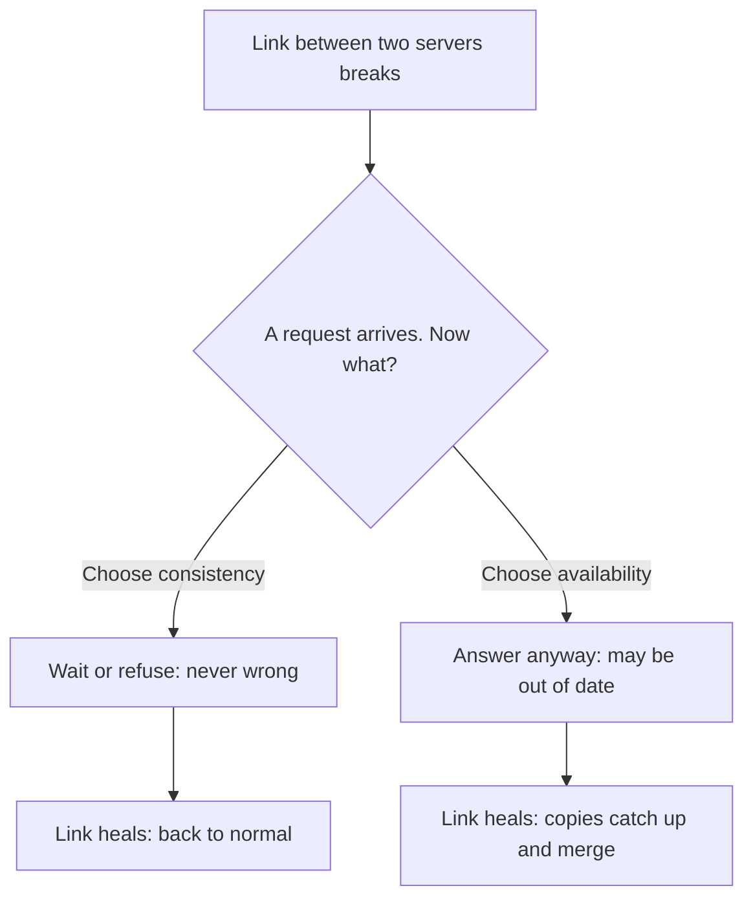

> [!crumbs] [[00 Start Here|🏠 Home]] › [[Part 1 System Design|Part 1]] › [[Architecture]] › [[Distributed Systems]] › CAP Theorem

> [!tldr] In one sentence
> When the network between a system's computers breaks, the system must choose: **answer anyway and risk being wrong, or refuse to answer** until the link comes back.

## 🧠 Think of it like…

> [!analogy] Two bank branches with a dead phone line
> Two branches keep a shared account in step by phone. The line goes dead just as two people withdraw from that account at different branches.

Each branch can refuse until the line works, so the balance is never wrong. Or it can pay out and sort it out later, risking an overdraft.

That is the CAP theorem. The branches are **servers** (computers that answer requests), the phone line is the network, and the dead line is a **partition**. Real ATMs usually pay out, with a lower limit to cap the risk.[^1]

## What it is

CAP names three things you would like a **distributed system** (one spread over many computers) to have:

- **Consistency** — every read sees the latest write, as if there were only one copy of the data.[^2]
- **Availability** — every request that reaches a working server eventually gets an answer.[^2]
- **Partition tolerance** — the system keeps going even when messages between servers are lost or delayed.[^2]

The theorem says no system can guarantee all three at once. Eric Brewer proposed it in a 2000 keynote, and it was later proved mathematically.[^1]

## Why it matters

Cables get cut and equipment breaks. You can't rule out a partition, so the real question is what your system does during one.[^1]

- Pick **consistency** and some users get an error, but nobody sees wrong data. That suits bank balances.
- Pick **availability** and everyone gets an answer, but some may be **stale** (out of date). Amazon's shopping cart always accepts new items and merges copies later.[^3]

## How it works

With no partition, a system can be both consistent and available. The choice only bites while the network is broken.[^1]

Systems that pick availability usually promise **eventual consistency**: if updates stop, every copy ends up with the same value. The gap while they disagree is the inconsistency window.[^3]

Even a healthy network forces a quieter trade-off, because keeping copies in step means waiting. **PACELC** spells it out: if Partition, choose Availability or Consistency; Else, choose Latency (speed) or Consistency.[^4]

Some products let you choose per request. Amazon DynamoDB reads are eventually consistent by default; strongly consistent reads cost twice as much.[^5]

## A real-world example

On October 21, 2018, GitHub lost a network link on the US East Coast for just **43 seconds**. Automatic failover moved database writes to the West Coast. Afterwards, each coast held writes the other lacked.[^6]

GitHub put correct data first. It ran a degraded site for **24 hours and 11 minutes** while engineers reconciled the data.[^6] A tiny partition forced a big CAP choice, and consistency won.

## Myths and pitfalls

- **❌ Myth:** You get to "pick any two of three." **✅ Reality:** Partitions happen anyway, so the real choice is consistency or availability while one lasts. Brewer himself called "2 of 3" misleading.[^1]
- **❌ Myth:** The "C" in CAP is the "C" in ACID database transactions. **✅ Reality:** CAP's C means acting like a single, up-to-date copy.[^7]
- **❌ Myth:** Every database is simply "CP" or "AP." **✅ Reality:** Many fit neither label. Ask what each operation guarantees.[^7]

## Check yourself

> [!question]- Why is partition tolerance not really optional?
> Networks fail whether you plan for it or not. The only question is what the system does then: stay consistent or stay available.

> [!question]- A ticketing site must never sell the same seat twice. Which side of CAP should it favor during a partition?
> Consistency. An error is better than selling one seat twice.

> [!question]- What does PACELC add to CAP?
> Even with no partition, keeping copies in step costs time, so systems also trade speed against consistency.

## Key terms

- **Partition** — a network break that splits servers into groups that can't talk.
- **Consistency** — every read returns the most recent write.
- **Availability** — every request to a working server gets an answer.
- **Eventual consistency** — copies may disagree for a while but end up the same once updates stop.
- **PACELC** — CAP plus the everyday trade-off between speed and consistency.

> [!deepdive] Ready for the technical take?
> The formal proof, linearizability, PACELC classifications, quorums and why Google calls Spanner "technically CP" yet treats it as CA.
> → [[CAP Theorem (Deep Dive)]]

## Related

- [[Replication]] — copies of data are what can disagree during a partition.
- [[NoSQL Databases]] — many were built around the availability side of CAP.
- [[Trade-offs]] — CAP is the most famous trade-off in system design.
- [[Fault Tolerance]] — designing for the failures that trigger the CAP choice.
- [[AI Scalability & Distributed Systems]] — AI platforms spread over many machines face the same choice.

> [!nav] Keep going
> ← [[Object Storage]] · [[Distributed Systems|🕸️ Distributed Systems]] · [[Replication]] →
> 🔬 Technical take: [[CAP Theorem (Deep Dive)]] · 🗺️ [[Glossary]]

## 📚 Sources

[^1]: 📝 [CAP Twelve Years Later: How the "Rules" Have Changed](https://www.infoq.com/articles/cap-twelve-years-later-how-the-rules-have-changed/) — Eric Brewer, InfoQ (from IEEE Computer), 2012. Article. Checked 2026-11.
[^2]: 🔬 [Perspectives on the CAP Theorem](https://groups.csail.mit.edu/tds/papers/Gilbert/Brewer2.pdf) — Seth Gilbert and Nancy Lynch, IEEE Computer, 2012. Paper. Checked 2026-11.
[^3]: 📝 [Eventually Consistent - Revisited](https://www.allthingsdistributed.com/2008/12/eventually_consistent.html) — Werner Vogels, All Things Distributed, 2008. Article. Checked 2026-11.
[^4]: 🔬 [Consistency Tradeoffs in Modern Distributed Database System Design](https://www.cs.umd.edu/~abadi/papers/abadi-pacelc.pdf) — Daniel J. Abadi, IEEE Computer, 2012. Paper. Checked 2026-11.
[^5]: 📄 [DynamoDB read consistency](https://docs.aws.amazon.com/amazondynamodb/latest/developerguide/HowItWorks.ReadConsistency.html) — Amazon DynamoDB Developer Guide. Official docs. Checked 2026-11.
[^6]: 📝 [October 21 post-incident analysis](https://github.blog/news-insights/company-news/oct21-post-incident-analysis/) — GitHub Blog, 2018. Engineering blog. Checked 2026-11.
[^7]: 📝 [Please stop calling databases CP or AP](https://martin.kleppmann.com/2015/05/11/please-stop-calling-databases-cp-or-ap.html) — Martin Kleppmann, 2015. Article. Checked 2026-11.
