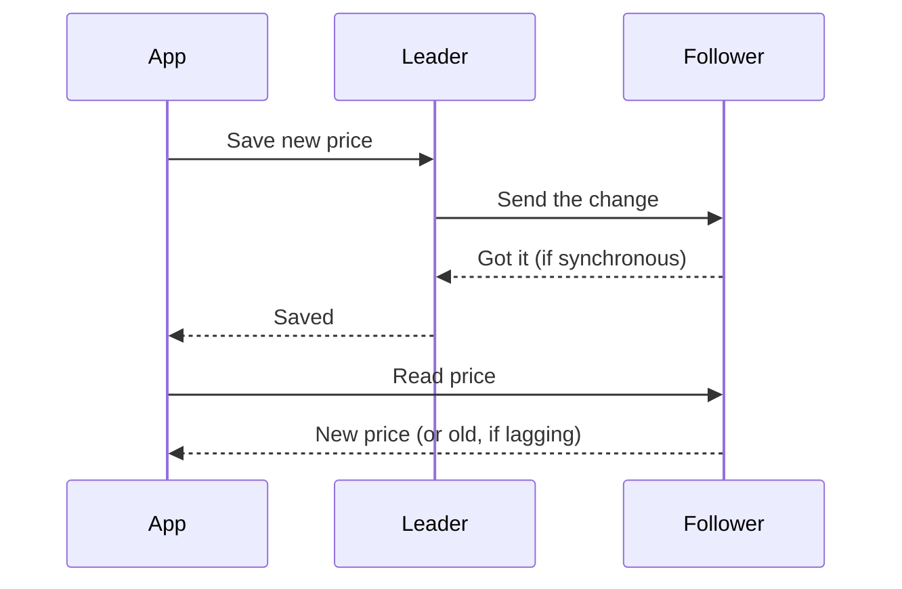

> [!crumbs] [[00 Start Here|🏠 Home]] › [[Part 1 System Design|Part 1]] › [[Architecture]] › [[Distributed Systems]] › Replication

> [!tldr] In one sentence
> Replication means keeping **copies of the same data on several machines**, so that if one machine fails, another can keep serving it.

## 🧠 Think of it like…

> [!analogy] The head chef's specials board
> A head chef writes the specials on a master board. Assistants copy each change onto boards in every dining room, and guests read the nearest one. If the chef goes home sick, an assistant takes over.

The master board is the **leader**, the copies are **followers** (or replicas), and the assistant stepping up is **failover**. A dining-room board may run a minute behind. That delay is **replication lag**.

## What it is

A **replica** is a full copy of a database on another machine. The most common setup is **leader-follower** replication: the leader accepts every change and passes it to the followers.[^1] MongoDB calls them "primary" and "secondary";[^1] older documentation says "master-slave."

Followers can answer reads. If the leader fails, a follower is promoted.[^1] Two other styles exist:

- **Multi-leader** — several machines accept changes and later reconcile any that clash.[^2]
- **Leaderless** — any copy accepts changes, and each save or read checks several copies. Apache Cassandra works this way.[^3]

## Why it matters

- **Survive failures.** At Amazon's scale, components "fail continuously."[^4] A copy elsewhere means one failure isn't an outage.
- **Serve more readers.** Read-only copies take load off the main database.[^5]
- **Keep a spare ready.** A copy in another region can be promoted if the main one fails.[^5]

## How it works

The key decision is **when the leader says "saved."**

- **Synchronous** — the leader waits for a follower to confirm. Nothing confirmed is lost if the leader dies, but every save waits.[^2]
- **Asynchronous** — the leader confirms at once and copies in the background. Saves are fast, but the last few can vanish if the leader dies.[^2]

In PostgreSQL, asynchronous followers typically trail by **under a second** if they keep up.[^6] During that gap, a follower may show old data.

**Failover** is the hand-over when the leader goes silent. MongoDB followers wait 10 seconds by default, then elect a new leader, typically within about 12 seconds in total.[^1]

Leaderless systems use a **quorum**, a minimum number of copies that must respond. With three copies, a save waits for two and a read asks two. Any two of three overlap, so the read sees the latest save.[^3]

## A real-world example

Amazon built its Dynamo store to keep the shopping cart writeable even when machines or data centers fail. Each item lives on **three machines** across data centers; a common setup waits for two on each save and asks two on each read.[^4]

Copies can briefly disagree, but rarely: over 24 hours, **99.94%** of cart reads saw exactly one version.[^4]

## Myths and pitfalls

- **❌ Myth:** A replica always has the latest data. **✅ Reality:** Most replicas copy in the background, so they can lag.[^1]
- **❌ Myth:** More copies make everything faster. **✅ Reality:** Copies help reads, but synchronous copies make every save wait.[^2]
- **❌ Myth:** Failover is instant and safe. **✅ Reality:** In 2018, a 43-second network blip at GitHub triggered a failover that left the site degraded for over 24 hours.[^7]
- **❌ Myth:** Replication and sharding are the same thing. **✅ Reality:** Replication copies data; sharding splits it. Big systems give each shard its own replicas.[^8]

## Check yourself

> [!question]- Why might you see an old value right after saving a new one?
> Your read hit a follower that hadn't received the change yet: replication lag.

> [!question]- What do you gain and lose with synchronous replication?
> You gain safety: a confirmed save exists on two machines. You lose speed, because every save waits for a follower.

> [!question]- With three copies, why do "write to two, read from two" settings return fresh data?
> Any two of three copies share at least one machine, so the read always touches the latest save.

## Key terms

- **Replica** — a copy of the data on another machine.
- **Leader / follower** — the copy that accepts changes, and the copies that receive them.
- **Replication lag** — how far a follower trails behind the leader.
- **Synchronous / asynchronous** — whether a save waits for followers to confirm.
- **Failover** — promoting a follower when the leader fails.
- **Quorum** — the minimum number of copies that must respond for an action to count.

> [!deepdive] Ready for the technical take?
> WAL and binlog shipping, semi-synchronous commits, Raft elections, sloppy quorums and hinted handoff, and what went wrong at GitHub.
> → [[Replication (Deep Dive)]]

## Related

- [[CAP Theorem]] — what happens when replicas can't talk to each other.
- [[Sharding]] — the partner technique for data too big for one machine.
- [[Databases]] — the systems that do the replicating.
- [[Fault Tolerance]] — replication is the core tool for surviving failures.
- [[AI Scalability & Distributed Systems]] — AI services replicate models and data the same way.

> [!nav] Keep going
> ← [[CAP Theorem]] · [[Distributed Systems|🕸️ Distributed Systems]] · [[Sharding]] →
> 🔬 Technical take: [[Replication (Deep Dive)]] · 🗺️ [[Glossary]]

## 📚 Sources

[^1]: 📄 [Replication](https://www.mongodb.com/docs/manual/replication/) — MongoDB Manual. Official docs. Checked 2026-11.
[^2]: 📄 [Comparison of Different Solutions](https://www.postgresql.org/docs/current/different-replication-solutions.html) — PostgreSQL Documentation. Official docs. Checked 2026-11.
[^3]: 📄 [Dynamo (Cassandra architecture)](https://cassandra.apache.org/doc/latest/cassandra/architecture/dynamo.html) — Apache Cassandra documentation. Official docs. Checked 2026-11.
[^4]: 🔬 [Dynamo: Amazon's Highly Available Key-value Store](https://www.allthingsdistributed.com/files/amazon-dynamo-sosp2007.pdf) — DeCandia et al., SOSP 2007. Paper. Checked 2026-11.
[^5]: 📄 [Working with DB instance read replicas](https://docs.aws.amazon.com/AmazonRDS/latest/UserGuide/USER_ReadRepl.html) — Amazon RDS User Guide. Official docs. Checked 2026-11.
[^6]: 📄 [Log-Shipping Standby Servers](https://www.postgresql.org/docs/current/warm-standby.html) — PostgreSQL Documentation. Official docs. Checked 2026-11.
[^7]: 📝 [October 21 post-incident analysis](https://github.blog/news-insights/company-news/oct21-post-incident-analysis/) — GitHub Blog, 2018. Engineering blog. Checked 2026-11.
[^8]: 📄 [Sharding](https://vitess.io/docs/reference/features/sharding/) — Vitess documentation. Official docs. Checked 2026-11.
