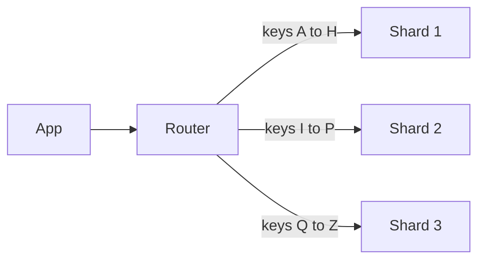

> [!crumbs] [[00 Start Here|🏠 Home]] › [[Part 1 System Design|Part 1]] › [[Architecture]] › [[Distributed Systems]] › Sharding

> [!tldr] In one sentence
> Sharding splits one big set of data into pieces and puts each piece on a different machine, so **no single machine has to hold or serve everything**.

## 🧠 Think of it like…

> [!analogy] Check-in desks at a big conference
> Thousands arrive at once. Instead of one line, there are three desks: last names A–H, I–P and Q–Z. Each desk holds only its own badges, and all three lines move at once.

Each desk is a **shard**: one machine holding one slice of the data. The last name is the **shard key**, which decides where each record lives. The sign above the desks is the **router**.

It also shows the risks. If half the guests are named Smith, one desk is swamped. Adding a fourth desk means moving badges around.

## What it is

**Sharding**, or **horizontal partitioning**, divides a database's records across several machines. Each holds part of the data and does part of the work.[^1]

The alternative, **vertical scaling**, means buying a bigger machine. That is simpler, but hardware sets a ceiling.[^1]

The shard key, such as a customer ID, tells the system where to store each record and where to look for it.[^1]

## Why it matters

- **Data outgrows one machine.** Notion ran on one PostgreSQL database for five years until growth threatened to overwhelm it.[^2]
- **Traffic outgrows one machine.** Amazon DynamoDB caps each internal partition at 3,000 reads and 1,000 writes per second, so busy tables must spread across many.[^3]

## How it works

There are two common ways to split the data:[^1]

- **By range.** Shard 1 gets A–H, shard 2 gets I–P. Nearby keys sit together, which makes "everything from March" fast. But if new data has similar keys, one shard takes all the load.
- **By hash.** A **hash function**, a formula that scrambles the key into a number, picks the shard. Data spreads evenly, but nearby keys end up apart.

Adding a machine means moving data. A naive "divide by the number of machines" rule moves almost everything; **consistent hashing** places machines on a circle so only a small share moves.[^4]

A query with the shard key goes to one shard. Without it, the router must ask **every** shard and combine the answers.[^1]

## A real-world example

In 2021, Notion split its main database into **480 logical shards** on **32 physical databases**, keyed by workspace ID, because almost everything you do stays inside one workspace.[^2]

Why 480? It divides evenly, so Notion can grow from 32 machines to 40 or 48 and keep shards balanced. The switch-over needed just five minutes of scheduled downtime.[^2]

## Myths and pitfalls

- **❌ Myth:** Sharding is the first fix for a slow database. **✅ Reality:** It adds a lot of complexity.[^1] Notion ran on one database for five years before sharding.[^2]
- **❌ Myth:** Any shard key will do. **✅ Reality:** A poor key piles traffic onto one shard, a **hot spot**. Discord saw busy chat channels overload their shard and slow everything down.[^5]
- **❌ Myth:** Sharding and replication are the same thing. **✅ Reality:** Sharding splits data; replication copies it. Large systems give every shard its own copies.[^6]
- **❌ Myth:** Once data is sharded, the job is done. **✅ Reality:** Data keeps shifting, so shards must be rebalanced over time.[^1]

## Check yourself

> [!question]- What is the difference between sharding and buying a bigger server?
> A bigger server is simpler but hits a hardware ceiling. Sharding spreads data over many machines: no hard ceiling, more complexity.

> [!question]- Why is "date created" often a poor shard key on its own?
> New records share similar dates, so one shard does all the writing while the others sit idle.

> [!question]- Why did Notion use the workspace ID as its shard key?
> Almost every request stays inside one workspace, so it touches just one shard.

## Key terms

- **Shard** — one piece of the data, stored on its own machine.
- **Shard key** — the field that decides which shard a record lives on.
- **Horizontal scaling** — adding more machines instead of a bigger one.
- **Hot spot** — a shard getting far more traffic than the rest.
- **Hash function** — a formula that turns a key into a scrambled number.
- **Consistent hashing** — a way to place data so adding a machine moves only a little of it.

> [!deepdive] Ready for the technical take?
> Range vs hash vs directory schemes, consistent hashing and virtual nodes, choosing a shard key, resharding live, and Discord's hot partitions.
> → [[Sharding (Deep Dive)]]

## Related

- [[Replication]] — copies each shard so a machine failure loses nothing.
- [[CAP Theorem]] — more machines means more network links that can break.
- [[Databases]] — the systems being split.
- [[NoSQL Databases]] — many shard automatically by design.
- [[Load Balancing]] — spreading requests, the way sharding spreads data.
- [[Embeddings & Vector Databases]] — large vector indexes get split across machines too.

> [!nav] Keep going
> ← [[Replication]] · [[Distributed Systems|🕸️ Distributed Systems]] · [[API Design]] →
> 🔬 Technical take: [[Sharding (Deep Dive)]] · 🗺️ [[Glossary]]

## 📚 Sources

[^1]: 📄 [Sharding](https://www.mongodb.com/docs/manual/sharding/) — MongoDB Manual. Official docs. Checked 2026-11.
[^2]: 📝 [Herding elephants: Lessons learned from sharding Postgres at Notion](https://www.notion.com/blog/sharding-postgres-at-notion) — Garrett Fidalgo, Notion Blog, 2021. Engineering blog. Checked 2026-11.
[^3]: 📄 [Best practices for designing and using partition keys effectively in DynamoDB](https://docs.aws.amazon.com/amazondynamodb/latest/developerguide/bp-partition-key-design.html) — Amazon DynamoDB Developer Guide. Official docs. Checked 2026-11.
[^4]: 📖 [Consistent hashing](https://en.wikipedia.org/wiki/Consistent_hashing) — Wikipedia. Encyclopedia. Checked 2026-11.
[^5]: 📝 [How Discord Stores Trillions of Messages](https://discord.com/blog/how-discord-stores-trillions-of-messages) — Bo Ingram, Discord Blog, 2023. Engineering blog. Checked 2026-11.
[^6]: 📄 [Sharding](https://vitess.io/docs/reference/features/sharding/) — Vitess documentation. Official docs. Checked 2026-11.
