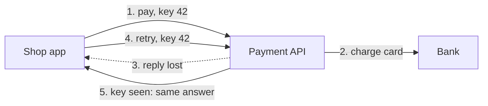

> [!crumbs] [[00 Start Here|🏠 Home]] › [[Part 1 System Design|Part 1]] › [[Scalability]] › [[Communication]] › API Design

> [!tldr] In one sentence
> API design is deciding **the rules other programs must follow to talk to yours**, and keeping those rules stable so nobody's code breaks when you change things.

## 🧠 Think of it like…

> [!analogy] A restaurant menu
> You don't cook in the kitchen. You order from the menu and get a dish back. The kitchen can change its stoves and staff; your order still works.

An API is the menu; the kitchen is the code and data behind it. A good menu is clear and never silently changes what "soup of the day" means.

## What it is

An **API (application programming interface)** lets two pieces of software talk under a shared set of rules.[^1] Your phone's weather app uses one to fetch the forecast.[^1]

The program that asks is the **client**; the one that answers is the **server**.[^1] Each request goes to an **endpoint**, an address that accepts one kind of request.[^1]

An API works like a **contract**: what you may ask, how to phrase it, and what comes back.[^1] API design is writing that contract well.

## Why it matters

- **Other people build on it.** Once apps depend on your API, a bad design is expensive to undo.
- **Networks fail.** A request can vanish midway, or succeed while the reply gets lost.[^2] Good APIs make retries harmless.
- **Data grows.** At Slack, some lists grew from a few hundred records to hundreds of thousands.[^3] The API must hand them out in pieces.

## How it works

**1. Make retries safe (idempotency).** An action is **idempotent** if doing it twice has the same effect as doing it once. The client attaches an **idempotency key**, a random label for this one action that it reuses on every retry. On a retry with the same key, the server returns the first answer instead of charging again.[^4]

**2. Hand out big lists in pages (pagination).** The server sends one page plus a bookmark, called a **cursor**, that says where to continue.[^3] Slack switched to cursors because page numbers got slow and could skip or repeat items as new ones arrived.[^3]

**3. Change without breaking (versioning).** Adding a new field is usually safe. Renaming or removing one breaks clients. So APIs carry a **version**: in the web address, like `/v2/`, or in a request header.[^5] Old clients keep the old behavior until they choose to upgrade.[^6]

## A real-world example

Stripe, the payments company, says it has kept every API version since 2011 working.[^6] Versions are named by release date, and each account is pinned to the version it first used.[^6]

Requests that create or update something can carry an idempotency key. Stripe saves the first response for that key and replays it on retries.[^4]

## Myths and pitfalls

- **❌ Myth:** An API is just a list of web addresses. **✅ Reality:** It also promises behavior. Changing what a field *means* breaks clients too.
- **❌ Myth:** Retrying a failed request is always safe. **✅ Reality:** If the first attempt worked, a blind retry does it twice.[^2]
- **❌ Myth:** "Page 3 of 10" is the best way to split a list. **✅ Reality:** Page numbers slow down and skip items on busy lists.[^3]
- **❌ Myth:** You can add a version number later if you need it. **✅ Reality:** Plan for change from day one. Stripe tries to get designs right the first time.[^6]

## Check yourself

> [!question]- What problem does an idempotency key solve?
> It lets a client retry without the server doing the work twice.

> [!question]- Why do APIs return long lists in pages?
> Sending everything at once is slow. A cursor lets clients walk the list in order without skipping items.

> [!question]- Your API has a field called `price`. Is renaming it to `cost` a safe change?
> No. Every client that reads `price` breaks. Add `cost` alongside it, or rename it in a new version.

## Key terms

- **API** — the agreed way one program asks another for data or actions.
- **Idempotent** — safe to repeat: doing it twice has the same effect as once.
- **Pagination** — splitting a long list into pages.
- **Cursor** — a bookmark that tells the server where the next page starts.
- **Versioning** — labeling API changes so old clients keep working.

> [!deepdive] Ready for the technical take?
> Compatibility rules, versioning strategies, cursor pagination, idempotency-key storage, retries with jitter.
> → [[API Design (Deep Dive)]]

## Related

- [[REST]] — the most common style for web APIs.
- [[gRPC]] — a typed, binary style for service-to-service calls.
- [[Rate Limiting]] — protects an API from clients that ask too often.
- [[Microservices]] — small services that talk through APIs.
- [[AI Agents & Tool Use]] — AI agents call tools through API contracts.

> [!nav] Keep going
> ← [[Sharding]] · [[Communication|💬 Communication]] · [[REST]] →
> 🔬 Technical take: [[API Design (Deep Dive)]] · 🗺️ [[Glossary]]

## 📚 Sources

[^1]: 📄 [What is an API?](https://aws.amazon.com/what-is/api/) — Amazon Web Services. Official docs. Checked 2026-11.
[^2]: 📝 [Designing robust and predictable APIs with idempotency](https://stripe.com/blog/idempotency) — Brandur Leach, Stripe, 2017. Engineering blog. Checked 2026-11.
[^3]: 📝 [Evolving API Pagination at Slack](https://slack.engineering/evolving-api-pagination-at-slack/) — Michael Hahn, Slack Engineering, 2017. Engineering blog. Checked 2026-11.
[^4]: 📄 [Idempotent requests](https://docs.stripe.com/api/idempotent_requests) — Stripe documentation. Official docs. Checked 2026-11.
[^5]: 📄 [Web API design best practices](https://learn.microsoft.com/en-us/azure/architecture/best-practices/api-design) — Microsoft Azure Architecture Center. Official docs. Checked 2026-11.
[^6]: 📝 [APIs as infrastructure: future-proofing Stripe with versioning](https://stripe.com/blog/api-versioning) — Brandur Leach, Stripe, 2017. Engineering blog. Checked 2026-11.
