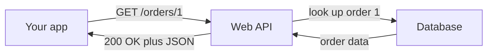

> [!crumbs] [[00 Start Here|🏠 Home]] › [[Part 1 System Design|Part 1]] › [[Scalability]] › [[Communication]] › REST

> [!tldr] In one sentence
> REST is the most common way to build web APIs: **every piece of data gets its own web address**, and you act on it with the same few standard verbs the web already uses.

## 🧠 Think of it like…

> [!analogy] A library with a front desk
> Every book has its own shelf address. At the desk you only ever make a few requests: "show me this", "add this", "replace this", "remove this". The same requests work for every book in the building.

In REST, each piece of data, like a customer or an order, is a **resource** with its own address. The few desk requests are the standard **HTTP methods**, the verbs your browser already speaks.

## What it is

**REST (Representational State Transfer)** is an architectural style, a set of rules for designing networked software. Roy Fielding described it in 2000 to explain how the web itself works.[^1]

In a REST API, each resource has a **URI**, a unique web address such as `https://api.example.com/orders/1`.[^2] Ask for it and you get back a **representation**, usually written in **JSON**, a simple text format for data.[^2]

APIs that follow these rules are called **RESTful**.

## Why it matters

- **Everyone already speaks it.** REST uses plain HTTP, so almost any language, phone or browser can call it.[^2]
- **Client and server can change separately.** The app doesn't need to know how the server is built, only the addresses and formats.[^2]
- **It scales out easily.** Each request carries everything needed to answer it, so any server in a pool can handle it.[^1]

## How it works

You combine a **method** with an address. The common methods map to the four basic data actions, often called **CRUD** (create, read, update, delete):[^2]

- **GET** `/customers/5` reads customer 5.
- **POST** `/customers` creates a new customer.
- **PUT** or **PATCH** `/customers/5` replaces or updates customer 5.
- **DELETE** `/customers/5` removes customer 5.

Every answer comes with a three-digit **status code** that says how it went. Codes starting with 2 mean success, 4 means the client made a mistake, and 5 means the server failed.[^3] You have probably met `404 Not Found` in your browser.[^3]

The server keeps no memory of you between requests: this is called being **stateless**.[^1] Your app resends its details every time. That costs a little extra data, but any server can answer.[^1]

## A real-world example

GitHub, the code-hosting site, offers a large REST API. Every request is a method plus a path, such as `GET /octocat`, and it can name the API version it expects in a header.[^4] Logged-in users may make 5,000 requests per hour; anonymous callers get 60.[^5]

## Myths and pitfalls

- **❌ Myth:** REST means "JSON over HTTP". **✅ Reality:** REST is a set of design rules. Most APIs follow only some of them, and Fielding argues the full style also needs links between resources.[^6]
- **❌ Myth:** You can send everything as POST to one address. **✅ Reality:** That works, but it throws away what the web offers: clear verbs, status codes and caching.[^6]
- **❌ Myth:** Retrying any request is harmless. **✅ Reality:** GET, PUT and DELETE are designed to be repeatable; POST is not, and a retry may create a duplicate.[^7]
- **❌ Myth:** REST is the best choice for everything. **✅ Reality:** Its uniform style costs some efficiency.[^1] Busy internal services often use faster options like [[gRPC]].

## Check yourself

> [!question]- What is a resource in REST?
> Any piece of information that can be named, such as a customer, an order or a photo. Each one has its own web address.

> [!question]- What does a 404 status code tell you?
> The server could not find the resource at that address. Codes starting with 4 mean the problem is on the client's side.

> [!question]- Why does being stateless help a REST API grow?
> Each request carries everything needed, so any server in a pool can answer it.

## Key terms

- **Resource** — any named piece of data, like a customer or an order.
- **URI** — the unique web address of a resource.
- **HTTP method** — the verb of a request: GET, POST, PUT, PATCH, DELETE.
- **CRUD** — create, read, update, delete: the four basic data actions.
- **Status code** — a three-digit number saying how a request went.
- **Stateless** — the server keeps no memory of the client between requests.

> [!deepdive] Ready for the technical take?
> Fielding's six constraints, method semantics, the Richardson Maturity Model, PUT vs PATCH, conditional requests and HATEOAS.
> → [[REST (Deep Dive)]]

## Related

- [[API Design]] — the broader craft REST is one style of.
- [[Networking]] — HTTP and the web underneath REST.
- [[Caching]] — REST responses are built to be cached.
- [[Load Balancing]] — stateless requests spread easily.
- [[Deployment & Serving]] — AI models are often served behind REST endpoints.

> [!nav] Keep going
> ← [[API Design]] · [[Communication|💬 Communication]] · [[gRPC]] →
> 🔬 Technical take: [[REST (Deep Dive)]] · 🗺️ [[Glossary]]

## 📚 Sources

[^1]: 📘 [Architectural Styles and the Design of Network-based Software Architectures, chapter 5: REST](https://ics.uci.edu/~fielding/pubs/dissertation/rest_arch_style.htm) — Roy T. Fielding, University of California, Irvine, 2000. Dissertation. Checked 2026-11.
[^2]: 📄 [Web API design best practices](https://learn.microsoft.com/en-us/azure/architecture/best-practices/api-design) — Microsoft Azure Architecture Center. Official docs. Checked 2026-11.
[^3]: 📄 [HTTP response status codes](https://developer.mozilla.org/en-US/docs/Web/HTTP/Reference/Status) — MDN Web Docs. Official docs. Checked 2026-11.
[^4]: 📄 [Getting started with the REST API](https://docs.github.com/en/rest/using-the-rest-api/getting-started-with-the-rest-api) — GitHub Docs. Official docs. Checked 2026-11.
[^5]: 📄 [Rate limits for the REST API](https://docs.github.com/en/rest/using-the-rest-api/rate-limits-for-the-rest-api) — GitHub Docs. Official docs. Checked 2026-11.
[^6]: 📝 [Richardson Maturity Model](https://martinfowler.com/articles/richardsonMaturityModel.html) — Martin Fowler, 2010. Article. Checked 2026-11.
[^7]: 📄 [RFC 9110: HTTP Semantics](https://www.rfc-editor.org/rfc/rfc9110.html) — IETF, 2022. Standard. Checked 2026-11.
