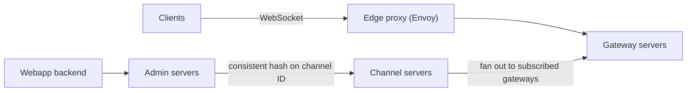

> [!crumbs] [[00 Start Here|🏠 Home]] › [[Part 1 System Design|Part 1]] › [[Scalability]] › [[Communication]] › [[WebSockets]] › 🔬 Deep Dive

> [!tldr] For engineers
> WebSocket (RFC 6455) upgrades one HTTP/1.1 request into a **full-duplex, message-framed channel over a single TCP connection**. It beats polling on latency and overhead, but turns your edge into a **stateful** tier: millions of long-lived sockets, heartbeats against idle timeouts, fan-out to many gateways, and reconnect storms after every deploy or outage. For server-to-client only, **SSE** is simpler; for backpressure or unreliable delivery, look at WebTransport.

> [!basics]- New to this? Start with the basics
> [[WebSockets]] explains it with no jargon.

## How it really works

### The spectrum of "real-time" on the web

- **Short polling:** the client asks on a timer. Every check is a full HTTP request with headers, even when nothing changed.[^1]
- **Long polling:** the server holds the request open until it has an event or hits a timeout, then the client immediately asks again.[^2] RFC 6202 lists the costs: full headers per message, worst-case latency of over three network transits, and a held TCP connection plus HTTP request per client.[^2]
- **Server-sent events (SSE):** one long HTTP response with `Content-Type: text/event-stream`; the browser's `EventSource` parses `event:`, `data:`, `id:` and `retry:` fields and **reconnects automatically**.[^3] It is one-way: the client cannot send over it.[^3]
- **WebSocket:** a two-way session where both sides send messages without polling.[^4]
- **WebTransport:** a newer browser API with backpressure, unidirectional streams and unreliable datagrams.[^4]

### The opening handshake

A WebSocket starts as an HTTP/1.1 `GET` asking to switch protocols:[^1]

```http
GET /chat HTTP/1.1
Host: server.example.com
Upgrade: websocket
Connection: Upgrade
Sec-WebSocket-Key: dGhlIHNhbXBsZSBub25jZQ==
Origin: http://example.com
Sec-WebSocket-Version: 13

HTTP/1.1 101 Switching Protocols
Upgrade: websocket
Connection: Upgrade
Sec-WebSocket-Accept: s3pPLMBiTxaQ9kYGzzhZRbK+xOo=
```

`Sec-WebSocket-Accept` is derived from the client's key, a fixed GUID and SHA-1, proving the server really speaks WebSocket and isn't a confused HTTP server.[^1] The `Origin` header lets the server refuse scripts from origins it doesn't trust.[^1] `ws://` defaults to port 80 and `wss://` (over TLS) to 443, so traffic passes through ordinary web infrastructure.[^1] RFC 8441 later defined how to run a WebSocket over a single stream of an HTTP/2 connection, using an extended `CONNECT` instead of the `101` upgrade, so one TCP connection can carry both protocols.[^5]

### Framing

After the handshake, data moves as frames:[^1]

```text
FIN | RSV1-3 | opcode (4 bits) | MASK | payload len (7, 7+16 or 7+64 bits) | masking key (32 bits, client→server) | payload
```

- **Opcodes:** `0x1` text, `0x2` binary, `0x8` close, `0x9` ping, `0xA` pong.[^1]
- **Masking:** a client must mask every frame with a fresh random 32-bit key; a server must not mask.[^1] This defends against attacks that trick non-compliant intermediaries into treating client data as an HTTP request and poisoning their caches.[^1]
- **Control frames:** a ping may serve as a keepalive or a liveness check, answered by a pong.[^1] A close frame carries a status code: `1000` normal closure, `1001` going away (server shutdown or page navigation), `1002` protocol error.[^1]

The browser `WebSocket` interface has **no backpressure**: if messages arrive faster than the page handles them, it buffers until memory fills or the CPU pegs.[^4]

### Scaling the connection tier

Sockets are long-lived and stateful, so real systems separate **holding connections** from **routing messages**. Slack's design is a good template:[^6]



- **Gateway servers** hold each user's socket and channel subscriptions in memory, deployed in several regions.[^6]
- **Channel servers** own channels by consistent hashing; a send goes from the web app to an admin server, which finds the right channel server, which fans out to every subscribed gateway.[^6]
- On boot the client fetches a token and connection info over normal HTTP, then opens the socket.[^6]

Discord hit the next layer of problems: a session process per connected user, guild (server) processes with up to 30,000 concurrent users, and fan-out from one guild taking 900 ms to 2.1 s until it batched sends per remote node with its Manifold library.[^7]

## Design choices and trade-offs

| Option | Direction | Gains | Costs |
| --- | --- | --- | --- |
| Short polling | Client pulls | Trivial; stateless servers; cache-friendly | Latency = poll interval; wasted requests |
| Long polling | Server push (emulated) | Works anywhere HTTP works | Full headers per event; held request per client; timeout tuning[^2] |
| SSE | Server → client | Plain HTTP, auto-reconnect, event IDs | One-way; 6-connection cap per domain on HTTP/1.x[^3] |
| WebSocket | Both ways | Low overhead, low latency, binary or text | Stateful tier; no browser backpressure; custom reconnect logic[^4] |
| WebTransport | Both ways, multi-stream | Backpressure, unidirectional streams, out-of-order and unreliable delivery[^4] | Different API and server stack; not a drop-in swap |

Rule of thumb: **SSE for feeds, notifications and streamed responses; WebSocket for chat, collaboration, games and anything where the client talks often.**

## Numbers worth knowing

| Figure | Value |
| --- | --- |
| WebSocket standard | RFC 6455, December 2011[^1] |
| Browser support | All major browsers since July 2015[^4] |
| SSE connection limit without HTTP/2 | 6 per browser per domain[^3] |
| HTTP/2 default concurrent streams (SSE over HTTP/2) | 100, negotiated[^3] |
| Long-poll timeout (RFC 6202, 2011) | 30 s "safer"; up to 120 s seen working; browsers then defaulted to 300 s[^2] |
| AWS API Gateway WebSocket limits | 2 h max connection, 10 min idle timeout, 128 KB message, 32 KB frame[^8] |
| AWS API Gateway new connections | 500/s per account per Region by default[^8] |
| Slack global delivery latency | About 500 ms[^6] |
| Slack channels per channel-server host at peak | About 16 million[^6] |
| Slack channel-server replacement | Under 20 s[^6] |
| Discord concurrent users (2017) | Nearly 5 million[^7] |
| Live sessions per Discord session VM | Up to 500,000[^7] |

## Failure modes

- **Silent idle drops.** NATs, proxies and load balancers kill quiet connections; AWS closes idle ones after 10 minutes.[^8][^2] Send application-level heartbeats or protocol pings well inside the shortest timeout.[^1]
- **Hard lifetime caps.** Some managed gateways cap connection lifetime (2 hours on API Gateway).[^8] Clients must treat reconnecting as normal, not exceptional.
- **Reconnect storms.** After a deploy or outage, every client reconnects at once. At Discord, about 5 million sessions hammering roughly ten registry processes caused cascading outages; a semaphore that let callers bail out early fixed it.[^7] On the client side, use exponential backoff with jitter.[^9]
- **Lost messages across reconnects.** A socket gives no replay. Number events and resync on reconnect; SSE builds this in with the `id:` field.[^3]
- **Hot rooms.** One huge channel or guild turns every message into tens of thousands of sends. Batch fan-out per node, as Discord's Manifold does.[^7]
- **Slow consumers.** Without backpressure, a slow client makes the server or browser buffer without bound.[^4] Cap per-connection queues and drop or disconnect laggards.
- **Oversized messages.** Gateways enforce frame and payload limits; API Gateway closes the connection with code `1009` on an oversized frame.[^8]
- **Regional failure or draining.** Slack moves users off a bad region by draining gateways to the nearest healthy one.[^6]
- **Cross-site WebSocket hijacking.** A malicious page can try to open a socket to your server from a user's browser. Check the `Origin` header and authenticate explicitly.[^1]

## In the real world

- **Slack** runs stateful gateway and channel servers in Java, with consistent hash rings managed by a dedicated service and discovered through Consul.[^6]
- **Discord** built its real-time layer on Elixir, with a process per connected session and per guild, and wrote Manifold, Semaphore and FastGlobal to handle fan-out, overload and shared lookups.[^7]
- **Amazon API Gateway** offers managed WebSocket APIs, with no hard cap on concurrent connections but a cap on new connections per second.[^8]

## In a design interview

For "design a chat app" or "live dashboard":

1. **Pick the channel.** "Two-way chat → WebSocket; read-only ticker → SSE."
2. **Separate tiers.** "Stateless API for sends and history; stateful gateway tier holding sockets; pub/sub or channel servers for fan-out."
3. **Routing.** "Consistent-hash channels to servers; gateways subscribe on the user's behalf."
4. **Resilience.** "Heartbeat every 30 s; reconnect with backoff and jitter; resync from last sequence number; drain gateways on deploy."
5. **Capacity.** "N concurrent users ÷ sockets per gateway = gateway count; size memory per connection."

Probes: *How does a message reach a user on another gateway?* (Channel server or pub/sub fan-out.) *What happens when a gateway dies?* (Clients reconnect elsewhere and resync.) *Why not just poll?* (Overhead and latency.) *How do you load-balance sockets?* (Balance at connect time; sessions then stay put.)

## Check yourself

> [!question]- Why must clients mask WebSocket frames but servers must not?
> Masking with an unpredictable key stops a malicious page from crafting bytes that a broken proxy would read as an HTTP request and cache. The threat is client-originated data, so only client-to-server frames are masked.

> [!question]- A dashboard only receives updates and runs over HTTP/1.1. SSE or WebSocket?
> SSE fits the one-way flow and reconnects automatically, but over HTTP/1.x it shares the 6-connections-per-domain limit across tabs. Serve it over HTTP/2, or use WebSocket if many tabs must stay open.

> [!question]- Your gateway fleet restarts for a deploy and the database falls over. What happened, and what is the fix?
> Every client reconnected and resynced at once. Drain gateways gradually, add jittered backoff on clients, and make resync cheap (deltas from a sequence number, not full reloads).

## Further reading

- 📄 [RFC 6455: The WebSocket Protocol](https://www.rfc-editor.org/rfc/rfc6455.html) — the handshake, framing and security rationale, straight from the source.
- 📄 [RFC 6202: Long Polling and Streaming in Bidirectional HTTP](https://www.rfc-editor.org/rfc/rfc6202.html) — why the pre-WebSocket tricks hurt.
- 📄 [Using server-sent events](https://developer.mozilla.org/en-US/docs/Web/API/Server-sent_events/Using_server-sent_events) — the simplest push channel, with the stream format.
- 📝 [Real-time Messaging](https://slack.engineering/real-time-messaging/) — how Slack routes messages to tens of millions of sockets.
- 📝 [How Discord Scaled Elixir to 5,000,000 Concurrent Users](https://discord.com/blog/how-discord-scaled-elixir-to-5-000-000-concurrent-users) — fan-out and reconnect-storm war stories.

## Related

- [[Load Balancing (Deep Dive)]] — balancing long-lived connections.
- [[Message Queues (Deep Dive)]] — pub/sub fan-out behind the socket tier.
- [[Sharding (Deep Dive)]] — consistent hashing of channels to servers.
- [[Fault Tolerance (Deep Dive)]] — backoff, jitter and draining.
- [[REST (Deep Dive)]] — the request/response style for everything else.
- [[LLM Inference & Optimization (Deep Dive)]] — streaming tokens to users as they are generated.

> [!nav] Keep going
> ← [[gRPC (Deep Dive)|gRPC]] · [[Communication|💬 Communication]] · [[Caching (Deep Dive)|Caching]] →
> 🌱 Back to the basics: [[WebSockets]] · 🗺️ [[Glossary]]

## 📚 Sources

[^1]: 📄 [RFC 6455: The WebSocket Protocol](https://www.rfc-editor.org/rfc/rfc6455.html) — IETF, 2011. Standard. Checked 2026-11.
[^2]: 📄 [RFC 6202: Known Issues and Best Practices for the Use of Long Polling and Streaming in Bidirectional HTTP](https://www.rfc-editor.org/rfc/rfc6202.html) — IETF, 2011. Standard (informational). Checked 2026-11.
[^3]: 📄 [Using server-sent events](https://developer.mozilla.org/en-US/docs/Web/API/Server-sent_events/Using_server-sent_events) — MDN Web Docs. Official docs. Checked 2026-11.
[^4]: 📄 [The WebSocket API (WebSockets)](https://developer.mozilla.org/en-US/docs/Web/API/WebSockets_API) — MDN Web Docs. Official docs. Checked 2026-11.
[^5]: 📄 [RFC 8441: Bootstrapping WebSockets with HTTP/2](https://www.rfc-editor.org/rfc/rfc8441.html) — IETF, 2018. Standard. Checked 2026-11.
[^6]: 📝 [Real-time Messaging](https://slack.engineering/real-time-messaging/) — Sameera Thangudu, Slack Engineering, 2023. Engineering blog. Checked 2026-11.
[^7]: 📝 [How Discord Scaled Elixir to 5,000,000 Concurrent Users](https://discord.com/blog/how-discord-scaled-elixir-to-5-000-000-concurrent-users) — Stanislav Vishnevskiy, Discord, 2017. Engineering blog. Checked 2026-11.
[^8]: 📄 [Quotas for configuring and running a WebSocket in API Gateway](https://docs.aws.amazon.com/apigateway/latest/developerguide/apigateway-execution-service-websocket-limits-table.html) — Amazon API Gateway Developer Guide. Official docs. Checked 2026-11.
[^9]: 📝 [Designing robust and predictable APIs with idempotency](https://stripe.com/blog/idempotency) — Brandur Leach, Stripe, 2017. Engineering blog. Checked 2026-11.
