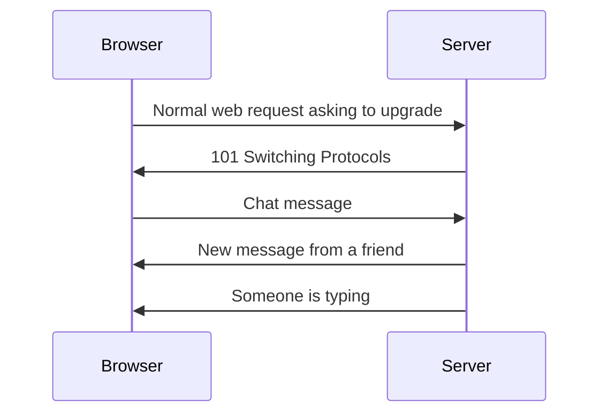

> [!crumbs] [[00 Start Here|🏠 Home]] › [[Part 1 System Design|Part 1]] › [[Scalability]] › [[Communication]] › WebSockets

> [!tldr] In one sentence
> A WebSocket is a connection between your browser and a server that **stays open**, so either side can send a message the instant something happens, with no need to keep asking "anything new?".

## 🧠 Think of it like…

> [!analogy] Phoning the bakery
> You could call the bakery every five minutes to ask if your cake is ready. Or you could stay on a call with them, so they tell you the moment it comes out of the oven, and you can still ask questions.

Calling again and again is **polling**. The open line is a **WebSocket**: both sides can talk at any time, and nobody wastes calls.

## What it is

Normally your browser asks and the server answers. The server can't start a conversation on its own.

The **WebSocket** standard, published in 2011, fixes that.[^1] It opens a two-way session between your browser and a server, so you can send and receive messages without polling.[^2] Every major browser has supported it since 2015.[^2]

There are lighter options too. **Server-sent events (SSE)** keep a one-way channel open so the server can push updates; the browser can't reply over it.[^3] **Long polling** is the old trick: the server holds your request open until it has news, then you ask again.[^4]

## Why it matters

- **Instant updates.** Chat, live scores, shared documents and multiplayer games need news in well under a second.
- **Less waste.** Polling sends a full request, headers and all, even when nothing has changed.[^1]
- **Fewer connections.** Before WebSockets, servers often juggled several connections per user to fake two-way talk.[^1]

## How it works

1. **The handshake.** The browser starts with an ordinary web request that asks to "upgrade". The server agrees with the reply `101 Switching Protocols`.[^1]
2. **The open line.** From then on, the same connection carries small **frames**, little packets of text or data, in both directions.[^1]
3. **Staying alive.** Either side can send a tiny "ping" to check the other is still there.[^1]
4. **Closing.** Either side sends a close message with a reason code, such as "normal closure" or "going away".[^1]

## A real-world example

Slack keeps your app up to date over a WebSocket. When the app starts, it connects to a **gateway server** in the nearest region.[^5] When someone posts in a channel, the message is sent to every gateway holding a member of that channel, and each gateway pushes it down the open sockets.[^5]

Slack says this system delivers messages across the world in about 500 milliseconds, to tens of millions of connected clients.[^5]

## Myths and pitfalls

- **❌ Myth:** Live updates always need WebSockets. **✅ Reality:** If only the server talks, server-sent events are simpler and reconnect automatically.[^3]
- **❌ Myth:** An open connection is free. **✅ Reality:** As with long polling, each open connection holds server resources the whole time, which limits how many one server can carry.[^4]
- **❌ Myth:** Once open, a connection stays open forever. **✅ Reality:** Networks and cloud services close idle or long-lived connections. Amazon's API Gateway caps WebSocket connections at two hours.[^6]
- **❌ Myth:** WebSockets replace the web's normal requests. **✅ Reality:** Every WebSocket begins as a normal web request, and most apps still use ordinary requests for everything else.[^1]

## Check yourself

> [!question]- What is the difference between polling and a WebSocket?
> Polling asks the server again and again whether anything changed. A WebSocket keeps one connection open so the server can push news the moment it happens.

> [!question]- When would server-sent events be enough?
> When updates only flow from server to browser, like a live news feed or a progress bar.

> [!question]- Why is a WebSocket server harder to scale than a normal web server?
> Each user keeps a connection open the whole time, so the server must hold state for every one of them.

## Key terms

- **WebSocket** — a lasting, two-way connection between browser and server.
- **Polling** — asking a server repeatedly whether anything changed.
- **Long polling** — the server holds a request open until it has news.
- **Server-sent events (SSE)** — a one-way stream of updates from server to browser.
- **Handshake** — the opening request that upgrades a web connection to a WebSocket.
- **Push** — the server sending data without being asked first.

> [!deepdive] Ready for the technical take?
> Framing and masking, heartbeats, SSE vs WebSocket vs WebTransport, scaling millions of sockets, and reconnect storms.
> → [[WebSockets (Deep Dive)]]

## Related

- [[Networking]] — HTTP and TCP, which WebSockets build on.
- [[Load Balancing]] — long-lived connections change how traffic is spread.
- [[Message Queues]] — often used to fan messages out to socket servers.
- [[REST]] — the request-and-response style WebSockets complement.
- [[LLM Inference & Optimization]] — chat assistants stream answers as they are generated.

> [!nav] Keep going
> ← [[gRPC]] · [[Communication|💬 Communication]] · [[Caching]] →
> 🔬 Technical take: [[WebSockets (Deep Dive)]] · 🗺️ [[Glossary]]

## 📚 Sources

[^1]: 📄 [RFC 6455: The WebSocket Protocol](https://www.rfc-editor.org/rfc/rfc6455.html) — IETF, 2011. Standard. Checked 2026-11.
[^2]: 📄 [The WebSocket API (WebSockets)](https://developer.mozilla.org/en-US/docs/Web/API/WebSockets_API) — MDN Web Docs. Official docs. Checked 2026-11.
[^3]: 📄 [Using server-sent events](https://developer.mozilla.org/en-US/docs/Web/API/Server-sent_events/Using_server-sent_events) — MDN Web Docs. Official docs. Checked 2026-11.
[^4]: 📄 [RFC 6202: Known Issues and Best Practices for the Use of Long Polling and Streaming in Bidirectional HTTP](https://www.rfc-editor.org/rfc/rfc6202.html) — IETF, 2011. Standard (informational). Checked 2026-11.
[^5]: 📝 [Real-time Messaging](https://slack.engineering/real-time-messaging/) — Sameera Thangudu, Slack Engineering, 2023. Engineering blog. Checked 2026-11.
[^6]: 📄 [Quotas for configuring and running a WebSocket in API Gateway](https://docs.aws.amazon.com/apigateway/latest/developerguide/apigateway-execution-service-websocket-limits-table.html) — Amazon API Gateway Developer Guide. Official docs. Checked 2026-11.
