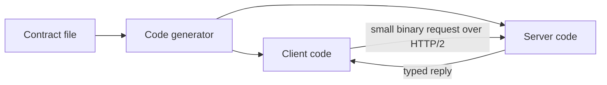

> [!crumbs] [[00 Start Here|🏠 Home]] › [[Part 1 System Design|Part 1]] › [[Scalability]] › [[Communication]] › gRPC

> [!tldr] In one sentence
> gRPC lets one program **call a function on another machine as if it were local**, using a shared contract and small binary messages, so services talk to each other quickly and without misunderstandings.

## 🧠 Think of it like…

> [!analogy] Two offices sharing the same order forms
> Instead of writing letters, both offices use identical printed forms with numbered boxes. You fill in box 1 and box 3 and send it over. The other office knows exactly what each box means, so it reads the form instantly and never misreads your handwriting.

The form is gRPC's **contract file**. Only box numbers and values travel, not long labels, so messages stay small.

## What it is

**gRPC** is an open-source framework for **remote procedure calls (RPC)**: a client calls a method on a server elsewhere as if it were an ordinary function in its own code.[^1]

Google built it as the next version of **Stubby**, an internal system it had used for over a decade to connect its services. In 2015 Google decided to rebuild it as open source.[^2]

The contract is usually written with **Protocol Buffers (protobuf)**, Google's format for describing and packing data. It is "like JSON, except it's smaller and faster".[^3]

## Why it matters

- **Speed.** Binary messages are smaller and quicker to read than text formats like JSON.[^3]
- **Fewer mistakes.** Both sides are generated from the same contract, so they agree on every field.[^1]
- **Many languages.** gRPC offers client libraries in 11 languages, so a Go service can call a Java one.[^2]
- **Streaming.** A call can send or receive a whole stream of messages, not just one.[^4]

## How it works

1. **Write the contract.** A `.proto` file, a plain text file, lists the services, their methods, and the shape of each message. Each field gets a number.[^1]
2. **Generate code.** A tool reads the contract and writes ready-made client and server code in your chosen languages.[^1]
3. **Call it.** The client calls a method on a local stand-in called a **stub**. The stub packs the arguments, sends them, and hands back the reply.[^4]

Messages travel over **HTTP/2**, a modern version of the web's protocol that can carry many calls at once over one connection.[^5]

Calls can carry a **deadline**, a time limit after which the caller gives up. By default there is none, so a careless client could wait forever.[^6]

## A real-world example

Dropbox runs hundreds of services, written in different languages, that exchange millions of requests per second.[^7] It moved them onto gRPC, wrapped in an in-house framework called Courier.[^7]

Dropbox chose gRPC mainly because it could reuse the protobuf definitions it already had.[^7] It also made deadlines mandatory on every call, so one slow service can't make the others wait forever.[^7]

## Myths and pitfalls

- **❌ Myth:** gRPC is only for Google-sized companies. **✅ Reality:** Square, Netflix and Cockroach Labs all adopted it.[^2]
- **❌ Myth:** A web page can call gRPC directly. **✅ Reality:** Browsers don't expose enough of HTTP/2. A web page needs gRPC-Web plus a translating proxy.[^8]
- **❌ Myth:** Binary means you can read the data like JSON. **✅ Reality:** Protobuf messages don't describe themselves; you need the contract to decode them.[^3]
- **❌ Myth:** gRPC replaces REST everywhere. **✅ Reality:** It shines between your own services. Public APIs for outside developers usually stay on [[REST]].

## Check yourself

> [!question]- What is a stub in gRPC?
> A local stand-in for the remote service. Your code calls it; it sends the request and returns the answer.

> [!question]- Why are protobuf messages smaller than JSON?
> Field names never travel. Each field is identified by a small number from the contract, and values are packed in a compact binary form.

> [!question]- Why should every gRPC call set a deadline?
> Without one, gRPC can wait forever. A deadline stops a slow service from tying up its callers.

## Key terms

- **RPC (remote procedure call)** — calling a function that runs on another machine.
- **Protocol Buffers (protobuf)** — Google's compact binary format and contract language.
- **`.proto` file** — the contract listing services, methods and messages.
- **Stub** — generated client code that makes the remote call look local.
- **HTTP/2** — a newer web protocol that carries many calls over one connection.
- **Deadline** — how long a caller will wait before giving up.

> [!deepdive] Ready for the technical take?
> The wire format, the four streaming modes, deadline propagation, why gRPC breaks connection-level load balancing, and gRPC-Web.
> → [[gRPC (Deep Dive)]]

## Related

- [[API Design]] — the contract thinking gRPC enforces with code.
- [[REST]] — the text-based style gRPC is usually compared with.
- [[Microservices]] — where gRPC is most at home.
- [[Load Balancing]] — gRPC's long-lived connections need smarter balancing.
- [[Deployment & Serving]] — model servers need a call protocol too.

> [!nav] Keep going
> ← [[REST]] · [[Communication|💬 Communication]] · [[WebSockets]] →
> 🔬 Technical take: [[gRPC (Deep Dive)]] · 🗺️ [[Glossary]]

## 📚 Sources

[^1]: 📄 [Introduction to gRPC](https://grpc.io/docs/what-is-grpc/introduction/) — gRPC Authors. Official docs. Checked 2026-11.
[^2]: 📄 [About gRPC](https://grpc.io/about/) — gRPC Authors. Official docs. Checked 2026-11.
[^3]: 📄 [Overview](https://protobuf.dev/overview/) — Protocol Buffers documentation, Google. Official docs. Checked 2026-11.
[^4]: 📄 [Core concepts, architecture and lifecycle](https://grpc.io/docs/what-is-grpc/core-concepts/) — gRPC Authors. Official docs. Checked 2026-11.
[^5]: 📝 [gRPC on HTTP/2: Engineering a Robust, High-performance Protocol](https://grpc.io/blog/grpc-on-http2/) — Jean de Klerk, gRPC blog, 2018. Engineering blog. Checked 2026-11.
[^6]: 📄 [Deadlines](https://grpc.io/docs/guides/deadlines/) — gRPC Authors. Official docs. Checked 2026-11.
[^7]: 📝 [Courier: Dropbox migration to gRPC](https://dropbox.tech/infrastructure/courier-dropbox-migration-to-grpc) — Ruslan Nigmatullin and Alexey Ivanov, Dropbox, 2019. Engineering blog. Checked 2026-11.
[^8]: 📝 [The state of gRPC in the browser](https://grpc.io/blog/state-of-grpc-web/) — Johan Brandhorst, gRPC blog, 2019. Engineering blog. Checked 2026-11.
