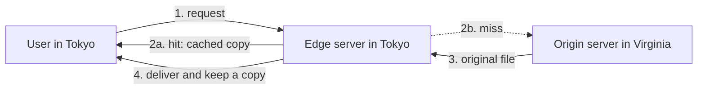

> [!crumbs] [[00 Start Here|🏠 Home]] › [[Part 1 System Design|Part 1]] › [[Scalability]] › [[Performance]] › CDN

> [!tldr] In one sentence
> A CDN (content delivery network) is a fleet of servers spread around the world that keeps copies of a website's files **close to each user**, so pages and videos arrive fast wherever people are.

## 🧠 Think of it like…

> [!analogy] Local bookshops instead of one head office
> A bookshop chain doesn't mail every book from its head office. It stocks popular titles in local branches, so you pick one up down the street. Only rare books get ordered from head office.

A CDN is the chain of branches. Your own server, the **origin** (where the original files live), is the head office. The branches are **edge servers**, CDN machines in cities near users, which call the origin only for files they lack.

## What it is

A **CDN** is a network of servers in many places that delivers web content for a website. It is a kind of [[Caching|cache]]: copies kept close to where they're needed.[^1]

When you open a page, **DNS** (the internet's address book, which turns a name like example.com into a server address) sends you to the CDN location that can answer you fastest, usually the nearest one.[^1] That location is called an **edge location** or **point of presence (PoP)**.

## Why it matters

- **Distance is slow.** In a 2010 Akamai study, a 4 GB movie took about 12 minutes to download from under 100 miles away, and about 20 hours from 6,000 miles away.[^2]
- **The origin gets a rest.** Every request the edge answers is one your own servers never see.[^3]
- **Failures hurt less.** With servers spread across about a thousand networks, losing one data center needn't affect users.[^2]

## How it works

DNS sends you to a nearby edge server. On a **cache hit** it already has the file and answers at once. On a **cache miss** it fetches the file from the origin and keeps a copy for the next person.[^1]

CDNs shine with **static content**: files that are the same for everyone, like images, videos and scripts. Personal pages, like your shopping cart, usually go straight to the origin.

Each file carries **headers** (labels on the response) saying how long copies may be kept. When a file changes, the simplest trick is to give it a new name.[^3]

## A real-world example

Netflix built its own CDN, Open Connect, starting in 2011.[^4] It puts its own servers at the hubs where networks meet and even inside internet providers' buildings, free for qualifying providers.[^4]

Because Netflix can predict what members will watch, it copies new shows onto these servers during quiet off-peak hours. When you press play, the app streams from a nearby one.[^4]

## Myths and pitfalls

- **❌ Myth:** A CDN caches your whole site automatically. **✅ Reality:** Many CDNs cache only certain file types by default. Cloudflare doesn't cache HTML or JSON unless you tell it to.[^5]
- **❌ Myth:** Caching any page at the edge is harmless. **✅ Reality:** On Christmas Day 2015, a caching mistake at Steam let account pages for about 34,000 users be seen by others.[^6]
- **❌ Myth:** "Nearest" means closest on a map. **✅ Reality:** CDNs pick the location that answers you fastest, measured in network delay, not miles.[^1]
- **❌ Myth:** A CDN replaces your servers. **✅ Reality:** It sits in front of them; the origin still handles anything that can't be cached.[^1]

## Check yourself

> [!question]- What happens when an edge server doesn't have the file you asked for?
> A cache miss. The edge fetches it from the origin and keeps a copy, so the next nearby user gets a hit.

> [!question]- Why is a CDN faster for a user far from the origin?
> The file comes from a nearby edge server instead of crossing continents, so there is far less delay.

> [!question]- Should a bank put each customer's account page in the CDN cache?
> No. Personal pages should be marked private and fetched from the origin, or one customer could see another's details.

## Key terms

- **CDN (content delivery network)** — servers worldwide that deliver copies of content close to users.
- **Origin** — your own server, which holds the original files.
- **Edge server / PoP** — a CDN location near users that serves cached copies.
- **Cache hit / miss** — whether the edge already had the file or had to fetch it.
- **Static content** — files that are the same for every user.
- **Purge (invalidation)** — telling the CDN to drop a copy early.

> [!deepdive] Ready for the technical take?
> DNS and anycast routing, cache keys, tiered caches and origin shields, invalidation versus versioned file names, and the day Fastly went down.
> → [[CDN (Deep Dive)]]

## Related

- [[Caching]] — a CDN is caching spread across the globe.
- [[Networking]] — DNS and distance explain why CDNs help.
- [[Load Balancing]] — spreads requests across servers; a CDN spreads them across the planet.
- [[Object Storage]] — a common origin for images and video.
- [[Fault Tolerance]] — many locations survive one failure.
- [[Cost Optimization]] — edge hits cut origin bandwidth.

> [!nav] Keep going
> ← [[Caching]] · [[Performance|⚡ Performance]] · [[Load Balancing]] →
> 🔬 Technical take: [[CDN (Deep Dive)]] · 🗺️ [[Glossary]]

## 📚 Sources

[^1]: 📄 [How CloudFront delivers content](https://docs.aws.amazon.com/AmazonCloudFront/latest/DeveloperGuide/HowCloudFrontWorks.html) — Amazon CloudFront Developer Guide. Official docs. Checked 2026-11.
[^2]: 🔬 [The Akamai Network: A Platform for High-Performance Internet Applications](https://courses.cs.duke.edu/fall21/compsci514/internal/readings/NygrenSS10.pdf) — Nygren, Sitaraman and Sun, Akamai Technologies, 2010. Paper. Checked 2026-11.
[^3]: 📄 [HTTP caching](https://developer.mozilla.org/en-US/docs/Web/HTTP/Guides/Caching) — MDN Web Docs. Official docs. Checked 2026-11.
[^4]: 📄 [Open Connect Overview](https://openconnect.netflix.com/Open-Connect-Overview.pdf) — Netflix. Official docs. Checked 2026-11.
[^5]: 📄 [Default cache behavior](https://developers.cloudflare.com/cache/concepts/default-cache-behavior/) — Cloudflare Docs. Official docs. Checked 2026-11.
[^6]: 📝 [Valve's statement on the Steam Christmas incident](https://store.steampowered.com/news/19852) — Valve, Steam News, December 2015. Article. Checked 2026-11.
