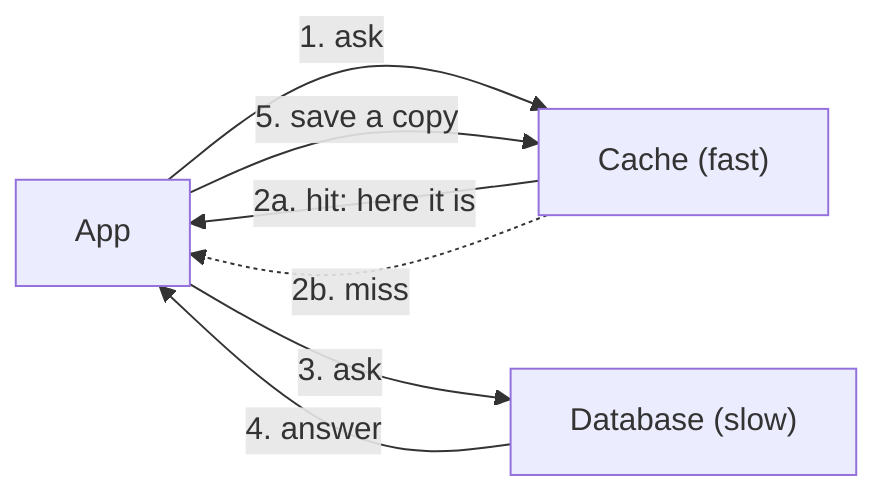

> [!crumbs] [[00 Start Here|🏠 Home]] › [[Part 1 System Design|Part 1]] › [[Scalability]] › [[Performance]] › Caching

> [!tldr] In one sentence
> Caching means keeping a copy of data you use often in a place that is **much faster to reach**, so you don't fetch it the slow way every time.

## 🧠 Think of it like…

> [!analogy] Your kitchen counter
> You keep salt, oil and coffee on the counter, not in the basement pantry. The pantry holds everything; the counter holds the few things you grab all day.

A cache is the counter. The **database** (the system that stores all the data for good) is the pantry. Most requests only need a small set of popular items, so keeping those close saves a trip every time.

## What it is

A **cache** is a small, fast storage layer that holds a copy of some data. It usually lives in **memory (RAM)**, which a computer reads far faster than a disk.[^1]

When an app needs a piece of data, it checks the cache first:

- If the data is there, that is a **cache hit**: the answer comes back right away.
- If it isn't, that is a **cache miss**: the app gets it from the slower source, then saves a copy in the cache for next time.[^2]

## Why it matters

- **Speed.** Reading from an in-memory cache takes well under a millisecond.[^1] Users feel the difference.
- **Less load on the database.** Every hit is a question the database never has to answer, so it can serve more users without bigger machines.[^1]
- **Calm during spikes.** On Black Friday, thousands of people view the same product. The cache answers most of them, so the database isn't buried.[^1]

## How it works

Caches are small, so they can't keep everything. Two simple rules keep them useful:

- **Expiry (TTL).** Each copy gets a **time to live**, say five minutes. After that it is thrown away and fetched fresh, so old data can't linger forever.[^2]
- **Eviction.** When the cache is full, it removes something to make room. A common choice is to drop whatever was **least recently used**.[^3]

The hard part is keeping the copy in step with the original. If the price changes in the database but the cache still holds the old price, users see the wrong one. This is called a **stale** cache. It is hard enough that a famous programming joke lists "cache invalidation" as one of only two hard things in computer science.[^4]

## A real-world example

Facebook leans on a huge layer of caches built on Memcached, an open-source in-memory cache. In 2013 its engineers reported that this layer handled **billions of requests per second** for over a billion users.[^5] Loading one popular page pulled an average of 521 separate items from the cache.[^5] Without it, every one of those items would hit a database.

## Myths and pitfalls

- **❌ Myth:** A cache makes everything faster. **✅ Reality:** It only helps data that is read again and again. Data read once just wastes space.
- **❌ Myth:** The cache always has the latest data. **✅ Reality:** Unless you design for it, a cache can serve out-of-date copies for as long as its TTL.[^2]
- **❌ Myth:** If the cache dies, the app dies. **✅ Reality:** A well-built app falls back to the database. It gets slower, not broken.[^2]
- **❌ Myth:** Caching is only a server thing. **✅ Reality:** Your browser, your phone and networks around the world cache too.[^6]

## Check yourself

> [!question]- What is the difference between a cache hit and a cache miss?
> A hit means the data was already in the cache and came back fast. A miss means it wasn't, so the app had to fetch it from the slower source and usually saved a copy for next time.

> [!question]- Why do cached copies get a time to live?
> So stale copies don't live forever. When the TTL runs out, the copy is dropped and the next request fetches a fresh one.

> [!question]- A shop's product prices change once a day. Is that a good fit for caching?
> Yes. The data is read constantly and changes rarely, so most requests can be served from the cache. A TTL or a refresh when prices change keeps it correct.

## Key terms

- **Cache** — a small, fast copy of data kept close to where it is used.
- **Cache hit / miss** — whether the data was found in the cache or not.
- **TTL (time to live)** — how long a copy may stay before it is thrown away.
- **Eviction** — removing items when the cache is full.
- **Stale data** — a cached copy that no longer matches the original.
- **Redis / Memcached** — two popular in-memory caching systems.

> [!deepdive] Ready for the technical take?
> Cache-aside vs. write-through, eviction policies, HTTP caching headers, stampedes and how Facebook tamed them.
> → [[Caching (Deep Dive)]]

## Related

- [[CDN]] — a cache spread around the world, close to users.
- [[Databases]] — the slower source a cache protects.
- [[Load Balancing]] — the other half of handling heavy traffic.
- [[Data Structures]] — a cache is, at heart, a giant hash map.
- [[LLM Inference & Optimization]] — AI models cache too, to answer faster.

> [!nav] Keep going
> ← [[WebSockets]] · [[Performance|⚡ Performance]] · [[CDN]] →
> 🔬 Technical take: [[Caching (Deep Dive)]] · 🗺️ [[Glossary]]

## 📚 Sources

[^1]: 📄 [Caching Overview](https://aws.amazon.com/caching/) — Amazon Web Services. Official docs. Checked 2026-11.
[^2]: 📄 [Caching strategies for Memcached](https://docs.aws.amazon.com/AmazonElastiCache/latest/dg/Strategies.html) — Amazon ElastiCache User Guide. Official docs. Checked 2026-11.
[^3]: 📄 [Key eviction](https://redis.io/docs/latest/develop/reference/eviction/) — Redis documentation. Official docs. Checked 2026-11.
[^4]: 📝 [TwoHardThings](https://martinfowler.com/bliki/TwoHardThings.html) — Martin Fowler. Article. Checked 2026-11.
[^5]: 🔬 [Scaling Memcache at Facebook](https://www.usenix.org/conference/nsdi13/technical-sessions/presentation/nishtala) — Nishtala et al., USENIX NSDI 2013. Paper. Checked 2026-11.
[^6]: 📄 [HTTP caching](https://developer.mozilla.org/en-US/docs/Web/HTTP/Guides/Caching) — MDN Web Docs. Official docs. Checked 2026-11.
