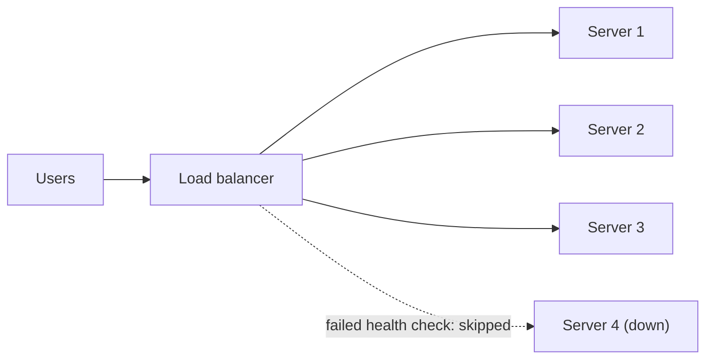

> [!crumbs] [[00 Start Here|🏠 Home]] › [[Part 1 System Design|Part 1]] › [[Scalability]] › [[Performance]] › Load Balancing

> [!tldr] In one sentence
> A load balancer sits in front of a group of servers and **spreads incoming requests across them**, skipping broken ones, so no single machine is overwhelmed.

## 🧠 Think of it like…

> [!analogy] The host at a busy restaurant
> Guests don't pick their own waiter. The host at the door seats each new party with whichever waiter has room. If a waiter goes home sick, the host stops seating people in that section.

The load balancer is the host. Guests are **requests** (each click or page load), and waiters are **servers** (the computers that do the work).

## What it is

A **load balancer** sits between users and a group of servers and spreads the traffic across them.[^1] Users connect to one address, and it passes each request to one of the servers behind it, called **backends** or **targets**.[^2]

It keeps checking each server's health and sends work only to healthy ones.[^2] Many load balancers are a **reverse proxy**: a server that accepts requests for other servers and forwards them. The web server **NGINX** is often used this way.[^3]

## Why it matters

- **Grow by adding machines.** When traffic grows, you add servers and the load balancer spreads the work.[^1] Growing sideways like this, rather than buying a bigger computer, is **horizontal scaling**.
- **Survive failures.** When a server dies, traffic flows to the others.[^1]
- **Update without downtime.** Before a server is removed, it gets no new requests and current ones can finish; AWS waits up to 300 seconds by default.[^4]

## How it works

Each request goes to a server picked by a simple rule:

- **Round robin.** Take turns: 1, 2, 3, then back to 1. It's the default in NGINX and Amazon's Application Load Balancer.[^3][^4]
- **Least busy.** Send it to the server with the fewest requests in progress, which helps when some requests take much longer.[^4]
- **Hashing.** Turn something about the request, such as the user's address, into a number that always points to the same server.[^3]

**Health checks**, test requests sent on a timer, spot broken servers. Amazon's load balancer asks every 30 seconds by default; two failures in a row take a server out, five successes bring it back.[^5]

Some load balancers read only network addresses, which is fast. Others read the request and can send all image requests to their own servers.[^1]

## A real-world example

Google's load balancer, **Maglev**, has handled Google's traffic since 2008, as software on ordinary Linux servers.[^6]

Hardware load balancers often come in pairs, one working and one idle as backup, wasting half the capacity. Every Maglev machine works at once; if one fails, the others carry its share.[^7] Google Cloud customers can jump from zero to a million requests per second with no warm-up.[^7]

## Myths and pitfalls

- **❌ Myth:** A load balancer makes your app unbreakable. **✅ Reality:** It is a machine too. That's why large systems run many load balancers side by side, all active.[^7]
- **❌ Myth:** A server that answers health checks is fine. **✅ Reality:** A server can pass the check yet show users error pages, and because errors are fast, it may even attract more traffic.[^8]
- **❌ Myth:** If every server fails its check, the load balancer sends nothing. **✅ Reality:** Many send traffic to all of them (**failing open**), since a check failing everywhere often means the check itself, or something shared, is broken.[^5][^8]

## Check yourself

> [!question]- What does a load balancer do when one of its servers crashes?
> Health checks notice the server stopped answering, so it stops sending requests there and the others take the traffic.

> [!question]- Why is adding more servers behind a load balancer called horizontal scaling?
> You grow sideways, adding more machines, instead of upward, replacing one machine with a bigger one.

> [!question]- Some requests take 10 milliseconds and others 10 seconds. Which rule is better, round robin or least busy?
> Least busy. Round robin may keep feeding a server stuck on slow requests; least busy sends work where there is room.

## Key terms

- **Load balancer** — a traffic director that spreads requests across a group of servers.
- **Backend (target)** — a server behind the load balancer that does the work.
- **Round robin** — taking turns, one server after another.
- **Health check** — a test request that shows whether a server is working.
- **Horizontal scaling** — handling more traffic by adding more machines.
- **Reverse proxy** — a server that receives requests for other servers and passes them on.

> [!deepdive] Ready for the technical take?
> Layer 4 versus layer 7, "power of two choices", consistent hashing, health-check traps and how Maglev works.
> → [[Load Balancing (Deep Dive)]]

## Related

- [[Caching]] — the other half of handling heavy traffic.
- [[CDN]] — spreads users across the planet first.
- [[Microservices]] — each service sits behind a load balancer.
- [[Fault Tolerance]] — health checks route around failures.
- [[Sharding]] — hashing that routes data, not just requests.
- [[Deployment & Serving]] — AI models run as many copies behind one.

> [!nav] Keep going
> ← [[CDN]] · [[Performance|⚡ Performance]] · [[Message Queues]] →
> 🔬 Technical take: [[Load Balancing (Deep Dive)]] · 🗺️ [[Glossary]]

## 📚 Sources

[^1]: 📄 [Load Balancer](https://www.f5.com/glossary/load-balancer) — F5 Glossary. Official docs. Checked 2026-11.
[^2]: 📄 [How Elastic Load Balancing works](https://docs.aws.amazon.com/elasticloadbalancing/latest/userguide/how-elastic-load-balancing-works.html) — Elastic Load Balancing User Guide. Official docs. Checked 2026-11.
[^3]: 📄 [HTTP Load Balancing](https://docs.nginx.com/nginx/admin-guide/load-balancer/http-load-balancer/) — NGINX Documentation. Official docs. Checked 2026-11.
[^4]: 📄 [Edit target group attributes for your Application Load Balancer](https://docs.aws.amazon.com/elasticloadbalancing/latest/application/edit-target-group-attributes.html) — Elastic Load Balancing, Application Load Balancers guide. Official docs. Checked 2026-11.
[^5]: 📄 [Health checks for Application Load Balancer target groups](https://docs.aws.amazon.com/elasticloadbalancing/latest/application/target-group-health-checks.html) — Elastic Load Balancing, Application Load Balancers guide. Official docs. Checked 2026-11.
[^6]: 🔬 [Maglev: A Fast and Reliable Software Network Load Balancer](https://www.usenix.org/conference/nsdi16/technical-sessions/presentation/eisenbud) — Eisenbud et al., USENIX NSDI 2016. Paper. Checked 2026-11.
[^7]: 📝 [Google shares software network load balancer design powering GCP networking](https://cloud.google.com/blog/products/gcp/google-shares-software-network-load-balancer-design-powering-gcp-networking/) — Google Cloud Blog, March 2016. Engineering blog. Checked 2026-11.
[^8]: 📝 [Implementing health checks](https://builder.aws.com/content/3Ev53O39izHCtWLzp4XU6t8PC1O/implementing-health-checks) — Amazon Builders' Library. Article. Checked 2026-11.
