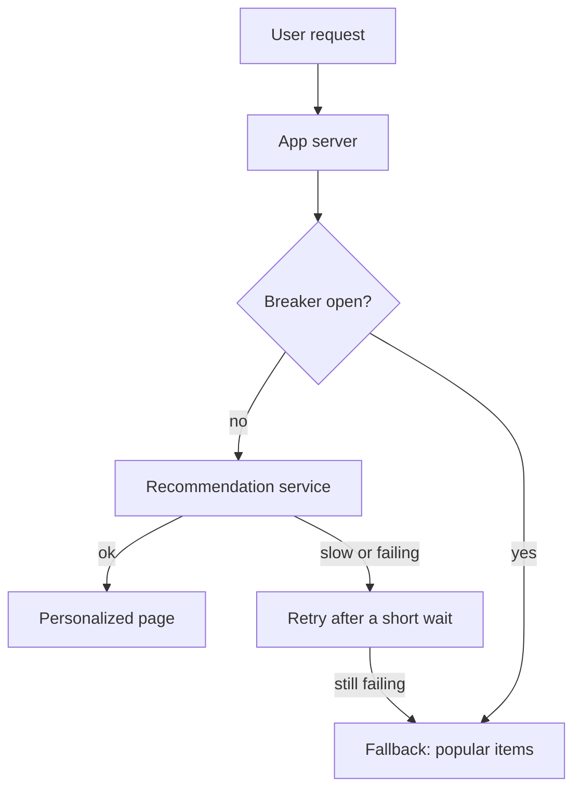

> [!crumbs] [[00 Start Here|🏠 Home]] › [[Part 1 System Design|Part 1]] › [[Scalability]] › [[Reliability]] › Fault Tolerance

> [!tldr] In one sentence
> Fault tolerance means designing a system so that when a part breaks, and parts always break, **users barely notice**.

## 🧠 Think of it like…

> [!analogy] A hospital during a power cut
> The lights flicker, then a backup generator takes over. Surgery carries on. The gift shop's music goes quiet, because the generator powers what matters most first.

The generator is **redundancy**, a spare ready to take over. Switching off the gift shop is **graceful degradation**: dropping extras so the core keeps working. A fault-tolerant system plans for both before anything breaks.

## What it is

A large online service runs on thousands of machines. At that size, something is always broken somewhere.

A **fault** is one part going wrong: a crashed server, a slow database. A **failure** is when users feel it. Fault tolerance is the set of habits that stop faults from turning into failures.

## Why it matters

- **Downtime is measured in "nines".** A target of 99.99% availability allows about 52 minutes of downtime a year.[^1]
- **Perfection is not the goal.** Each extra nine may cost 100 times more than the last, so teams choose a target instead of chasing 100%.[^1]
- **Problems spread.** When one server falls over, its traffic lands on the others, which can then fall over too. This domino effect is a **cascading failure**.[^2]

## How it works

Four everyday tools do most of the work:

1. **Redundancy.** Keep spares. Amazon runs many services in three separate zones, with enough extra capacity to lose a whole zone.[^3]
2. **Timeouts and retries.** Never wait forever. Give up after a set time, then try again, waiting a little longer each time. A random wiggle, called **jitter**, stops thousands of clients retrying at the same instant.[^4]
3. **Circuit breakers.** After too many failures, stop calling the broken service for a while and fail fast instead. Later, let one test call through to see if it has recovered.[^5]
4. **Graceful degradation.** Keep the core job running when an extra breaks. A shop should still show products and the checkout even if its recommendations are down.[^6]

Retries need care. A retry is only safe if doing the action twice is harmless, which engineers call **idempotent**. Retrying a payment that went through could charge you twice.[^4]

## A real-world example

Netflix built **Chaos Monkey**, a tool that randomly shuts down servers in its live production system. The point is to force engineers to build services that survive losing a server at any moment.[^7] Netflix also built Hystrix, a library to stop cascading failures with fallbacks and graceful degradation.[^8]

## Myths and pitfalls

- **❌ Myth:** The goal is 100% uptime. **✅ Reality:** Google's reliability engineers say 100% is probably never the right target. It is impossible, and users can't tell the difference.[^1]
- **❌ Myth:** Retrying always helps. **✅ Reality:** Retries add load to a system that is already struggling. If five layers each retry three times, the database can get 243 times the load.[^4]
- **❌ Myth:** Having a backup means you're safe. **✅ Reality:** Only if it has enough capacity ready and you have tested the switch. Amazon provisions spare capacity in advance for this reason.[^3]
- **❌ Myth:** Faults are mostly broken hardware. **✅ Reality:** Overload is the most common cause of cascading failures.[^2]

## Check yourself

> [!question]- What is the difference between a fault and a failure?
> A fault is one part going wrong. A failure is when users notice. Fault tolerance stops the first from becoming the second.

> [!question]- Why add random jitter to retries?
> Without it, clients that failed together retry together, hitting the recovering service with a new wave.

> [!question]- What does a circuit breaker do when it is "open"?
> It stops sending calls to the failing service and returns an error or fallback right away, giving that service room to recover.

## Key terms

- **Redundancy** — spare copies ready to take over when one breaks.
- **Availability** — the share of time or requests a system works, often written in "nines".
- **Timeout** — the longest you will wait for an answer before giving up.
- **Retry with backoff** — trying again, waiting longer after each failure.
- **Circuit breaker** — a switch that stops calls to a service that keeps failing.
- **Graceful degradation** — dropping extras so the core keeps working.
- **Cascading failure** — one failure overloading others, like dominoes.

> [!deepdive] Ready for the technical take?
> Retry budgets, backoff with jitter, circuit breaker states, bulkheads and static stability.
> → [[Fault Tolerance (Deep Dive)]]

## Related

- [[Load Balancing]] — sends traffic away from servers that have died.
- [[Replication]] — keeps spare copies of your data.
- [[Message Queues]] — hold work safely while a part is down.
- [[Rate Limiting]] — protects a service from the overload that starts cascades.
- [[AI Reliability & Fault Tolerance]] — the same ideas applied to AI models and their providers.

> [!nav] Keep going
> ← [[Message Queues]] · [[Reliability|🛡️ Reliability]] · [[Rate Limiting]] →
> 🔬 Technical take: [[Fault Tolerance (Deep Dive)]] · 🗺️ [[Glossary]]

## 📚 Sources

[^1]: 📘 [Embracing Risk](https://sre.google/sre-book/embracing-risk/) — Site Reliability Engineering, Google (O'Reilly). Book chapter. Checked 2026-11.
[^2]: 📘 [Addressing Cascading Failures](https://sre.google/sre-book/addressing-cascading-failures/) — Site Reliability Engineering, Google (O'Reilly). Book chapter. Checked 2026-11.
[^3]: 📝 [Static stability using Availability Zones](https://builder.aws.com/content/3K9SiqiJ369TGkkGzqPM95BuYWI/static-stability-using-availability-zones) — Mike Furr, Amazon Builders' Library, 2019. Engineering blog. Checked 2026-11.
[^4]: 📝 [Timeouts, retries, and backoff with jitter](https://builder.aws.com/content/3EumjoZascWd1oZiEgL8ORlv3qE/timeouts-retries-and-backoff-with-jitter) — Marc Brooker, Amazon Builders' Library, 2019. Engineering blog. Checked 2026-11.
[^5]: 📝 [CircuitBreaker](https://martinfowler.com/bliki/CircuitBreaker.html) — Martin Fowler, 2014. Article. Checked 2026-11.
[^6]: 📄 [REL05-BP01 Implement graceful degradation](https://docs.aws.amazon.com/wellarchitected/latest/reliability-pillar/rel_mitigate_interaction_failure_graceful_degradation.html) — AWS Well-Architected Framework, Reliability Pillar. Official docs. Checked 2026-11.
[^7]: 📄 [Chaos Monkey](https://netflix.github.io/chaosmonkey/) — Netflix. Official docs. Checked 2026-11.
[^8]: 📄 [Hystrix README](https://github.com/Netflix/Hystrix) — Netflix, GitHub. Official docs. Checked 2026-11.
