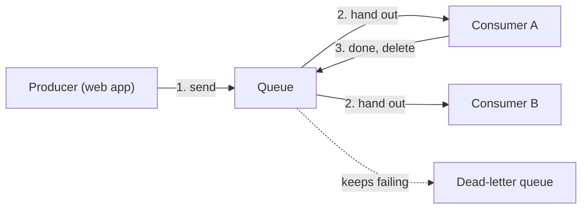

> [!crumbs] [[00 Start Here|🏠 Home]] › [[Part 1 System Design|Part 1]] › [[Scalability]] › [[Reliability]] › Message Queues

> [!tldr] In one sentence
> A message queue is a waiting line for work: one part of a system **drops off a task and moves on**, and another part picks it up when it is ready.

## 🧠 Think of it like…

> [!analogy] The order rail in a restaurant kitchen
> A waiter clips an order ticket to the rail and goes straight back to the tables. The cooks pull tickets off the rail one at a time, as fast as they can cook.

The waiter is the **producer**, the part that creates work. The cooks are **consumers**, the parts that do it. The rail is the queue. A rush of orders just makes the rail longer; nobody stands around waiting.

## What it is

A **message queue** is a buffer that holds small messages between two pieces of software, such as "resize this photo". A message stays in the queue until a consumer handles it and deletes it.[^1]

The software that runs queues is a **message broker**. Well-known ones are Amazon SQS, RabbitMQ and Apache Kafka.

Queues come in two main flavors:

- **Point-to-point:** each message goes to exactly one consumer, like a ticket taken by one cook.[^1]
- **Publish/subscribe (pub/sub):** each message reaches every interested reader, like a notice pinned up for the whole staff.[^1]

## Why it matters

- **Nobody waits.** Your photo upload finishes right away while resizing happens in the background.[^2]
- **Spikes get smoothed out.** A burst of orders becomes a longer line, not an outage.[^1]
- **Failures stay contained.** If a consumer crashes mid-task, the message goes back in line for another try.[^3]
- **Easy to scale.** Add more consumers and the line shrinks faster.[^2]

## How it works

1. **Send.** The broker keeps copies on several machines, so one server failing does not lose the message.[^2][^4]
2. **Hand out.** In Amazon SQS, a message being worked on is hidden from other consumers, 30 seconds by default. This is the **visibility timeout**.[^3]
3. **Delete.** When the job is done, the consumer deletes the message. If it crashes first, the message reappears for someone else.[^3]
4. **Give up safely.** A message that keeps failing moves to a **dead-letter queue**, a side queue engineers can inspect.[^5]

One catch: retries mean a message can occasionally arrive twice. So a consumer should be **idempotent**: doing a job twice has the same effect as doing it once.[^2]

Kafka is a little different. It keeps a **log** of events for a set time even after they are read, so many readers can each go at their own speed.[^4]

## A real-world example

LinkedIn uses Kafka as the main pipeline that moves data between its systems. In 2015 it carried **more than 1 trillion messages a day**, peaking at 4.5 million per second, and each message was read by about four applications.[^6] LinkedIn's Kafka team now lists over 7 trillion messages a day.[^7]

## Myths and pitfalls

- **❌ Myth:** A queue makes the work itself faster. **✅ Reality:** It makes the sender faster. If consumers stay slower than producers, the line grows without end.
- **❌ Myth:** Every message is delivered exactly once. **✅ Reality:** Many queues promise "at least once", so duplicates happen and your code must cope.[^2]
- **❌ Myth:** Once a consumer reads a message, it is gone. **✅ Reality:** In SQS it is only hidden until deleted.[^3] In Kafka it stays until its retention period ends.[^4]
- **❌ Myth:** Queues always keep messages in order. **✅ Reality:** SQS standard queues only try their best; strict order needs a FIFO (first in, first out) queue.[^2]

## Check yourself

> [!question]- Why does a queue let a website respond faster?
> Dropping a message in the queue is quick. The slow work happens later in a separate consumer.

> [!question]- A consumer crashes halfway through a message. What happens to that message?
> It was never deleted, so when its visibility timeout runs out it reappears and another consumer retries it.

> [!question]- Why should a consumer be idempotent?
> Queues can deliver a message more than once. If a repeat changes nothing, duplicates are harmless: no double charge.

## Key terms

- **Message queue** — a buffer that holds tasks until a worker is ready for them.
- **Producer / consumer** — the part that sends messages and the part that processes them.
- **Pub/sub** — a pattern where one message is delivered to every subscriber.
- **Visibility timeout** — how long a received message stays hidden from other consumers.
- **Dead-letter queue** — a side queue for messages that keep failing.
- **Idempotent** — safe to do twice; repeating it changes nothing extra.

> [!deepdive] Ready for the technical take?
> Work queues vs. logs, Kafka consumer groups, delivery guarantees, dead-letter queues and backlogs.
> → [[Message Queues (Deep Dive)]]

## Related

- [[Microservices]] — queues let services talk without waiting on each other.
- [[Fault Tolerance]] — queues keep work safe while a part is down.
- [[Rate Limiting]] — another shield against traffic spikes.
- [[Data Engineering & Pipelines]] — event streams like Kafka feed AI data pipelines.

> [!nav] Keep going
> ← [[Load Balancing]] · [[Reliability|🛡️ Reliability]] · [[Fault Tolerance]] →
> 🔬 Technical take: [[Message Queues (Deep Dive)]] · 🗺️ [[Glossary]]

## 📚 Sources

[^1]: 📄 [What is a Message Queue?](https://aws.amazon.com/message-queue/) — Amazon Web Services. Official docs. Checked 2026-11.
[^2]: 📄 [Amazon SQS queue types](https://docs.aws.amazon.com/AWSSimpleQueueService/latest/SQSDeveloperGuide/sqs-queue-types.html) — Amazon SQS Developer Guide. Official docs. Checked 2026-11.
[^3]: 📄 [Amazon SQS visibility timeout](https://docs.aws.amazon.com/AWSSimpleQueueService/latest/SQSDeveloperGuide/sqs-visibility-timeout.html) — Amazon SQS Developer Guide. Official docs. Checked 2026-11.
[^4]: 📄 [Introduction](https://kafka.apache.org/intro) — Apache Kafka documentation. Official docs. Checked 2026-11.
[^5]: 📄 [Using dead-letter queues in Amazon SQS](https://docs.aws.amazon.com/AWSSimpleQueueService/latest/SQSDeveloperGuide/sqs-dead-letter-queues.html) — Amazon SQS Developer Guide. Official docs. Checked 2026-11.
[^6]: 📝 [How We're Improving and Advancing Kafka at LinkedIn](https://engineering.linkedin.com/apache-kafka/how-we_re-improving-and-advancing-kafka-linkedin) — Kartik Paramasivam, LinkedIn Engineering, 2015. Engineering blog. Checked 2026-11.
[^7]: 📝 [Kafka](https://engineering.linkedin.com/teams/data/data-infrastructure/streams/kafka) — LinkedIn Engineering, Data Infrastructure team page. Engineering blog. Checked 2026-11.
