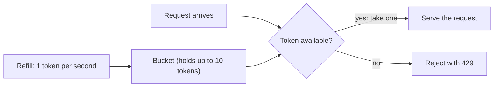

> [!crumbs] [[00 Start Here|🏠 Home]] › [[Part 1 System Design|Part 1]] › [[Scalability]] › [[Reliability]] › Rate Limiting

> [!tldr] In one sentence
> Rate limiting caps how many requests someone can send in a given time, so **one heavy user can't crowd out everyone else** or knock the service over.

## 🧠 Think of it like…

> [!analogy] A bouncer at a busy club
> The bouncer lets people in at a steady pace. A small group can walk straight in, but if a crowd shows up at once, most of them wait outside. The club never gets dangerously packed.

Each guest is a **request**, one call to a service. The bouncer is the **rate limiter**, and "please wait outside" is its polite rejection.

## What it is

A **rate limit** is a rule such as "100 requests per minute per user". The service counts each caller's requests, telling callers apart by account or internet address.

When a caller goes over the limit, the service answers with the standard error **429 Too Many Requests**. It may add a **Retry-After** note saying how long to wait.[^1]

A **quota** is the same idea over a longer stretch, like a monthly allowance. GitHub's public API (the doorway other programs use to talk to it), for example, allows 60 requests an hour to anonymous callers and 5,000 an hour to signed-in users.[^2]

## Why it matters

- **Fairness.** One runaway script can't hog a shared service.[^3]
- **Protection.** Limits stop overload, abuse and password-guessing before they reach the expensive parts of a system.[^4]
- **Predictability.** Developers know how hard they can push. GitHub reports your remaining requests on every response.[^2]

## How it works

The most popular method is the **token bucket**.

1. Each caller gets a bucket holding a limited number of tokens.
2. Tokens drip in at a steady rate; extras spill over when it is full.
3. Every request takes one token. No token, no service.[^4]

Because the bucket starts full, a caller can make a quick **burst** of requests. Over time, though, they can't go faster than the refill rate.[^4] Stripe and Amazon's API Gateway both use this method.[^3][^5]

Other methods trade simplicity against accuracy:[^4]

- **Fixed window:** count requests per clock minute. Simple, but allows double bursts around the boundary.
- **Sliding window:** count the last 60 seconds from right now. Smoother.
- **Leaky bucket:** requests drain out at a fixed pace. No bursts at all.

## A real-world example

The payments company **Stripe** runs four kinds of limiters on its API.[^3] The first caps each user's requests per second; in one month it rejected millions of requests, often from buggy test scripts.[^3]

A second caps how many requests one user can have in progress at once, for example 20. The other two kick in during overload, turning away less important requests to keep capacity for critical work like creating a payment.[^3]

## Myths and pitfalls

- **❌ Myth:** Rate limiting is mainly about stopping hackers. **✅ Reality:** Stripe found it often catches honest mistakes, like buggy scripts.[^3]
- **❌ Myth:** If you get a 429, try again right away. **✅ Reality:** Wait as told. GitHub warns that ignoring its limits can get your app banned.[^2]
- **❌ Myth:** Limits are exact. **✅ Reality:** Amazon calls its API limits best-effort targets, not hard ceilings.[^5]
- **❌ Myth:** If the rate limiter breaks, block everything to be safe. **✅ Reality:** Stripe lets traffic through when its limiter fails, so a limiter bug can't take down the whole API.[^3]

## Check yourself

> [!question]- What does a 429 status mean?
> The caller sent too many requests in a given time and should retry later, after any Retry-After time.

> [!question]- Why does a token bucket allow short bursts?
> Unused tokens pile up to the bucket's size, so a quiet caller can spend several at once. The refill rate caps the average.

> [!question]- Why might a limit count requests in progress instead of requests per second?
> Some requests are slow and heavy. Capping how many run at once protects servers even from callers who send only a few.

## Key terms

- **Rate limit** — the most requests a caller may make in a period of time.
- **Throttling** — slowing or rejecting requests once a limit is reached.
- **Quota** — a usage allowance over a longer period, like a day or a month.
- **429 Too Many Requests** — the standard web error for "slow down".
- **Token bucket** — a limiter that spends tokens per request and refills them steadily.
- **Leaky bucket** — a limiter that lets requests out at a fixed, steady pace.
- **Burst** — a short spike of requests sent close together.

> [!deepdive] Ready for the technical take?
> Five algorithms compared, distributed counters, Cloudflare's approximation, load shedding and headers.
> → [[Rate Limiting (Deep Dive)]]

## Related

- [[API Design]] — limits and their headers are part of an API's contract.
- [[Fault Tolerance]] — limiting stops the overload that starts cascading failures.
- [[Authentication]] — knowing who is calling lets you limit each user fairly.
- [[LLM Inference & Optimization]] — AI model APIs ration scarce capacity the same way.

> [!nav] Keep going
> ← [[Fault Tolerance]] · [[Reliability|🛡️ Reliability]] · [[Authentication]] →
> 🔬 Technical take: [[Rate Limiting (Deep Dive)]] · 🗺️ [[Glossary]]

## 📚 Sources

[^1]: 📄 [RFC 6585: Additional HTTP Status Codes](https://www.rfc-editor.org/rfc/rfc6585.html) — Nottingham & Fielding, IETF, 2012. Standard. Checked 2026-11.
[^2]: 📄 [Rate limits for the REST API](https://docs.github.com/en/rest/using-the-rest-api/rate-limits-for-the-rest-api) — GitHub Docs. Official docs. Checked 2026-11.
[^3]: 📝 [Scaling your API with rate limiters](https://stripe.com/blog/rate-limiters) — Paul Tarjan, Stripe Engineering, 2017. Engineering blog. Checked 2026-11.
[^4]: 📄 [Build 5 Rate Limiters with Redis](https://redis.io/tutorials/howtos/ratelimiting/) — William Johnston, Redis, 2026. Official docs. Checked 2026-11.
[^5]: 📄 [Throttle requests to your REST APIs for better throughput in API Gateway](https://docs.aws.amazon.com/apigateway/latest/developerguide/api-gateway-request-throttling.html) — Amazon API Gateway Developer Guide. Official docs. Checked 2026-11.
