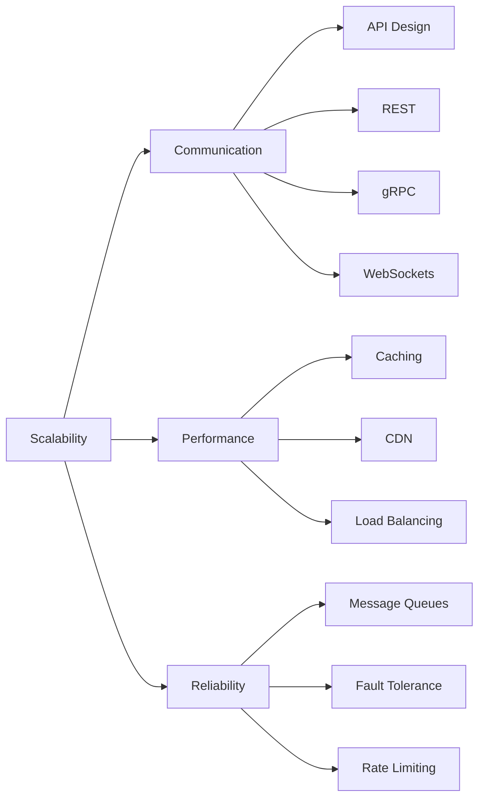

> [!crumbs] [[00 Start Here|🏠 Home]] › [[Part 1 System Design|Part 1]] › Scalability

> [!hub] 📈 Scalability
> How systems talk, stay fast, and keep working as traffic grows.

## Topics

### 💬 [[Communication]]
How the parts of a system, and its users, talk to each other.

| Topic | In one line | Technical take |
| --- | --- | --- |
| [[API Design]] | Designing the contract other programs use to talk to yours. | [[API Design (Deep Dive)\|🔬 Deep dive]] |
| [[REST]] | The web's most common API style: resources over plain HTTP. | [[REST (Deep Dive)\|🔬 Deep dive]] |
| [[gRPC]] | Fast, typed calls between services using compact binary messages. | [[gRPC (Deep Dive)\|🔬 Deep dive]] |
| [[WebSockets]] | A connection that stays open so the server can push updates instantly. | [[WebSockets (Deep Dive)\|🔬 Deep dive]] |

### ⚡ [[Performance]]
Making systems fast by doing less work and doing it closer to the user.

| Topic | In one line | Technical take |
| --- | --- | --- |
| [[Caching]] | Keeping a copy of frequently used data somewhere faster. | [[Caching (Deep Dive)\|🔬 Deep dive]] |
| [[CDN]] | Servers around the world that hand out content close to each user. | [[CDN (Deep Dive)\|🔬 Deep dive]] |
| [[Load Balancing]] | Spreading incoming work across many servers so none is overwhelmed. | [[Load Balancing (Deep Dive)\|🔬 Deep dive]] |

### 🛡️ [[Reliability]]
Keeping the system working when parts of it fail or traffic spikes.

| Topic | In one line | Technical take |
| --- | --- | --- |
| [[Message Queues]] | Buffers that let parts of a system hand off work without waiting. | [[Message Queues (Deep Dive)\|🔬 Deep dive]] |
| [[Fault Tolerance]] | Designing so that when something breaks, the system keeps going. | [[Fault Tolerance (Deep Dive)\|🔬 Deep dive]] |
| [[Rate Limiting]] | Capping how often someone can call you, to stay fair and safe. | [[Rate Limiting (Deep Dive)\|🔬 Deep dive]] |

## The shape of it

> [!tip] How to read these
> Every topic has a **🌱 basics** note (no jargon, about 5 minutes) and a **🔬 deep dive** (the technical take). Start with the basics; open the deep dive when you want more.
