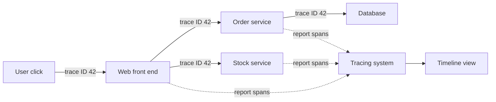

> [!crumbs] [[00 Start Here|🏠 Home]] › [[Part 1 System Design|Part 1]] › [[Production]] › [[Observability]] › Distributed Tracing

> [!tldr] In one sentence
> Distributed tracing **follows a single request as it hops from service to service**, so you can see exactly where it went and where the time was spent.

## 🧠 Think of it like…

> [!analogy] A parcel tracking number
> A parcel gets one tracking number. Every depot scans it on the way. Later you see the whole journey, and which depot sat on it for two days.

A trace is that tracking history for a web request. The tracking number is the **trace ID**. Each depot scan is a **span**: one step of work, with a start time and an end time.

## What it is

Big apps are often split into many small programs called **services** that call each other. One click might touch a dozen of them.

A **trace** records the path one request takes through all those services.[^1] It is made of **spans**, where each span is a single unit of work, such as one call to a database.[^1] Spans nest: the first span covers the whole request, and its "child" spans cover the smaller steps inside it.[^1]

Google described this idea at scale in 2010 with Dapper, its in-house tracing system.[^2] Today the common open standard is **OpenTelemetry**, an open-source toolkit for producing traces, metrics and logs.[^3]

## Why it matters

- **Finding the slow step.** A page takes three seconds; the trace shows most of that was one slow service.
- **Seeing across teams.** Each service may be built by a different team. One engineer rarely knows them all, and the trace shows the full path anyway.[^2]
- **Filling the gaps.** **Metrics** (numbers over time) and **logs** (written records of events) are often blind to what happens *across* services; traces connect them.[^4][^5]

## How it works

1. **Give the request an ID.** A new request gets a unique **trace ID**.
2. **Pass the ID along.** Every time one service calls another, it attaches the ID to the call, usually in a standard web header.[^6] This handing-on is called **context propagation**.[^1]
3. **Record spans.** Each service notes when its step started and ended, and reports it to a tracing system.[^1]
4. **Rebuild the story.** The tracing system groups spans by trace ID and draws them as a timeline.

Recording every request would cost too much, so most systems keep only a **sample**, such as one request in a hundred, or even fewer.[^7] Busy services still yield plenty of examples.[^2]

## A real-world example

Uber grew from about 500 services in 2015 to over 2,000 by early 2017.[^5] Logs and metrics no longer showed what happened between services.[^5] So they built **Jaeger**, a tracing system that was soon recording **thousands of traces every second**.[^5] Uber made it open source in 2017, and it later graduated as a top-level project of the Cloud Native Computing Foundation.[^5]

## Myths and pitfalls

- **❌ Myth:** Tracing replaces logs and metrics. **✅ Reality:** Metrics say something is wrong; traces show where; logs give details.[^4]
- **❌ Myth:** You must trace every single request. **✅ Reality:** For busy systems, sampling about 1% or less is usually representative.[^7]
- **❌ Myth:** Tracing slows everything down. **✅ Reality:** Google measured almost no effect on latency when sampling one request in 1,024.[^2]
- **❌ Myth:** It just works once installed. **✅ Reality:** If one service fails to pass the trace ID along, the trace breaks into pieces.[^1]

## Check yourself

> [!question]- What is the difference between a trace and a span?
> A trace is the whole journey of one request. A span is one step inside that journey, with its own start and end time.

> [!question]- Why must each service pass the trace ID to the next one?
> The ID lets the tracing system stitch spans from different services into one story. Without it, spans stand alone.

> [!question]- Why do most systems sample only some requests?
> Recording every request costs storage and computing power. A small sample of a busy system still shows the patterns.

## Key terms

- **Trace** — the full record of one request's path through a system.
- **Span** — one timed step of work inside a trace.
- **Trace ID** — the unique label shared by every span in one trace.
- **Context propagation** — passing the trace ID from service to service.
- **Sampling** — keeping only some traces to control cost.
- **OpenTelemetry** — an open standard and toolkit for traces, metrics and logs.
- **Jaeger** — an open-source tracing system first built at Uber.

> [!deepdive] Ready for the technical take?
> Span anatomy, the W3C `traceparent` header, head vs. tail sampling, Dapper's overhead numbers and Jaeger's architecture.
> → [[Distributed Tracing (Deep Dive)]]

## Related

- [[Microservices]] — the architecture that makes tracing necessary.
- [[Logging]] — log lines carry the trace ID to link back to a request.
- [[Metrics]] — tell you something is slow; traces tell you where.
- [[gRPC]] — service-to-service calls that carry trace context.
- [[AI Agents & Tool Use]] — agent runs are traced step by step, tool call by tool call.

> [!nav] Keep going
> ← [[Metrics]] · [[Observability|🔭 Observability]] · [[High-Level Design]] →
> 🔬 Technical take: [[Distributed Tracing (Deep Dive)]] · 🗺️ [[Glossary]]

## 📚 Sources

[^1]: 📄 [Traces](https://opentelemetry.io/docs/concepts/signals/traces/) — OpenTelemetry documentation. Official docs. Checked 2026-11.
[^2]: 🔬 [Dapper, a Large-Scale Distributed Systems Tracing Infrastructure](https://static.googleusercontent.com/media/research.google.com/en//archive/papers/dapper-2010-1.pdf) — Sigelman et al., Google Technical Report, 2010. Paper. Checked 2026-11.
[^3]: 📄 [What is OpenTelemetry?](https://opentelemetry.io/docs/what-is-opentelemetry/) — OpenTelemetry documentation. Official docs. Checked 2026-11.
[^4]: 📄 [Observability primer](https://opentelemetry.io/docs/concepts/observability-primer/) — OpenTelemetry documentation. Official docs. Checked 2026-11.
[^5]: 📝 [Evolving Distributed Tracing at Uber Engineering](https://www.uber.com/blog/distributed-tracing/) — Uber Engineering, 2017. Engineering blog. Checked 2026-11.
[^6]: 📄 [Trace Context](https://www.w3.org/TR/trace-context/) — W3C Recommendation, 2021. Standard. Checked 2026-11.
[^7]: 📄 [Sampling](https://opentelemetry.io/docs/concepts/sampling/) — OpenTelemetry documentation. Official docs. Checked 2026-11.
