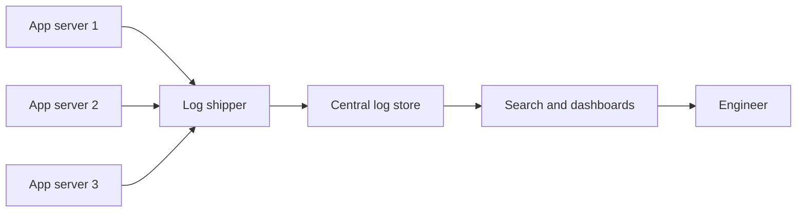

> [!crumbs] [[00 Start Here|🏠 Home]] › [[Part 1 System Design|Part 1]] › [[Production]] › [[Observability]] › Logging

> [!tldr] In one sentence
> Logging means having your software **write down what happened, one event at a time**, so people can look back later and work out what went wrong.

## 🧠 Think of it like…

> [!analogy] A ship's logbook
> Every few hours, the crew writes a line: the time, the position, the weather, anything unusual. If the ship runs aground, the logbook tells how it got there.

A log is the logbook for software. Each line records **one event**, like a failed payment. When something breaks, engineers read it to replay what happened.

## What it is

A **log** is a timestamped message that a program writes as it runs.[^1] Put many of them together and you get a **stream of events in time order**, with no fixed end, as long as the program keeps running.[^2]

A typical log line holds a time, a **severity level** (how serious it is, like INFO, WARNING or ERROR) and a short message.[^1] Some logs are free text. Others are **structured logs**: each line is written as labeled fields, often in JSON (a simple text format for labeled data), so a computer can search by field.[^3]

## Why it matters

- **Finding the cause.** When an order vanishes, a log can show the exact error at the exact second.[^2]
- **Spotting trends.** Counting log lines over time shows trends like requests per minute.[^2]
- **Raising the alarm.** Teams can set alerts that fire when, say, errors pass a threshold.[^2]
- **Security trail.** Logs record sign-ins, failed logins and admin actions, which helps spot attacks.[^4]

## How it works

Modern apps run on many machines at once, so teams use **log aggregation**: gathering every machine's logs into one searchable place.

1. **The app writes events.** It simply prints each event, one per line, and lets the platform decide where logs go.[^2]
2. **A shipper collects them.** The platform captures each machine's stream, merges them and forwards them on.[^2]
3. **A store indexes them.** A central system files every line so it can be found fast, much like a book's index.
4. **People search.** Engineers ask for things like "all errors for order 123 in the last hour."

A popular version of this pipeline is the **ELK stack**: **E**lasticsearch stores and searches the data,[^5] **L**ogstash collects and reshapes it,[^6] and **K**ibana draws the charts and dashboards.[^5]

## A real-world example

Uber adopted the ELK stack for logging in 2014.[^7] By 2021 it was ingesting **millions of log lines per second** from thousands of services.[^7] At that size ELK struggled: it dropped logs whose fields clashed in type, and some queries timed out.[^7] Uber rebuilt the store on ClickHouse, an open-source database built for fast analysis, and **cut hardware cost by more than half**.[^7]

## Myths and pitfalls

- **❌ Myth:** Log everything, just in case. **✅ Reality:** Logs cost money to ship and store. Uber found that only about 5% of the fields it indexed were ever searched.[^7]
- **❌ Myth:** Logs are private, so anything can go in them. **✅ Reality:** Passwords, access tokens, card numbers and personal data should never be written to logs.[^4]
- **❌ Myth:** Free-text messages are good enough. **✅ Reality:** Unstructured text can only be searched as a string; structured fields can be filtered and indexed one by one.[^3]
- **❌ Myth:** Logs alone explain everything. **✅ Reality:** A single line often lacks context about which request it belonged to. Linking it to a trace fixes that.[^1]

## Check yourself

> [!question]- What is the difference between a plain log and a structured log?
> A plain log is free text for humans. A structured log stores labeled fields (like user and order), so tools can filter and count by field.

> [!question]- Why do teams gather logs into one central place?
> The app runs on many machines. Searching one place beats opening files on every machine.

> [!question]- Should a login system log the user's password when sign-in fails?
> No. Log that the attempt failed, when and from where, but never the password.

## Key terms

- **Log** — a timestamped record of one event in a program.
- **Severity level** — a label for how serious an event is, such as INFO or ERROR.
- **Structured log** — a log written as labeled fields, often JSON, so machines can query it.
- **Log aggregation** — collecting logs from many machines into one searchable place.
- **ELK stack** — Elasticsearch, Logstash and Kibana, a popular open-source logging toolkit.

> [!deepdive] Ready for the technical take?
> Structured log schemas, the OpenTelemetry log model, pipeline design, sampling and cost control, and how Uber outgrew ELK.
> → [[Logging (Deep Dive)]]

## Related

- [[Metrics]] — numbers over time; logs explain the "why" behind a spike.
- [[Distributed Tracing]] — ties log lines to the request that caused them.
- [[Microservices]] — many small services make central logging a must.
- [[Security]] — logs are the audit trail when something suspicious happens.
- [[AI Monitoring & Observability]] — AI systems log prompts, answers and model behavior.

> [!nav] Keep going
> ← [[Encryption]] · [[Observability|🔭 Observability]] · [[Metrics]] →
> 🔬 Technical take: [[Logging (Deep Dive)]] · 🗺️ [[Glossary]]

## 📚 Sources

[^1]: 📄 [Observability primer](https://opentelemetry.io/docs/concepts/observability-primer/) — OpenTelemetry documentation. Official docs. Checked 2026-11.
[^2]: 📝 [XI. Logs](https://12factor.net/logs) — The Twelve-Factor App. Article. Checked 2026-11.
[^3]: 📄 [Structured logging](https://docs.cloud.google.com/logging/docs/structured-logging) — Google Cloud Logging documentation. Official docs. Checked 2026-11.
[^4]: 📄 [Logging Cheat Sheet](https://cheatsheetseries.owasp.org/cheatsheets/Logging_Cheat_Sheet.html) — OWASP Cheat Sheet Series. Official docs. Checked 2026-11.
[^5]: 📄 [The Elastic Stack](https://www.elastic.co/elastic-stack) — Elastic. Official docs. Checked 2026-11.
[^6]: 📄 [Logstash](https://www.elastic.co/docs/reference/logstash) — Elastic documentation. Official docs. Checked 2026-11.
[^7]: 📝 [Fast and Reliable Schema-Agnostic Log Analytics Platform](https://www.uber.com/blog/logging/) — Uber Engineering, 2021. Engineering blog. Checked 2026-11.
