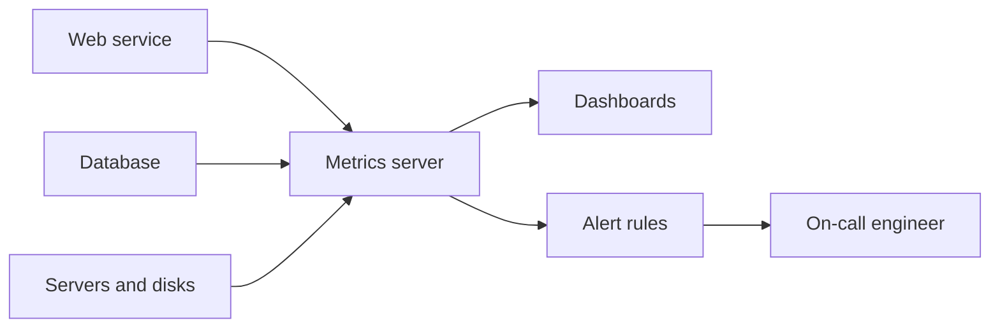

> [!crumbs] [[00 Start Here|🏠 Home]] › [[Part 1 System Design|Part 1]] › [[Production]] › [[Observability]] › Metrics

> [!tldr] In one sentence
> Metrics are **numbers measured over and over through time**, like requests per second or error rate, that show at a glance whether a system is healthy.

## 🧠 Think of it like…

> [!analogy] A car's dashboard
> You don't read the engine's diary while driving. You glance at a few dials: speed, fuel, temperature. A warning light comes on only when something needs you.

Metrics are those dials for software. A handful of numbers, updated every few seconds, tell engineers if things are fine. **Alerts** are the warning lights: they fire when a number crosses a line someone set.

## What it is

A **metric** is a number about your system, measured again and again over a period of time.[^1] Examples are how many requests arrive, how many fail and how busy the processors are.[^1]

Each measurement is stored with its time, so you get a **time series**: a list of values over time that you can draw as a line on a chart.[^2]

**Monitoring** means collecting these numbers, showing them on **dashboards** (screens of live charts) and alerting people when something looks wrong.[^3]

## Why it matters

- **Health at a glance.** One dashboard shows whether the system is working right now.[^3]
- **Early warning.** An alert can page an engineer as soon as a key number goes wrong.[^3]
- **Spotting slow trends.** Disk filling up over weeks is easy to see on a chart and easy to miss otherwise.
- **Proof of reliability.** Metrics let a team check it is keeping its promises, such as "99.9% of requests succeed."

## How it works

1. **Services count things.** Code keeps running totals, such as "requests served so far."[^4]
2. **A collector gathers the numbers.** Prometheus, a popular open-source tool, visits each service on a schedule and pulls its current numbers.[^2]
3. **Rules watch the lines.** If, say, errors stay above 1% for five minutes, an alert goes to the engineer on call.

What should you measure? Three famous checklists help.

- **The four golden signals** (from Google): **latency** (how long requests take), **traffic** (how many arrive), **errors** (how many fail) and **saturation** (how full the system is).[^3]
- **The RED method** for services: **R**ate, **E**rrors and **D**uration of requests.[^5]
- **The USE method** for hardware: for every resource, check **U**tilization (how busy), **S**aturation (how much work is waiting) and **E**rrors.[^6]

## A real-world example

Prometheus was started at SoundCloud, the music site, in 2012.[^2] It is now maintained independently of any company.[^2] Uber runs metrics at enormous scale: in 2018 its M3 platform took in **500 million metrics per second** and held over 6.6 billion separate time series.[^7]

## Myths and pitfalls

- **❌ Myth:** The average response time tells you how users feel. **✅ Reality:** Averages hide the slow tail. With a 100 ms average, 1% of requests could still take 5 seconds.[^3]
- **❌ Myth:** More alerts mean safer systems. **✅ Reality:** Noisy alerts get ignored. Google's rule is that every page to a human should need action.[^3]
- **❌ Myth:** Metrics can tag every user. **✅ Reality:** Each new label value creates a whole new series, so things like user IDs can swamp the system.[^8]
- **❌ Myth:** Metrics are exact records. **✅ Reality:** Prometheus favors reliability over perfect accuracy and is a poor fit for billing.[^2]

## Check yourself

> [!question]- What is a time series?
> A list of values for one measurement, each stamped with its time, such as error rate every 15 seconds. Drawn on a chart, it shows the trend.

> [!question]- Why look at the slowest 1% of requests, not just the average?
> The average can look fine while a slice of users waits for seconds. Percentiles show that slow tail.

> [!question]- Name the four golden signals.
> Latency, traffic, errors and saturation.

## Key terms

- **Metric** — a number about a system, measured repeatedly over time.
- **Time series** — a run of timestamped values for one metric.
- **Dashboard** — a screen of live charts built from metrics.
- **Alert** — an automatic message that fires when a metric crosses a set line.
- **Percentile** — the value below which a given share of measurements fall, such as the 99th.
- **Prometheus** — a popular open-source system for collecting metrics and alerting.

> [!deepdive] Ready for the technical take?
> Counters, gauges and histograms, the pull model, cardinality, percentile math and SLO burn-rate alerting.
> → [[Metrics (Deep Dive)]]

## Related

- [[Logging]] — logs explain the cause behind a metric's spike.
- [[Distributed Tracing]] — follows one slow request to find where time went.
- [[Fault Tolerance]] — metrics are how you notice failures quickly.
- [[Load Balancing]] — balancers use health numbers to steer traffic.
- [[AI Monitoring & Observability]] — AI systems add metrics for model quality and cost.

> [!nav] Keep going
> ← [[Logging]] · [[Observability|🔭 Observability]] · [[Distributed Tracing]] →
> 🔬 Technical take: [[Metrics (Deep Dive)]] · 🗺️ [[Glossary]]

## 📚 Sources

[^1]: 📄 [Observability primer](https://opentelemetry.io/docs/concepts/observability-primer/) — OpenTelemetry documentation. Official docs. Checked 2026-11.
[^2]: 📄 [Overview](https://prometheus.io/docs/introduction/overview/) — Prometheus documentation. Official docs. Checked 2026-11.
[^3]: 📘 [Monitoring Distributed Systems](https://sre.google/sre-book/monitoring-distributed-systems/) — Site Reliability Engineering, Google (O'Reilly). Book. Checked 2026-11.
[^4]: 📄 [Metric types](https://prometheus.io/docs/concepts/metric_types/) — Prometheus documentation. Official docs. Checked 2026-11.
[^5]: 📝 [The RED Method: How to instrument your services](https://grafana.com/blog/the-red-method-how-to-instrument-your-services/) — Grafana Labs, 2018. Article. Checked 2026-11.
[^6]: 📝 [The USE Method](https://www.brendangregg.com/usemethod.html) — Brendan Gregg. Article. Checked 2026-11.
[^7]: 📝 [M3: Uber's Open Source, Large-scale Metrics Platform for Prometheus](https://www.uber.com/us/en/blog/m3/) — Uber Engineering, 2018. Engineering blog. Checked 2026-11.
[^8]: 📄 [Metric and label naming](https://prometheus.io/docs/practices/naming/) — Prometheus documentation. Official docs. Checked 2026-11.
