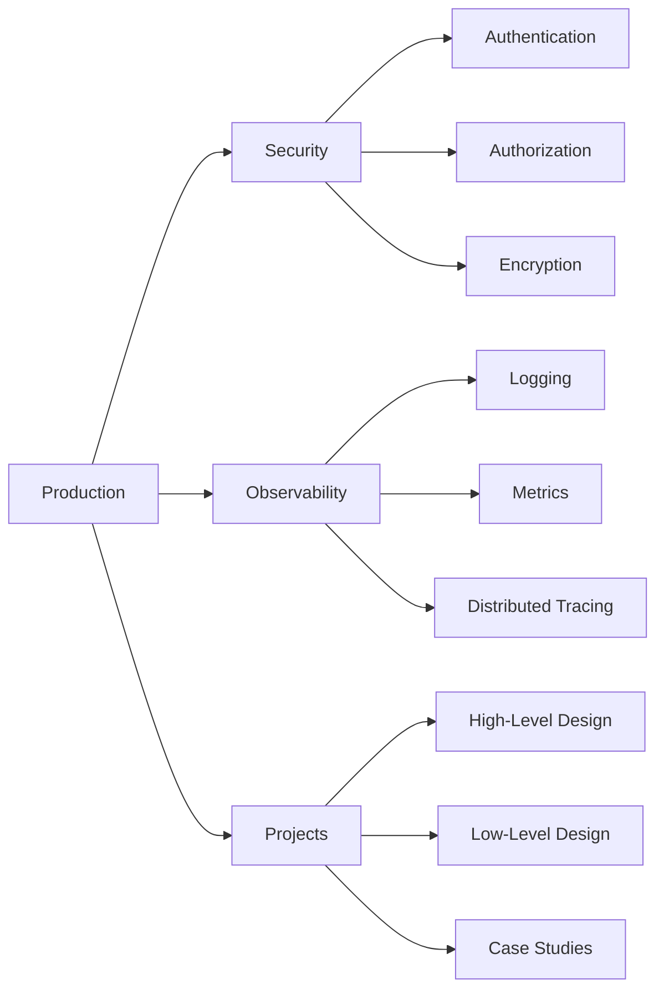

> [!crumbs] [[00 Start Here|🏠 Home]] › [[Part 1 System Design|Part 1]] › Production

> [!hub] 🚀 Production
> Running a system for real: keeping it secure, seeing inside it, and designing it on paper.

## Topics

### 🔒 [[Security]]
Who are you, what may you do, and is the data safe on the way.

| Topic | In one line | Technical take |
| --- | --- | --- |
| [[Authentication]] | Proving who someone is. | [[Authentication (Deep Dive)\|🔬 Deep dive]] |
| [[Authorization]] | Deciding what someone is allowed to do. | [[Authorization (Deep Dive)\|🔬 Deep dive]] |
| [[Encryption]] | Scrambling data so only the right people can read it. | [[Encryption (Deep Dive)\|🔬 Deep dive]] |

### 🔭 [[Observability]]
Seeing what a running system is doing, and why.

| Topic | In one line | Technical take |
| --- | --- | --- |
| [[Logging]] | Writing down what happened, event by event. | [[Logging (Deep Dive)\|🔬 Deep dive]] |
| [[Metrics]] | Numbers over time that show a system's health at a glance. | [[Metrics (Deep Dive)\|🔬 Deep dive]] |
| [[Distributed Tracing]] | Following one request as it hops across many services. | [[Distributed Tracing (Deep Dive)\|🔬 Deep dive]] |

### 📁 [[Projects]]
Putting it all together: from a whiteboard sketch to real designs.

| Topic | In one line | Technical take |
| --- | --- | --- |
| [[High-Level Design]] | The big-picture blueprint: boxes, arrows and why. | [[High-Level Design (Deep Dive)\|🔬 Deep dive]] |
| [[Low-Level Design]] | Zooming into one part: its classes, data and interfaces. | [[Low-Level Design (Deep Dive)\|🔬 Deep dive]] |
| [[Case Studies]] | Classic systems designed step by step, applying everything above. | [[Case Studies (Deep Dive)\|🔬 Deep dive]] |

## The shape of it

> [!tip] How to read these
> Every topic has a **🌱 basics** note (no jargon, about 5 minutes) and a **🔬 deep dive** (the technical take). Start with the basics; open the deep dive when you want more.
