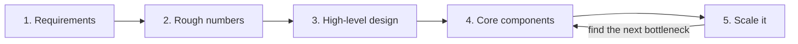

> [!crumbs] [[00 Start Here|🏠 Home]] › [[Part 1 System Design|Part 1]] › [[Production]] › [[Projects]] › Case Studies

> [!tldr] In one sentence
> A system design case study takes a **familiar app**, like a link shortener, a news feed or a chat app, and designs it step by step, so you see **all the building blocks working together**.

## 🧠 Think of it like…

> [!analogy] Cooking school's classic dishes
> Cooking schools don't just teach knife skills. They make you cook an omelet, a soup and a roast, because each classic dish combines those skills differently.

The building blocks, like [[Caching|caches]], [[Databases|databases]] and [[Message Queues|queues]], are the knife skills. Case studies are the dishes. Each stresses a different mix, so after a few you can cook something new.

## What it is

A **case study** is a real kind of system designed from a blank page. Three classics recur, and free guides work through them in full:[^1]

- **URL shortener.** Turn a long web address into a short code that redirects to it. Most traffic is people *following* links.
- **News feed.** Show the latest posts from everyone you follow, fast, even when some have millions of followers.
- **Chat system.** Deliver messages instantly, in order, and keep them for years.

Each follows the same recipe as any [[High-Level Design|high-level design]].

## Why it matters

- **The pieces finally fit.** Caches and databases make sense once you watch them solve one problem together.
- **Trade-offs become concrete.** "Should the feed be built when a post is written or when it is read?" has a real answer once you know the numbers.[^2]
- **Interviews use them.** Classic interview questions are these case studies in disguise.[^1]

## How it works

Every case study follows the same loop:[^1]

For each classic:

- **URL shortener.** One popular worked example assumes 10 million new links a month and ten times as many visits: about 4 new links and 40 visits per second.[^3] The key choice is how to make a short, unique code; seven letters and digits give over 3 trillion options.[^3]
- **News feed.** When you post, the system copies it into each follower's ready-made feed, called **fan-out**, so reading is instant.[^2] A celebrity's post would take minutes to fan out, so theirs are mixed in at read time instead.[^2]
- **Chat system.** Messages are stored grouped by conversation and sorted by time, so "load the last 50 messages" is one quick lookup.[^4]

The loop never ends: fix the slowest part, then find the next. Don't jump straight to a giant final design.[^3]

## A real-world example

Discord, the chat app, has published how it stores messages. In 2017 it handled over 100 million a day.[^4] Each channel's messages sit together, sorted by **time-ordered IDs** and split into roughly 10-day chunks so none grows too big.[^4]

By 2022 the store held trillions of messages on 177 database servers.[^5] After moving to a different database it runs on **72 servers**, and 99% of history loads finish in about 15 milliseconds, down from 40 to 125.[^5]

## Myths and pitfalls

- **❌ Myth:** Each case study has one correct answer. **✅ Reality:** Change the requirements and the best design changes too.[^6]
- **❌ Myth:** Memorize the final diagrams. **✅ Reality:** Interviewers care more about your reasoning than the final picture.[^6]
- **❌ Myth:** Start with the giant, internet-scale version. **✅ Reality:** Start simple and grow it one bottleneck at a time.[^3]
- **❌ Myth:** Your rough numbers must be exact. **✅ Reality:** Close enough to tell one server from a hundred is fine.[^3]

## Check yourself

> [!question]- Why does a URL shortener care much more about reads than writes?
> Each link is created once but clicked many times, so following links must be fast. A cache in front of the database serves popular links.

> [!question]- What is fan-out in a news feed, and where does it break?
> Copying each new post into every follower's feed so reading is instant. It breaks for accounts with millions of followers; their posts get merged in at read time.

> [!question]- Why does Discord split each channel's messages into time chunks?
> So no single storage unit grows without limit and slows down.

## Key terms

- **URL shortener** — a service that maps a short code to a long web address.
- **Fan-out** — copying one new post into many followers' feeds at once.
- **Read-heavy** — a system that answers far more lookups than it stores new data.
- **Bottleneck** — the part that slows everything down first as traffic grows.
- **Time-sortable ID** — a unique number that also tells you roughly when something was created.

> [!deepdive] Ready for the technical take?
> Worked numbers for all three, ID generation, fan-out trade-offs and Discord's storage migration.
> → [[Case Studies (Deep Dive)]]

## Related

- [[High-Level Design]] — the method every case study follows.
- [[Estimation]] — the rough numbers that steer each design.
- [[Caching]] — the first fix in most case studies.
- [[Sharding]] — splitting chat and feed data across machines.
- [[WebSockets]] — how chat apps push messages instantly.
- [[Capstone - AI Support Assistant]] — the same method, for an AI system.

> [!nav] Keep going
> ← [[Low-Level Design]] · [[Projects|📁 Projects]] · [[AI System Design Overview]] →
> 🔬 Technical take: [[Case Studies (Deep Dive)]] · 🗺️ [[Glossary]]

## 📚 Sources

[^1]: 📝 [The System Design Primer](https://github.com/donnemartin/system-design-primer) — Donne Martin, GitHub. Article. Checked 2026-11.
[^2]: 📝 [Design the Twitter timeline and search](https://github.com/donnemartin/system-design-primer/blob/master/solutions/system_design/twitter/README.md) — Donne Martin, The System Design Primer. Article. Checked 2026-11.
[^3]: 📝 [Design Pastebin.com (or Bit.ly)](https://github.com/donnemartin/system-design-primer/blob/master/solutions/system_design/pastebin/README.md) — Donne Martin, The System Design Primer. Article. Checked 2026-11.
[^4]: 📝 [How Discord Stores Billions of Messages](https://discord.com/blog/how-discord-stores-billions-of-messages) — Stanislav Vishnevskiy, Discord. Engineering blog. Checked 2026-11.
[^5]: 📝 [How Discord Stores Trillions of Messages](https://discord.com/blog/how-discord-stores-trillions-of-messages) — Bo Ingram, Discord. Engineering blog. Checked 2026-11.
[^6]: 🎓 [A Framework for System Design Interviews](https://bytebytego.com/courses/system-design-interview/a-framework-for-system-design-interviews) — Alex Xu, ByteByteGo. Course. Checked 2026-11.
