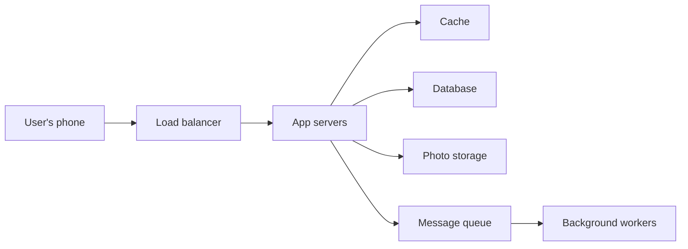

> [!crumbs] [[00 Start Here|🏠 Home]] › [[Part 1 System Design|Part 1]] › [[Production]] › [[Projects]] › High-Level Design

> [!tldr] In one sentence
> A high-level design is the **big-picture blueprint** of a system: the main parts, how they connect, and why each choice was made.

## 🧠 Think of it like…

> [!analogy] An architect's floor plan
> Before anyone picks tiles or paint, an architect draws the floor plan: which rooms exist, where the doors go, how people move between them. Changing a wall on paper costs an eraser. Changing it after it is built costs a fortune.

A high-level design is that floor plan for software. The rooms are the big parts: the app, the database, the cache. The hallways are the connections between them. Tiles and paint come later, in the [[Low-Level Design|low-level design]].

## What it is

A **high-level design (HLD)** shows a system as **boxes and arrows**. Each box is a major part, such as a web server or a database (the system that stores data for good). Each arrow shows who talks to whom.

Teams usually write it up in a **design doc**, written before coding. A good one says what the system will do, what it deliberately won't do, and which other designs were considered.[^1]

You rarely need every level of detail. A big-picture diagram plus one zoom level is enough for most teams.[^2]

## Why it matters

- **Mistakes are cheap on paper.** Spotting a bad idea in a document is far cheaper than rewriting working code.[^1]
- **Everyone shares one picture.** Architecture is often called "the shared understanding" of a system's design.[^3] The HLD writes it down.
- **Choices get explained.** The diagram shows *what*; the doc explains *why*, so the next person doesn't undo a decision they don't understand.[^4]
- **It is the core of design interviews.** You sketch one early, then defend it.[^5]

## How it works

A typical HLD for a photo-sharing app might look like this:

Building one follows a simple loop:

1. **Pin down the requirements.** What must it do, for how many people, how fast?[^6]
2. **Draw the main boxes.** Meet the core needs first; add complexity later.[^6]
3. **Walk one request through it,** like "upload a photo", to check nothing is missing.[^6]
4. **Find the weak spots.** What breaks at ten times the traffic? Add a [[Caching|cache]] or a [[Load Balancing|load balancer]] there.[^7]
5. **Write down the trade-offs:** what each choice gives up, and why it is worth it.[^1]

## A real-world example

Google engineers write a design doc before building most sizable systems. A larger project's doc runs roughly **10 to 20 pages**; small changes get a 1 to 3 page "mini design doc".[^1] Each one states goals and non-goals and includes **alternatives considered**, which the author calls one of the most important sections. Colleagues review it before coding starts.[^1]

## Myths and pitfalls

- **❌ Myth:** An HLD has to be a perfect, formal diagram. **✅ Reality:** It's for communication. Draw only diagrams that add value.[^2]
- **❌ Myth:** A bigger design is a better design. **✅ Reality:** Adding complexity too early is one of the most common mistakes.[^6]
- **❌ Myth:** Once written, the design is done. **✅ Reality:** Google's rule is to keep updating the doc until the system ships.[^1]
- **❌ Myth:** There is one right answer. **✅ Reality:** The requirements decide what fits.[^5]

## Check yourself

> [!question]- What do the boxes and arrows in a high-level design represent?
> Boxes are the major parts, such as servers, databases and caches. Arrows show which parts talk to each other.

> [!question]- Why does a good design doc list "alternatives considered"?
> It shows which options were weighed and why they lost, so nobody reopens settled questions or undoes decisions blindly.

> [!question]- Your design must handle ten times more users next year. Which step of the loop helps most?
> Finding the weak spots: ask what breaks first under that load, then add caches, servers or a queue there.

## Key terms

- **High-level design (HLD)** — the big-picture plan of a system's main parts and connections.
- **Design doc** — a short document, written before coding, that explains a design and its trade-offs.
- **Component** — one box in the diagram, like a server, database or cache.
- **Non-goal** — something the design deliberately chooses not to do.
- **Trade-off** — giving up one good thing to get another.
- **Bottleneck** — the part that slows everything down first when traffic grows.

> [!deepdive] Ready for the technical take?
> Design-doc anatomy, C4 zoom levels, decision records, interview timing and the ways designs go stale.
> → [[High-Level Design (Deep Dive)]]

## Related

- [[Requirements]] — the first input to any high-level design.
- [[Estimation]] — quick math that tells you how big each box must be.
- [[Trade-offs]] — every arrow in the diagram is a choice with a cost.
- [[Low-Level Design]] — the next zoom level, inside one box.
- [[Case Studies]] — high-level designs worked out for classic systems.
- [[AI Architecture Layers]] — the same big-picture thinking applied to AI systems.

> [!nav] Keep going
> ← [[Distributed Tracing]] · [[Projects|📁 Projects]] · [[Low-Level Design]] →
> 🔬 Technical take: [[High-Level Design (Deep Dive)]] · 🗺️ [[Glossary]]

## 📚 Sources

[^1]: 📝 [Design Docs at Google](https://www.industrialempathy.com/posts/design-docs-at-google/) — Malte Ubl, Industrial Empathy. Article. Checked 2026-11.
[^2]: 📄 [Diagrams](https://c4model.com/diagrams) — Simon Brown, The C4 model. Official docs. Checked 2026-11.
[^3]: 📝 [Software Architecture Guide](https://martinfowler.com/architecture/) — Martin Fowler. Article. Checked 2026-11.
[^4]: 📝 [Documenting Architecture Decisions](https://www.cognitect.com/blog/2011/11/15/documenting-architecture-decisions) — Michael Nygard, Cognitect. Article. Checked 2026-11.
[^5]: 🎓 [A Framework for System Design Interviews](https://bytebytego.com/courses/system-design-interview/a-framework-for-system-design-interviews) — Alex Xu, ByteByteGo. Course. Checked 2026-11.
[^6]: 🎓 [Delivery Framework](https://www.hellointerview.com/learn/system-design/in-a-hurry/delivery) — Hello Interview. Course. Checked 2026-11.
[^7]: 📝 [The System Design Primer](https://github.com/donnemartin/system-design-primer) — Donne Martin, GitHub. Article. Checked 2026-11.
