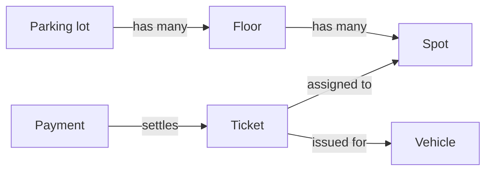

> [!crumbs] [[00 Start Here|🏠 Home]] › [[Part 1 System Design|Part 1]] › [[Production]] › [[Projects]] › Low-Level Design

> [!tldr] In one sentence
> Low-level design zooms into **one part of a system** and decides its building blocks: what pieces it has, what data each piece holds, and how they talk to each other.

## 🧠 Think of it like…

> [!analogy] The kitchen fitter's drawing
> The architect's floor plan says "kitchen here". The kitchen fitter then draws exactly where each cupboard goes, which way the doors open, and where the sink connects to the pipes.

The floor plan is the [[High-Level Design|high-level design]]. The fitter's drawing is the low-level design: one room, detailed enough to build without guessing.

## What it is

A **low-level design (LLD)** takes one box from the big-picture diagram and plans its insides. It builds on the high-level design, not instead of it.[^1] It is the deepest zoom level: one component, down to how it is built.[^2]

Those insides are usually **classes**: templates for one kind of thing, such as an Order. For each class, the LLD decides:

- **Data** — what it remembers, like an order's total.
- **Behavior** — what it can do, like "cancel" or "pay".
- **Relationships** — which other classes it uses or contains.
- **Interfaces** — the promise of what it can do, apart from how.

Designers often draw this as a **class diagram** in UML (Unified Modeling Language), a standard picture language for software.[^2][^3]

## Why it matters

- **Code that is easy to change.** Keep together "the things that change for the same reasons" and separate the rest.[^4] Then one change touches one place.
- **Reusing proven ideas.** **Design patterns** are typical solutions to common design problems.[^5] You adapt them instead of reinventing.
- **Faster features later.** Clean insides mean new features ship faster, with fewer bugs.[^6]
- **It is its own interview.** You may be asked to design a parking lot or an elevator, class by class.[^7]

## How it works

A first sketch for a parking lot, a classic practice problem:[^7]

The usual steps:

1. **Find the nouns.** "A vehicle enters, gets a ticket, parks in a spot, pays." Each noun becomes a class.
2. **Give each one job.** A Ticket tracks time and spot; a Payment handles money.[^4]
3. **Connect them.** A floor *has* many spots; a ticket *points to* one spot.[^7]
4. **List the states.** A payment is pending, paid or failed. Spell out the allowed moves.
5. **Spot the patterns.** If behavior changes a lot with state, the **State pattern** gives each state its own class.[^8]

## A real-world example

Stripe, the payments company, models every payment attempt as a **PaymentIntent** object that moves through fixed states.[^9] It starts as `requires_payment_method`, may pass through `requires_action` for a bank check, then `processing`, and ends `succeeded` or `canceled`.[^9] A declined card sends it back to `requires_payment_method` for a retry; a canceled one can never be revived.[^9] That rulebook of states and moves is low-level design.

## Myths and pitfalls

- **❌ Myth:** LLD means drawing perfect, complete UML. **✅ Reality:** Most UML is a quick sketch of just the interesting parts.[^10]
- **❌ Myth:** More classes and patterns mean a better design. **✅ Reality:** Patterns can be overkill, like the State pattern for a few simple states.[^8]
- **❌ Myth:** Design patterns are code you copy and paste. **✅ Reality:** A pattern is a general idea you adapt.[^5]
- **❌ Myth:** LLD replaces the high-level design. **✅ Reality:** It refines one part of it; details need a big picture to fit into.[^1][^2]

## Check yourself

> [!question]- How is low-level design different from high-level design?
> High-level design picks the big parts and how they connect. Low-level design plans one part's classes, data and interfaces in detail.

> [!question]- Why give each class a single job?
> So a rule change touches only one class, instead of breaking unrelated behavior.

> [!question]- A video in a streaming app can be uploading, processing, ready or failed. What should the LLD spell out?
> The states and which moves between them are allowed, such as processing to ready or failed.

## Key terms

- **Class** — a template for one kind of thing in the code, like an Order.
- **Interface** — a promise of what something can do, without saying how.
- **UML** — a standard picture language for drawing software designs.
- **Class diagram** — a UML drawing of classes and how they relate.
- **Design pattern** — a proven, reusable solution to a common design problem.
- **State machine** — a fixed list of states plus the allowed moves between them.

> [!deepdive] Ready for the technical take?
> SOLID in practice, UML relationships, the patterns interviewers expect, state machines and the LLD interview loop.
> → [[Low-Level Design (Deep Dive)]]

## Related

- [[High-Level Design]] — the big picture an LLD zooms into.
- [[Object-Oriented Programming]] — the classes and objects an LLD is made of.
- [[Design Patterns]] — the toolbox of proven solutions.
- [[API Design]] — the outward-facing interfaces of a component.
- [[Concurrency]] — many users touching one object at once.
- [[AI Agents & Tool Use]] — agents call tools through carefully designed interfaces.

> [!nav] Keep going
> ← [[High-Level Design]] · [[Projects|📁 Projects]] · [[Case Studies]] →
> 🔬 Technical take: [[Low-Level Design (Deep Dive)]] · 🗺️ [[Glossary]]

## 📚 Sources

[^1]: 📖 [Low-level design](https://en.wikipedia.org/wiki/Low-level_design) — Wikipedia. Encyclopedia. Checked 2026-11.
[^2]: 📄 [Code diagram](https://c4model.com/diagrams/code) — Simon Brown, The C4 model. Official docs. Checked 2026-11.
[^3]: 📄 [About the Unified Modeling Language Specification Version 2.5.1](https://www.omg.org/spec/UML/2.5.1/About-UML) — Object Management Group. Standard. Checked 2026-11.
[^4]: 📝 [Solid Relevance](https://blog.cleancoder.com/uncle-bob/2020/10/18/Solid-Relevance.html) — Robert C. Martin, Clean Coder Blog. Article. Checked 2026-11.
[^5]: 📝 [What's a design pattern?](https://refactoring.guru/design-patterns/what-is-pattern) — Refactoring.Guru. Article. Checked 2026-11.
[^6]: 📝 [Software Architecture Guide](https://martinfowler.com/architecture/) — Martin Fowler. Article. Checked 2026-11.
[^7]: 📝 [Awesome Low-Level Design](https://github.com/ashishps1/awesome-low-level-design) — ashishps1, GitHub. Article. Checked 2026-11.
[^8]: 📝 [State](https://refactoring.guru/design-patterns/state) — Refactoring.Guru. Article. Checked 2026-11.
[^9]: 📄 [How Payment Intents and Setup Intents work](https://docs.stripe.com/payments/paymentintents/lifecycle) — Stripe documentation. Official docs. Checked 2026-11.
[^10]: 📝 [UmlAsSketch](https://martinfowler.com/bliki/UmlAsSketch.html) — Martin Fowler. Article. Checked 2026-11.
