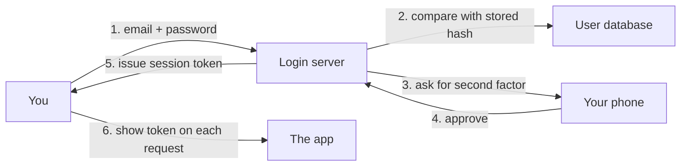

> [!crumbs] [[00 Start Here|🏠 Home]] › [[Part 1 System Design|Part 1]] › [[Production]] › [[Security]] › Authentication

> [!tldr] In one sentence
> Authentication is how a system **proves you are who you say you are** before it lets you in.

## 🧠 Think of it like…

> [!analogy] The hotel front desk
> At check-in, you show your passport and the clerk compares the photo to your face. Then you get a key card. For the rest of your stay, you just tap the card.

Logging in works the same way. You prove your identity once. The system then hands you a **digital key card**, called a session or token, that your browser shows on every later visit.

## What it is

**Authentication** (often shortened to "AuthN") is the step where a system checks your identity. It answers one question: "Who are you, really?"

You prove it with one or more **factors**. Security standards group them into three kinds:[^1]

- **Something you know**, like a password.
- **Something you have**, like your phone or a small USB security key.
- **Something you are**, like a fingerprint or your face.

Using two or more different kinds is called **multi-factor authentication (MFA)**. A stolen password alone is then not enough to get in.

Deciding what you may do once inside is a separate step: [[Authorization]].

## Why it matters

- **It is the front door.** In Verizon's 2025 report on 12,195 breaches, stolen logins were the top way in, at 22%.[^2]
- **Passwords leak.** When one site is breached, attackers try the same email and password everywhere else.[^3]
- **Everything else depends on it.** Permissions, billing and privacy assume the system knows who is asking.

## How it works

1. You type your password. The server never stores the password itself, only a **hash**: a one-way scrambled fingerprint of it.[^4]
2. If the fingerprints match, the server may ask for a second factor, such as a tap on your phone.
3. The server then gives your browser a **session token**, a long random string that acts as your key card.

A **passkey** skips passwords entirely. It is a pair of digital keys: the secret one stays locked on your devices, the public one sits with the website. Your phone proves it holds the secret key without sending it, so a fake website has nothing to steal.[^5]

**"Sign in with Google"** is **single sign-on (SSO)**: one trusted company checks who you are and vouches for you to other apps. The usual standard for this is OpenID Connect, built on top of OAuth.[^6]

## A real-world example

In 2019, Google, New York University and UC San Diego published a year-long study of account takeovers.[^7] An on-device prompt, a phone pop-up asking you to confirm the sign-in, blocked **100% of automated bot attacks**, 99% of bulk phishing and 90% of targeted attacks.[^7] Users who signed in only with physical security keys lost zero accounts to targeted phishing.[^7]

## Myths and pitfalls

- **❌ Myth:** A strong password is enough. **✅ Reality:** Strong passwords still get phished or leaked. A second factor is the best defense.[^3]
- **❌ Myth:** Forced password changes every 90 days help. **✅ Reality:** US federal guidance now forbids periodic forced changes; change only after signs of compromise.[^1]
- **❌ Myth:** All second factors are equally safe. **✅ Reality:** Typed codes, like SMS codes, can be phished. Passkeys and security keys resist phishing by design.[^1]
- **❌ Myth:** "Wrong password" and "no such user" should be different messages. **✅ Reality:** That tells attackers which emails have accounts. Use one generic error.[^3]

## Check yourself

> [!question]- What are the three kinds of authentication factor?
> Something you know (a password), something you have (a phone or security key) and something you are (a fingerprint or face).

> [!question]- Why does a website store a hash instead of your password?
> If the database is stolen, attackers get only one-way fingerprints, not the passwords themselves.

> [!question]- Why can't a fake website steal a passkey?
> The secret key never leaves your device, and there is nothing for you to type, so there is nothing to trick you into handing over.

## Key terms

- **Authentication (AuthN)** — proving who you are to a system.
- **MFA** — logging in with two or more different kinds of proof.
- **Hash** — a one-way scrambled fingerprint of a password, safe to store.
- **Session token** — the random "key card" your browser shows after logging in.
- **Passkey** — a password replacement built on a key pair that stays on your device.
- **SSO** — one trusted login provider vouching for you across many apps.

> [!deepdive] Ready for the technical take?
> Password hashing settings, NIST assurance levels, sessions vs. JWTs, the OpenID Connect code flow and passkeys.
> → [[Authentication (Deep Dive)]]

## Related

- [[Authorization]] — the next step: what you may do once you are in.
- [[Encryption]] — HTTPS keeps passwords and tokens secret on the way.
- [[Rate Limiting]] — slows down attackers guessing passwords.
- [[API Design]] — how APIs expect clients to send tokens.
- [[AI Security & Privacy]] — AI agents need identities and logins too.

> [!nav] Keep going
> ← [[Rate Limiting]] · [[Security|🔒 Security]] · [[Authorization]] →
> 🔬 Technical take: [[Authentication (Deep Dive)]] · 🗺️ [[Glossary]]

## 📚 Sources

[^1]: 📄 [NIST SP 800-63B: Authentication and Authenticator Management](https://pages.nist.gov/800-63-4/sp800-63b.html) — National Institute of Standards and Technology, SP 800-63-4. Official docs. Checked 2026-11.
[^2]: 📝 [2025 Data Breach Investigations Report](https://www.verizon.com/about/news/2025-data-breach-investigations-report) — Verizon. Article. Checked 2026-11.
[^3]: 📄 [Authentication Cheat Sheet](https://cheatsheetseries.owasp.org/cheatsheets/Authentication_Cheat_Sheet.html) — OWASP Cheat Sheet Series. Official docs. Checked 2026-11.
[^4]: 📄 [Password Storage Cheat Sheet](https://cheatsheetseries.owasp.org/cheatsheets/Password_Storage_Cheat_Sheet.html) — OWASP Cheat Sheet Series. Official docs. Checked 2026-11.
[^5]: 📄 [Passkeys](https://fidoalliance.org/passkeys/) — FIDO Alliance. Official docs. Checked 2026-11.
[^6]: 📄 [OpenID Connect Core 1.0](https://openid.net/specs/openid-connect-core-1_0.html) — OpenID Foundation. Official docs. Checked 2026-11.
[^7]: 📝 [New research: How effective is basic account hygiene at preventing hijacking](https://security.googleblog.com/2019/05/new-research-how-effective-is-basic.html?m=1) — Google Security Blog. Article. Checked 2026-11.
