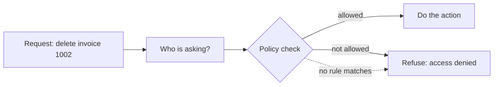

> [!crumbs] [[00 Start Here|🏠 Home]] › [[Part 1 System Design|Part 1]] › [[Production]] › [[Security]] › Authorization

> [!tldr] In one sentence
> Authorization is how a system decides **what you are allowed to do** once it knows who you are.

## 🧠 Think of it like…

> [!analogy] Wristbands at a concert
> Everyone shows a ticket at the gate. Inside, the color of your wristband decides where you can go: the floor, the VIP lounge, or backstage. The guard at each door checks the band, not your face.

The ticket is [[Authentication]]: proving who you are. The wristband check is **authorization**: matching you against **rules about what you may do**, again at every door.

## What it is

**Authorization** (often shortened to "AuthZ") answers one question for every action: "Is this person allowed to do this, to this thing, right now?"

The answer comes from a **policy**, a set of rules. Three common styles:

- **Role-based (RBAC).** You get a **role**, like "editor" or "admin", and each role carries a set of permissions.[^1]
- **Attribute-based (ABAC).** Rules look at facts, or **attributes**, about you, the thing and the situation: "nurses may read records of patients on their own ward."[^2]
- **Relationship-based (ReBAC).** Access follows links between people and things: "you can edit this document because you created it" or "because it is in a folder shared with you."[^3]

## Why it matters

- **It is the most common web security flaw.** OWASP, a nonprofit that tracks web risks, ranks broken access control as the number one risk in its 2025 Top 10.[^4] Every application it tested had some form of it.[^4]
- **Mistakes leak other people's data.** A classic bug: change the number at the end of a web address and see someone else's account or invoice.[^4]
- **It limits the damage of a break-in.** A stolen account can only touch what it was allowed to touch.

## How it works

Each request arrives tied to a logged-in person. The system asks the **policy** whether this person may do this action on this item. Two habits make this safe:

- **Deny by default.** If no rule explicitly allows something, the answer is no.[^3] Amazon Web Services works this way: requests are refused unless a policy allows them, and an explicit "deny" beats any "allow".[^5]
- **Least privilege.** Give each person or program only the permissions its job needs.[^3][^6]

The check must happen on the **server**, the computer that holds the data. Hiding a button is not protection; an attacker can send the request directly.[^3]

## A real-world example

When you share a Google Doc with a friend, Google must check "can this person see this?" before showing it. Its answer is a system called **Zanzibar**, described in a 2019 paper.[^7] One shared service decides access for Drive, Calendar, Photos, YouTube and other Google products.[^7] It stores **trillions of access rules** and handles millions of checks per second, answering over 95% of them in under 10 milliseconds.[^7]

## Myths and pitfalls

- **❌ Myth:** If users can't see the button, they can't do the action. **✅ Reality:** Anyone can send a request directly. Checks must run on the server.[^3]
- **❌ Myth:** Long, hard-to-guess IDs keep records private. **✅ Reality:** Hiding IDs is not enough. Check access to each specific item on every request.[^3]
- **❌ Myth:** Logging in proves you may do anything. **✅ Reality:** Login says who you are. Each action still needs its own permission check.
- **❌ Myth:** Giving everyone admin rights saves time. **✅ Reality:** It turns every stolen account into a master key. Start narrow and widen only when needed.[^6]

## Check yourself

> [!question]- What is the difference between authentication and authorization?
> Authentication proves who you are. Authorization decides what you are allowed to do once that is known.

> [!question]- What does "deny by default" mean?
> If no rule explicitly allows an action, the system refuses it. Forgetting to write a rule then fails safe instead of opening a hole.

> [!question]- A reporting tool only reads sales data. Why give it read-only access?
> Least privilege. If the tool is ever hijacked, the attacker can read reports but cannot change or delete anything.

## Key terms

- **Authorization (AuthZ)** — deciding whether an identity may perform an action.
- **Role (RBAC)** — a named bundle of permissions, like "admin."
- **Attribute (ABAC)** — a fact used in a rule, like department or time of day.
- **Policy** — the set of rules a system uses to decide.
- **Least privilege** — giving only the access a job truly needs.
- **Broken access control** — a bug that lets someone do what they shouldn't.

> [!deepdive] Ready for the technical take?
> RBAC vs. ABAC vs. ReBAC, policy engines, AWS policy evaluation, Zanzibar and classic access-control bugs.
> → [[Authorization (Deep Dive)]]

## Related

- [[Authentication]] — the step before: proving who is asking.
- [[Encryption]] — protects data even if access control fails.
- [[API Design]] — every endpoint needs its own permission check.
- [[Logging]] — records who did what, and who was refused.
- [[AI Agents & Tool Use]] — an AI agent should get only the permissions its task needs.

> [!nav] Keep going
> ← [[Authentication]] · [[Security|🔒 Security]] · [[Encryption]] →
> 🔬 Technical take: [[Authorization (Deep Dive)]] · 🗺️ [[Glossary]]

## 📚 Sources

[^1]: 📄 [Role Based Access Control](https://csrc.nist.gov/Projects/Role-Based-Access-Control) — NIST Computer Security Resource Center. Official docs. Checked 2026-11.
[^2]: 📄 [Guide to Attribute Based Access Control (ABAC) Definition and Considerations](https://csrc.nist.gov/pubs/sp/800/162/upd2/final) — NIST SP 800-162. Official docs. Checked 2026-11.
[^3]: 📄 [Authorization Cheat Sheet](https://cheatsheetseries.owasp.org/cheatsheets/Authorization_Cheat_Sheet.html) — OWASP Cheat Sheet Series. Official docs. Checked 2026-11.
[^4]: 📄 [A01:2025 Broken Access Control](https://top10.owasp.org/2025/A01_2025-Broken_Access_Control) — OWASP Top 10:2025. Official docs. Checked 2026-11.
[^5]: 📄 [How AWS enforcement code logic evaluates requests to allow or deny access](https://docs.aws.amazon.com/IAM/latest/UserGuide/reference_policies_evaluation-logic_policy-eval-denyallow.html) — AWS Identity and Access Management User Guide. Official docs. Checked 2026-11.
[^6]: 📄 [Security best practices in IAM](https://docs.aws.amazon.com/IAM/latest/UserGuide/best-practices.html) — AWS Identity and Access Management User Guide. Official docs. Checked 2026-11.
[^7]: 🔬 [Zanzibar: Google's Consistent, Global Authorization System](https://www.usenix.org/conference/atc19/presentation/pang) — Pang et al., USENIX ATC 2019. Paper. Checked 2026-11.
