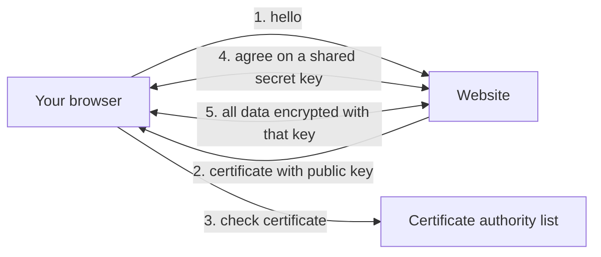

> [!crumbs] [[00 Start Here|🏠 Home]] › [[Part 1 System Design|Part 1]] › [[Production]] › [[Security]] › Encryption

> [!tldr] In one sentence
> Encryption **scrambles data with a secret key** so that anyone who intercepts or steals it sees only gibberish, while the right people can unscramble it.

## 🧠 Think of it like…

> [!analogy] Open padlocks
> You hand out open padlocks to anyone who wants to send you something. They put their letter in a box and snap your padlock shut. Now only you, with the one key, can open it. Not even the sender can.

That is **public-key encryption**. The open padlock is your **public key**, safe to share. The key on your keychain is your **private key**, which never leaves you.[^1]

## What it is

**Encryption** turns readable data, called **plaintext**, into scrambled **ciphertext** using a **key**, a long secret number. Without the key, the ciphertext is useless.

There are two main kinds:

- **Symmetric encryption** uses the same key to lock and unlock. It is fast. The standard is **AES**, picked by the US government in a public competition in 2000.[^2]
- **Asymmetric (public-key) encryption** uses a matched pair: a public key to lock, a private key to unlock. It is much slower, so it mostly just swaps a symmetric key safely.[^1]

**Hashing** is a cousin: a one-way fingerprint of data that cannot be turned back into the original. Websites store password hashes, not passwords.[^3]

## Why it matters

- **In transit.** Your data crosses Wi-Fi routers, internet providers and data centers. Without encryption, anyone on the path can read or change it.[^4]
- **At rest.** Disks get stolen and backups get copied. Encrypted, they are just noise.
- **Trust.** The same math lets your browser check it is talking to the real bank.[^5]

## How it works

When you open a website whose address starts with **HTTPS**, your browser and the server first run a short **handshake** using a protocol called **TLS**.

The server sends a **certificate**: its public key, vouched for by a trusted **certificate authority**. Both sides use public-key math to agree on a fresh shared key, then lock everything with fast symmetric encryption.

TLS gives three guarantees: only the two ends can read the data, nobody can change it without being caught, and the server is who it claims to be.[^5]

**Encryption at rest** works on stored data. Since January 2023, Amazon's storage service S3 encrypts every new file with AES-256 automatically.[^6] The hard part is keeping the **keys** safe, stored apart from the data.[^7]

## A real-world example

Google tracks how much of the web Chrome loads over HTTPS. It rose from about **30–45% in 2015 to 95–99% around 2020**, then leveled off.[^4] Let's Encrypt, a nonprofit, gives any domain owner a certificate for free.[^8] Google said Chrome 154, slated for October 2026, would ask by default before opening a public site without HTTPS.[^4]

## Myths and pitfalls

- **❌ Myth:** HTTPS means the website is trustworthy. **✅ Reality:** It means the connection is private. Anyone with a domain, including a scammer, can get a certificate.[^8]
- **❌ Myth:** Hashing and encryption are the same. **✅ Reality:** Encryption can be reversed with the key. Hashing cannot be reversed at all.[^3]
- **❌ Myth:** Encrypted data is safe no matter where the key lives. **✅ Reality:** A key stored beside the data is a key taped to the safe.[^7]
- **❌ Myth:** Encryption makes everything slow. **✅ Reality:** Modern encryption is cheap. S3 encrypts every new object with no performance impact.[^6]

## Check yourself

> [!question]- Why do websites use both public-key and symmetric encryption?
> Public-key encryption lets strangers agree on a secret safely, but it is slow. So it sets up a shared key, and fast symmetric encryption handles the data.

> [!question]- What is the difference between encryption in transit and at rest?
> In transit protects data while it moves across networks, as HTTPS does. At rest protects data while it sits on disks, backups or cloud storage.

> [!question]- Why store a password hash instead of an encrypted password?
> Whoever gets the key can decrypt. A hash cannot be reversed, so a stolen database does not directly reveal passwords.

## Key terms

- **Plaintext / ciphertext** — readable data before encryption, and the scrambled result.
- **Public / private key** — a matched pair: one shared openly, one kept secret.
- **AES** — the standard fast symmetric cipher used almost everywhere.
- **TLS / HTTPS** — the protocol that encrypts web traffic, and web browsing over it.
- **Certificate** — a signed document proving a public key belongs to a website.
- **Hashing** — a one-way fingerprint of data that cannot be reversed.

> [!deepdive] Ready for the technical take?
> The TLS 1.3 handshake, forward secrecy, AES-GCM, envelope encryption with a KMS, HSTS and post-quantum key exchange.
> → [[Encryption (Deep Dive)]]

## Related

- [[Authentication]] — passwords and tokens are only safe inside encrypted connections.
- [[Authorization]] — decides who may decrypt or read data.
- [[Networking]] — the roads that encrypted traffic travels on.
- [[Object Storage]] — where encryption at rest is switched on by default.
- [[AI Security & Privacy]] — protecting training data and prompts.

> [!nav] Keep going
> ← [[Authorization]] · [[Security|🔒 Security]] · [[Logging]] →
> 🔬 Technical take: [[Encryption (Deep Dive)]] · 🗺️ [[Glossary]]

## 📚 Sources

[^1]: 📄 [Public-key cryptography](https://developer.mozilla.org/en-US/docs/Glossary/Public-key_cryptography) — MDN Web Docs. Official docs. Checked 2026-11.
[^2]: 📄 [FIPS 197: Advanced Encryption Standard (AES)](https://csrc.nist.gov/pubs/fips/197/final) — NIST. Official docs. Checked 2026-11.
[^3]: 📄 [Password Storage Cheat Sheet](https://cheatsheetseries.owasp.org/cheatsheets/Password_Storage_Cheat_Sheet.html) — OWASP Cheat Sheet Series. Official docs. Checked 2026-11.
[^4]: 📝 [HTTPS by default](https://blog.google/security/https-by-defau/) — Google Chrome Security Team, October 2025. Article. Checked 2026-11.
[^5]: 📄 [RFC 8446: The Transport Layer Security (TLS) Protocol Version 1.3](https://datatracker.ietf.org/doc/html/rfc8446) — IETF, August 2018. Official docs. Checked 2026-11.
[^6]: 📄 [Default encryption FAQ](https://docs.aws.amazon.com/AmazonS3/latest/userguide/default-encryption-faq.html) — Amazon S3 User Guide. Official docs. Checked 2026-11.
[^7]: 📄 [Cryptographic Storage Cheat Sheet](https://cheatsheetseries.owasp.org/cheatsheets/Cryptographic_Storage_Cheat_Sheet.html) — OWASP Cheat Sheet Series. Official docs. Checked 2026-11.
[^8]: 📄 [About Let's Encrypt](https://letsencrypt.org/about/) — Let's Encrypt (ISRG). Official docs. Checked 2026-11.
