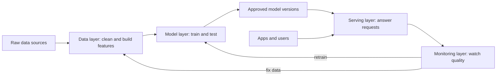

> [!crumbs] [[00 Start Here|🏠 Home]] › [[Part 2 AI System Design|Part 2]] › [[AI Foundations]] › AI Architecture Layers

> [!tldr] In one sentence
> Almost every AI system can be drawn as four layers: **data** (gathering and preparing examples), **model** (learning from them), **serving** (answering requests) and **monitoring** (watching quality and triggering fixes).

## 🧠 Think of it like…

> [!analogy] A bakery
> The prep team measures flour. A baker perfects the recipe. The counter sells loaves all day. A taster checks every batch.

Prep is the **data layer**, the recipe is the **model layer**, the counter is the **serving layer** and the taster is the **monitoring layer**. When bread goes wrong, the fix often starts at the flour.

## What it is

This vault groups the parts of an AI system into four layers. Cloud providers describe the same lifecycle in more steps, but the parts map onto these four.[^1][^2]

- **Data layer.** Collects raw data, cleans it and turns it into **features**, the measurable clues a model learns from.[^2]
- **Model layer.** Trains the model on those features, tests it, and keeps the approved versions.[^1]
- **Serving layer.** Puts the model to work, answering requests from apps and users.[^1]
- **Monitoring layer.** Watches whether the answers stay good and raises the alarm when they don't.[^2]

## Why it matters

- **Clear jobs.** Each layer has its own tools and often its own team, so people know who fixes what.
- **Swappable parts.** You can retrain the model without rebuilding data pipes, or move serving without retraining.
- **A built-in feedback loop.** Monitoring feeds back into data and training, so the system can recover from **model decay**, the slow loss of accuracy as the world changes.[^1]

## How it works

A few ideas make the layers work together:

- **Shared features.** A **feature store** keeps feature definitions in one place. It holds history for training and the latest values for fast answers, so both sides use the same numbers.[^3]
- **Two ways to serve.** **Batch** serving computes answers ahead of time and stores them, which is cheap but can be hours old. **Real-time** serving computes each answer on request, which handles anything new but costs more and must be fast.[^4]
- **A loop, not a line.** Monitoring compares live data and results with what the model saw in training. Big differences trigger retraining.[^1]

## A real-world example

Uber's **Michelangelo** platform follows this shape.[^5] Raw trip and app data flows into a data lake (one huge store for everything). Shared features, about 10,000 of them, live in a feature store.[^5] Trained models are deployed to serving machines that answer other Uber services over the network. Michelangelo also logs predictions and later compares them with what actually happened, to measure live accuracy.[^5]

## Myths and pitfalls

- **❌ Myth:** The layers are independent boxes. **✅ Reality:** Change one feature and the whole model can shift, so layers need shared definitions and testing.[^6]
- **❌ Myth:** Monitoring means checking the server is up. **✅ Reality:** A model can be up and wrong, so you also watch data and answer quality.[^1]
- **❌ Myth:** Every answer must be computed live. **✅ Reality:** Many systems precompute answers in batches, which is cheaper and safer when inputs are predictable.[^4]
- **❌ Myth:** Chatbot apps built on large language models have no data layer. **✅ Reality:** Fetching documents to give the model context is their data layer.[^7]

## Check yourself

> [!question]- Which layer would you look at first if answers got worse but nothing crashed?
> Monitoring tells you something changed, but the cause is often in the data layer: new or shifted input data.

> [!question]- Why keep features in one shared store?
> So training and serving compute features the same way. If they differ, the model sees different numbers live than it learned from.

> [!question]- When is batch serving a good choice?
> When you know the questions in advance, like tomorrow's recommendations, and hours-old answers are fine.

## Key terms

- **Feature** — a measurable clue the model uses, like a restaurant's average prep time.
- **Feature store** — a shared library of features for both training and serving.
- **Training pipeline** — the automated steps that turn data into a tested model.
- **Model registry** — a catalog of model versions and which one is live.
- **Batch vs real-time serving** — answers computed ahead of time versus on request.
- **Retraining** — training the model again on fresh data.

## 🧱 Builds on

- [[High-Level Design]] — the four layers are a high-level diagram for AI systems.
- [[Microservices]] — a served model is often its own small service that other services call.
- [[Message Queues]] — streams of logged events carry fresh data into near-real-time features.

> [!deepdive] Ready for the technical take?
> Feature stores and point-in-time joins, model registries, online versus batch versus async serving, the monitoring checklist and Uber's numbers.
> → [[AI Architecture Layers (Deep Dive)]]

## Related

- [[Data Engineering & Pipelines]] — the data layer in depth.
- [[Model Selection & Training]] — the model layer in depth.
- [[Deployment & Serving]] — the serving layer in depth.
- [[AI Monitoring & Observability]] — the monitoring layer in depth.
- [[MLOps & CI-CD]] — automating the loop across all four.

> [!nav] Keep going
> ← [[Business Goals & Requirements]] · [[AI Foundations|🎯 AI Foundations]] · [[Data Sources]] →
> 🔬 Technical take: [[AI Architecture Layers (Deep Dive)]] · 🗺️ [[Glossary]]

## 📚 Sources

[^1]: 📄 [MLOps: Continuous delivery and automation pipelines in machine learning](https://docs.cloud.google.com/architecture/mlops-continuous-delivery-and-automation-pipelines-in-machine-learning) — Google Cloud Architecture Center. Official docs. Checked 2026-11.
[^2]: 📄 [Well-Architected machine learning lifecycle](https://docs.aws.amazon.com/wellarchitected/latest/machine-learning-lens/machine-learning-lifecycle.html) — AWS Well-Architected Machine Learning Lens. Official docs. Checked 2026-11.
[^3]: 📄 [Introduction to Feast](https://docs.feast.dev/) — Feast documentation. Official docs. Checked 2026-11.
[^4]: 🎓 [Production ML systems: Static versus dynamic inference](https://developers.google.com/machine-learning/crash-course/production-ml-systems/static-vs-dynamic-inference) — Google Machine Learning Crash Course. Course. Checked 2026-11.
[^5]: 📝 [Meet Michelangelo: Uber's Machine Learning Platform](https://www.uber.com/en-AU/blog/michelangelo-machine-learning-platform/) — Uber Engineering. Engineering blog. Checked 2026-11.
[^6]: 🔬 [Hidden Technical Debt in Machine Learning Systems](https://proceedings.neurips.cc/paper/2015/file/86df7dcfd896fcaf2674f757a2463eba-Paper.pdf) — Sculley et al., NeurIPS 2015. Paper. Checked 2026-11.
[^7]: 📝 [Building A Generative AI Platform](https://huyenchip.com/2024/07/25/genai-platform.html) — Chip Huyen. Article. Checked 2026-11.
