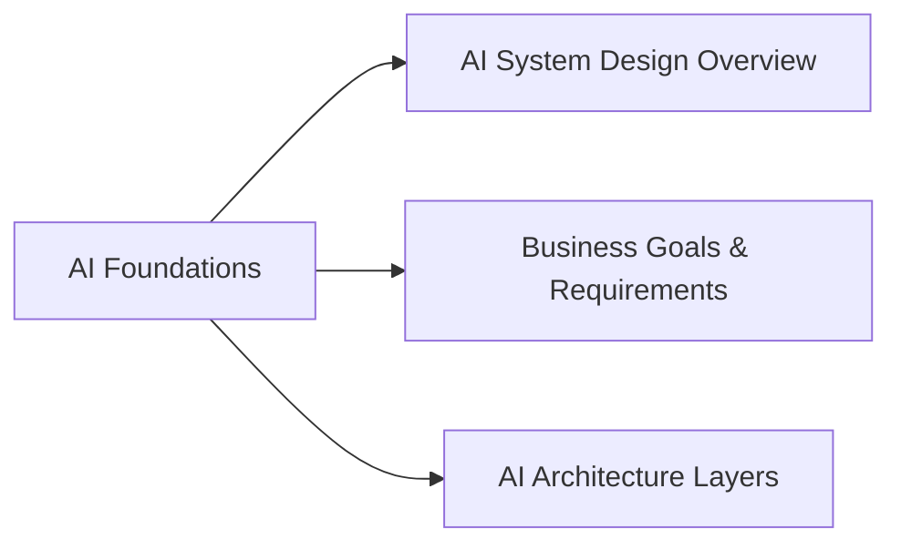

> [!crumbs] [[00 Start Here|🏠 Home]] › [[Part 2 AI System Design|Part 2]] › AI Foundations

> [!hub] 🎯 AI Foundations
> The whole umbrella at a glance, the business goals underneath it, and the four layers of every AI system.

## Topics

| Topic | In one line | Technical take |
| --- | --- | --- |
| [[AI System Design Overview]] | What makes designing an AI system different from any other system. | [[AI System Design Overview (Deep Dive)\|🔬 Deep dive]] |
| [[Business Goals & Requirements]] | Starting from the problem and the people, not from the model. | [[Business Goals & Requirements (Deep Dive)\|🔬 Deep dive]] |
| [[AI Architecture Layers]] | The four layers every AI system has: data, model, serving, monitoring. | [[AI Architecture Layers (Deep Dive)\|🔬 Deep dive]] |

## The shape of it

> [!tip] How to read these
> Every topic has a **🌱 basics** note (no jargon, about 5 minutes) and a **🔬 deep dive** (the technical take). Start with the basics; open the deep dive when you want more.
