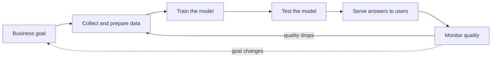

> [!crumbs] [[00 Start Here|🏠 Home]] › [[Part 2 AI System Design|Part 2]] › [[AI Foundations]] › AI System Design Overview

> [!tldr] In one sentence
> AI system design is planning a whole product around a model that **learns from data**, so you design for data, change and imperfect answers, not just for code.

## 🧠 Think of it like…

> [!analogy] A restaurant built around a star chef
> A brilliant chef is useless without suppliers, a kitchen, waiters and someone tasting every plate.

The chef is the **model**: the part that learned from examples and makes predictions. Everything else is the system around it, and that is where most of the work lives.[^1]

## What it is

Ordinary software follows rules a programmer wrote by hand. An AI system contains a **model**, a program that learned its behavior from example data.

AI system design decides how the parts fit: where data comes from, how the model is trained, how it answers users, and how you notice when it goes wrong.[^2] It reuses [[Part 1 System Design]] and adds new ideas on top.

## Why it matters

- **The model is the small part.** Google engineers showed the learning code is a tiny box inside much larger infrastructure.[^1]
- **Data behaves like code.** Change the data and the model's behavior changes, even if nobody touched the code.[^1]
- **Models wear out.** The world shifts, so a model slowly gets worse. Google's MLOps guide says models **decay**.[^2]
- **Answers are guesses.** Models make errors, so the design must plan for mistakes.[^3]

## How it works

Microsoft researchers studied the company's AI teams and described a loop from requirements, through data and training, to deployment and monitoring. Monitoring can send you back to any earlier stage.[^3]

What makes this harder than an ordinary web app:

- **Three things change, not one.** Code, model and data each change on their own, and any one can break the product.[^4]
- **Testing is fuzzier.** You can't test that every answer is exactly right. You check the data and measure accuracy on many examples.[^2]
- **Failures are silent.** A broken model rarely crashes; it just answers worse. You need **monitoring** (constant measuring) of answer quality, not only uptime.[^5]

Products built on **large language models (LLMs)**, models trained on huge amounts of text, follow the same loop. They add parts such as safety filters and a router that picks which model answers.[^6]

## A real-world example

Uber's teams once built one-off systems per model, with no standard path to production. So Uber built **Michelangelo**, one shared platform for data, training, deployment and monitoring.[^7] Its UberEATS model predicts when your food arrives, using clues like a restaurant's recent prep times.[^7] By 2024 the platform ran more than 5,000 models in production.[^8]

## Myths and pitfalls

- **❌ Myth:** AI system design is mostly picking the smartest model. **✅ Reality:** The model is a small slice; data, serving and monitoring take most of the effort.[^1]
- **❌ Myth:** Once a model ships, the job is done. **✅ Reality:** Data drifts, so models need retraining and constant watching.[^2]
- **❌ Myth:** Every product gets better with AI. **✅ Reality:** Google's own rule number one is not to be afraid to launch without machine learning.[^5]

## Check yourself

> [!question]- Why is the model called "the small part" of an AI system?
> Most of the effort goes into data, serving, configuration and monitoring. The learning code is a small box in the middle.

> [!question]- Your code hasn't changed in a month, but the AI got worse. How?
> The data changed. The world shifted, so what the model learned no longer matches reality. Retraining fixes it.

> [!question]- Why do AI systems need more monitoring than ordinary apps?
> A failing model rarely crashes. It keeps giving quietly worse answers, so you must measure answer quality, not just uptime.

## Key terms

- **Model** — a program that learned its behavior from example data.
- **Training** — showing a model many examples so it learns patterns.
- **Inference** — using a trained model to answer a new question.
- **Model decay** — a model getting less accurate as the world drifts away from its training data.
- **MLOps** — the habits and tools for shipping and watching machine learning systems reliably.
- **LLM** — a large language model, trained on huge amounts of text to read and write language.

## 🧱 Builds on

- [[Requirements]] — AI projects still start from user needs and speed and reliability targets, plus new ones like accuracy.
- [[Trade-offs]] — accuracy, speed and cost pull against each other in every AI design.
- [[High-Level Design]] — the same boxes-and-arrows sketch, with data and model boxes added.

> [!deepdive] Ready for the technical take?
> ML technical debt, the CACE principle, MLOps maturity levels, LLM platform parts and an interview skeleton.
> → [[AI System Design Overview (Deep Dive)]]

## Related

- [[Business Goals & Requirements]] — deciding what problem the AI should solve.
- [[AI Architecture Layers]] — the four layers every AI system has.
- [[AI Monitoring & Observability]] — how teams catch silent failures.
- [[MLOps & CI-CD]] — automating the loop from data to deployment.
- [[Capstone - AI Support Assistant]] — all of it applied to one product.

> [!nav] Keep going
> ← [[Case Studies]] · [[AI Foundations|🎯 AI Foundations]] · [[Business Goals & Requirements]] →
> 🔬 Technical take: [[AI System Design Overview (Deep Dive)]] · 🗺️ [[Glossary]]

## 📚 Sources

[^1]: 🔬 [Hidden Technical Debt in Machine Learning Systems](https://proceedings.neurips.cc/paper/2015/file/86df7dcfd896fcaf2674f757a2463eba-Paper.pdf) — Sculley et al., NeurIPS 2015. Paper. Checked 2026-11.
[^2]: 📄 [MLOps: Continuous delivery and automation pipelines in machine learning](https://docs.cloud.google.com/architecture/mlops-continuous-delivery-and-automation-pipelines-in-machine-learning) — Google Cloud Architecture Center. Official docs. Checked 2026-11.
[^3]: 🔬 [Software Engineering for Machine Learning: A Case Study](https://www.microsoft.com/en-us/research/uploads/prod/2019/03/amershi-icse-2019_Software_Engineering_for_Machine_Learning.pdf) — Amershi et al., Microsoft Research, ICSE-SEIP 2019. Paper. Checked 2026-11.
[^4]: 📝 [Continuous Delivery for Machine Learning](https://martinfowler.com/articles/cd4ml.html) — Sato, Wider and Windheuser, martinfowler.com. Article. Checked 2026-11.
[^5]: 📄 [Rules of Machine Learning: Best Practices for ML Engineering](https://developers.google.com/machine-learning/guides/rules-of-ml/) — Martin Zinkevich, Google for Developers. Official docs. Checked 2026-11.
[^6]: 📝 [Building A Generative AI Platform](https://huyenchip.com/2024/07/25/genai-platform.html) — Chip Huyen. Article. Checked 2026-11.
[^7]: 📝 [Meet Michelangelo: Uber's Machine Learning Platform](https://www.uber.com/en-AU/blog/michelangelo-machine-learning-platform/) — Uber Engineering. Engineering blog. Checked 2026-11.
[^8]: 📝 [From Predictive to Generative: How Michelangelo Accelerates Uber's AI Journey](https://www.uber.com/blog/from-predictive-to-generative-ai/) — Uber Engineering. Engineering blog. Checked 2026-11.
