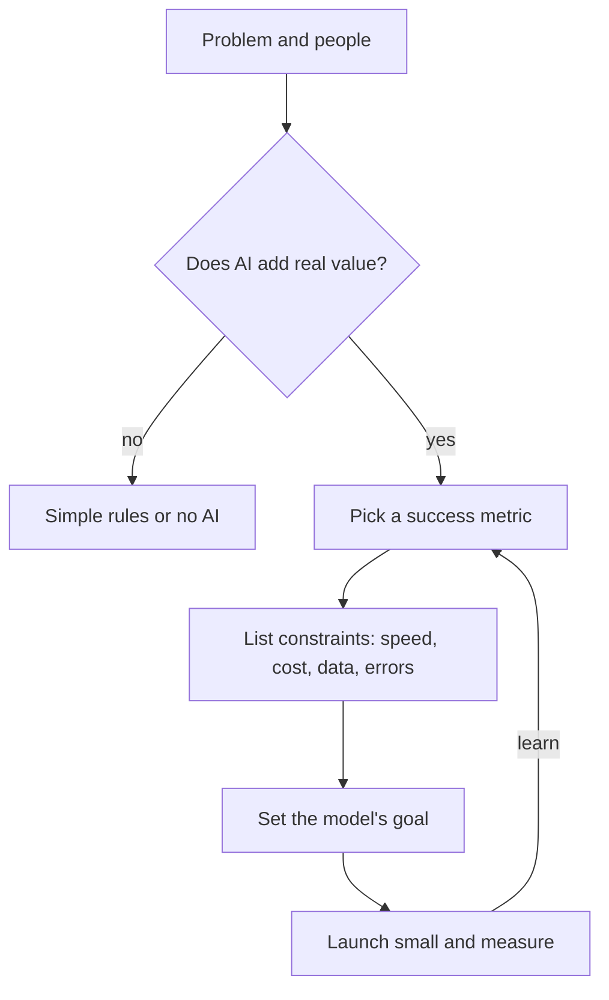

> [!crumbs] [[00 Start Here|🏠 Home]] › [[Part 2 AI System Design|Part 2]] › [[AI Foundations]] › Business Goals & Requirements

> [!tldr] In one sentence
> Before anyone picks a model, you pin down **what problem you're solving, for whom, and how you'll know it worked**, and you check whether AI is even the right tool.

## 🧠 Think of it like…

> [!analogy] Hiring a builder for your kitchen
> You don't start by choosing a power drill. You explain how you cook, your budget and your move-in date. Then the builder picks the tools.

The model is the drill; the business goal is the kitchen. **Requirements** are the budget, deadline and rules the result must meet.

## What it is

A **business goal** is the result the organization wants, such as fewer fraud losses. **Stakeholders** are the people affected: users, the team paying, support staff and anyone the system decides about.

Requirements turn the goal into checkable needs: what the system must do, and how fast, cheap and accurate it must be. Amazon's Well-Architected guide for machine learning calls this the **most important phase** of the whole lifecycle.[^1]

## Why it matters

- **A smarter model doesn't guarantee a better business.** Booking.com found that improving a model's score did not necessarily increase business value.[^2]
- **AI is expensive to keep alive.** Google warns that machine learning often needs "dedicated long-term maintenance," so it must earn its keep.[^3]
- **Mistakes aren't equal.** A false fire alarm is annoying; a missed fire is a disaster. Requirements must say which hurts more.[^4]

## How it works

1. **Name the problem in plain words.** "Detect spam," not "build a classifier."[^3]
2. **Ask whether AI fits.** AI shines at things like personal recommendations and spotting rare, changing events such as fraud. It is a poor fit when predictability matters most or errors are very costly.[^4] Try a simple rule first.[^3]
3. **Pick a success metric.** A number showing the business result, like how often people use a feature. It differs from the model's own scores, such as **accuracy** (how often it is right).[^5]
4. **List constraints.** Speed, cost per answer, and whether the needed data exists.[^1]
5. **Decide what you'll do when it slips.** Google's design guide suggests one sentence per metric: if the metric crosses a set threshold, the team takes a named action.[^4]

The model's goal comes last, often as a **proxy**: a measurable stand-in. A video app can't measure "useful," so it predicts shares or likes instead.[^5]

## A real-world example

Booking.com studied about **150 models** its customers use, each tested on some users but not others.[^2] Better model scores didn't reliably mean more bookings. And speed mattered: about 30% more waiting cost about 0.5% in conversions.[^2]

## Myths and pitfalls

- **❌ Myth:** Start by choosing the best model. **✅ Reality:** Start with the business goal; framing the ML problem comes after.[^1]
- **❌ Myth:** Higher accuracy always means more value. **✅ Reality:** Booking.com saw model gains that didn't move the business.[^2]
- **❌ Myth:** Every product needs AI. **✅ Reality:** Google's first rule of ML is not to be afraid to launch without it.[^6]
- **❌ Myth:** All errors cost the same. **✅ Reality:** Decide early whether false alarms or misses hurt your users more.[^4]

## Check yourself

> [!question]- What is the difference between a success metric and a model metric?
> A success metric measures the business result, like completed bookings. A model metric, like accuracy, measures prediction quality. One can rise while the other stays flat.

> [!question]- Why try a simple rule before building AI?
> Rules are cheaper, more predictable and easier to maintain. If a rule solves the problem well enough, AI only adds cost.

> [!question]- A spam filter can block too much or too little. Who should decide the balance?
> The stakeholders, early. Blocking a real email may hurt users more than letting spam through.

## Key terms

- **Business goal** — the result the organization wants, in plain words.
- **Stakeholder** — anyone affected by or responsible for the system.
- **Success metric** — a number that shows whether the business goal is being met.
- **Proxy metric** — a measurable stand-in for something you can't measure directly.
- **Constraint** — a limit the design must respect, like speed, cost or privacy.
- **False positive / false negative** — a false alarm versus a missed case.

## 🧱 Builds on

- [[Requirements]] — the same split into what the system does and how well it must do it, plus accuracy and error-cost targets.
- [[Estimation]] — traffic and cost per answer decide whether an AI feature pays for itself.
- [[Trade-offs]] — accuracy, speed, cost and which mistakes to prefer always pull against each other.

> [!deepdive] Ready for the technical take?
> The metric ladder, precision versus recall, latency and cost budgets, measurable LLM success criteria, and interview framing.
> → [[Business Goals & Requirements (Deep Dive)]]

## Related

- [[AI System Design Overview]] — where this step sits.
- [[Evaluation & Metrics]] — how the model's scores are measured.
- [[Cost Optimization]] — keeping the price per answer inside the budget.
- [[Ethics & Governance]] — stakeholders include people the AI decides about.
- [[AI Model Types]] — choosing a model once the problem is clear.

> [!nav] Keep going
> ← [[AI System Design Overview]] · [[AI Foundations|🎯 AI Foundations]] · [[AI Architecture Layers]] →
> 🔬 Technical take: [[Business Goals & Requirements (Deep Dive)]] · 🗺️ [[Glossary]]

## 📚 Sources

[^1]: 📄 [Business goal identification](https://docs.aws.amazon.com/wellarchitected/latest/machine-learning-lens/business-goal-identification.html) — AWS Well-Architected Machine Learning Lens. Official docs. Checked 2026-11.
[^2]: 📝 [150 successful machine learning models: 6 lessons learned at Booking.com](https://blog.acolyer.org/2019/10/07/150-successful-machine-learning-models/) — Adrian Colyer, The Morning Paper, summarizing Bernardi et al., KDD 2019. Article. Checked 2026-11.
[^3]: 🎓 [Understand the problem](https://developers.google.com/machine-learning/problem-framing/problem) — Google for Developers, Introduction to ML Problem Framing. Course. Checked 2026-11.
[^4]: 📄 [User Needs + Defining Success](https://pair.withgoogle.com/chapter/user-needs/) — Google PAIR, People + AI Guidebook. Official guide. Checked 2026-11.
[^5]: 🎓 [Framing an ML problem](https://developers.google.com/machine-learning/problem-framing/ml-framing) — Google for Developers, Introduction to ML Problem Framing. Course. Checked 2026-11.
[^6]: 📄 [Rules of Machine Learning: Best Practices for ML Engineering](https://developers.google.com/machine-learning/guides/rules-of-ml/) — Martin Zinkevich, Google for Developers. Official docs. Checked 2026-11.
