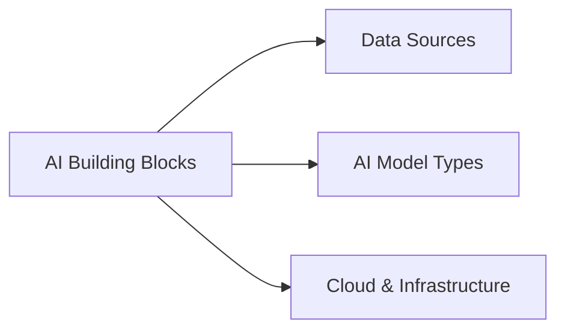

> [!crumbs] [[00 Start Here|🏠 Home]] › [[Part 2 AI System Design|Part 2]] › AI Building Blocks

> [!hub] 🧩 AI Building Blocks
> The raw ingredients: the data that feeds AI, the kinds of models, and where they run.

## Topics

| Topic | In one line | Technical take |
| --- | --- | --- |
| [[Data Sources]] | Where an AI system's data comes from: databases, APIs, streams, files, devices. | [[Data Sources (Deep Dive)\|🔬 Deep dive]] |
| [[AI Model Types]] | The main families of models and what each is good for. | [[AI Model Types (Deep Dive)\|🔬 Deep dive]] |
| [[Cloud & Infrastructure]] | The machines, chips and cloud services AI runs on. | [[Cloud & Infrastructure (Deep Dive)\|🔬 Deep dive]] |

## The shape of it

> [!tip] How to read these
> Every topic has a **🌱 basics** note (no jargon, about 5 minutes) and a **🔬 deep dive** (the technical take). Start with the basics; open the deep dive when you want more.
