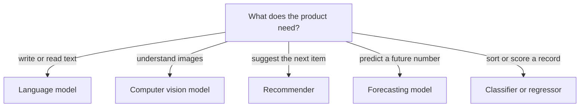

> [!crumbs] [[00 Start Here|🏠 Home]] › [[Part 2 AI System Design|Part 2]] › [[AI Building Blocks]] › AI Model Types

> [!tldr] In one sentence
> AI models come in a few big families, each built for one kind of job: **reading and writing text, seeing images, suggesting what you'll like, predicting future numbers, or sorting records**.

## 🧠 Think of it like…

> [!analogy] Specialist doctors
> You don't see an eye doctor for a broken leg. A hospital has specialists, and the front desk sends you to the right one for your problem.

AI model families are those specialists. A system designer plays the front desk: first name the problem, then pick the family built for it.

## What it is

A **model** is software that has learned patterns from examples so it can make predictions or create content.[^1] Hugging Face, a public hub for sharing models, sorts them by the kind of data they handle: text, images, audio, tables and mixes of these.[^2]

The families you will meet most often:

- **Language models (NLP).** NLP, natural language processing, means working with human language. A **large language model (LLM)** predicts the next piece of text, one word or word-fragment at a time.[^3]
- **Computer vision (CV).** Models that recognize what is in a photo or video, such as naming the object or finding where it is.[^2]
- **Recommenders.** Models that guess what you will want next: a video, a song, a product.[^4]
- **Forecasting.** Models that predict future numbers from past ones, such as next month's website visits.[^5]
- **Classic classifiers and regressors.** Models that sort a record into a category ("fraud" or "not fraud") or estimate a number ("house price").[^1]

## Why it matters

- **The family decides what is possible.** A forecasting model can't write an email, and an LLM is not a calculator.
- **Cost and speed vary hugely.** Some models run in a blink on a phone; the largest LLMs have **hundreds of billions of parameters** (the learned numbers inside) and need enormous computing power.[^3]
- **Simple often wins.** Google's own rule book says not to be afraid to **launch without machine learning**, and to keep the first model simple.[^6]

## How it works

Every family works the same way underneath. It is **trained** on many examples until its internal numbers capture the pattern. Then it is used for **inference**: given something new, it makes a prediction.[^1]

What changes between families is the input and output. Language models turn text into text. Vision models turn pixels into labels. Recommenders take your history and return a ranked list. Real products often chain several families together.

## A real-world example

YouTube's recommendations, described by Google engineers in 2016, serve more than a billion users.[^4] The system uses **two models in a row**. The first narrows millions of videos to a few hundred that might interest you. The second scores those few hundred and shows you the best few dozen.[^4] The split keeps it fast enough for every visit.

## Myths and pitfalls

- **❌ Myth:** An LLM is the best model for every job. **✅ Reality:** On medium-sized, spreadsheet-like data, older tree-based models still beat deep learning across a 45-dataset benchmark.[^7]
- **❌ Myth:** Bigger is always better. **✅ Reality:** DistilBERT is 40% smaller and 60% faster than the model it copies, yet keeps 97% of its language skill.[^8]
- **❌ Myth:** An LLM understands like a person. **✅ Reality:** It predicts likely text. Its answers can be confidently wrong, which is called **hallucination**.[^3]

## Check yourself

> [!question]- A store wants to predict how many umbrellas it will sell next month. Which family fits?
> Forecasting. It predicts a future number from past sales and patterns like seasons and holidays.[^5]

> [!question]- Why does YouTube use two models instead of one?
> Carefully scoring millions of videos on every visit would be too slow. A fast model shortlists; a careful one ranks.

> [!question]- What is hallucination?
> When a language model produces fluent text that is false.

## Key terms

- **LLM** — a large language model that writes and reads text by predicting the next piece.
- **NLP** — natural language processing: AI that works with human language.
- **Computer vision** — AI that understands images and video.
- **Recommender** — a model that suggests items you are likely to want.
- **Inference** — using a trained model to make a prediction.
- **Parameters** — the numbers a model learns during training.

## 🧱 Builds on

- [[Data Structures]] — models work on arrays of numbers and turn words or items into lists of numbers called vectors.
- [[Trade-offs]] — every model choice trades accuracy against speed, cost and simplicity.

> [!deepdive] Ready for the technical take?
> Architectures behind each family, two-stage recommenders, why trees win on tables, and distillation.
> → [[AI Model Types (Deep Dive)]]

## Related

- [[Model Selection & Training]] — how to pick and train the right model.
- [[Data Sources]] — each family needs its own kind of data.
- [[Embeddings & Vector Databases]] — how models turn things into numbers they can compare.
- [[LLM Inference & Optimization]] — making language models fast and affordable.
- [[Evaluation & Metrics]] — telling whether a model is any good.

> [!nav] Keep going
> ← [[Data Sources]] · [[AI Building Blocks|🧩 AI Building Blocks]] · [[Cloud & Infrastructure]] →
> 🔬 Technical take: [[AI Model Types (Deep Dive)]] · 🗺️ [[Glossary]]

## 📚 Sources

[^1]: 🎓 [What is Machine Learning?](https://developers.google.com/machine-learning/intro-to-ml/what-is-ml) — Google for Developers, Introduction to Machine Learning. Course. Checked 2026-11.
[^2]: 📄 [Tasks](https://huggingface.co/tasks) — Hugging Face. Official docs. Checked 2026-11.
[^3]: 🎓 [LLMs: What's a large language model?](https://developers.google.com/machine-learning/crash-course/llm/transformers) — Google Machine Learning Crash Course. Course. Checked 2026-11.
[^4]: 🔬 [Deep Neural Networks for YouTube Recommendations (PDF)](https://static.googleusercontent.com/media/research.google.com/en//pubs/archive/45530.pdf) — Covington, Adams and Sargin, Google, ACM RecSys 2016. Paper. Checked 2026-11.
[^5]: 📝 [Prophet: forecasting at scale](https://research.facebook.com/blog/2017/02/prophet-forecasting-at-scale/) — Meta Research, 2017. Engineering blog. Checked 2026-11.
[^6]: 📄 [Rules of Machine Learning](https://developers.google.com/machine-learning/guides/rules-of-ml) — Google for Developers. Official docs. Checked 2026-11.
[^7]: 🔬 [Why do tree-based models still outperform deep learning on tabular data?](https://arxiv.org/abs/2207.08815) — Grinsztajn, Oyallon and Varoquaux, 2022. Paper. Checked 2026-11.
[^8]: 🔬 [DistilBERT, a distilled version of BERT](https://arxiv.org/abs/1910.01108) — Sanh et al., Hugging Face, 2019. Paper. Checked 2026-11.
