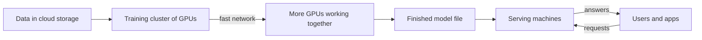

> [!crumbs] [[00 Start Here|🏠 Home]] › [[Part 2 AI System Design|Part 2]] › [[AI Building Blocks]] › Cloud & Infrastructure

> [!tldr] In one sentence
> AI runs on computers packed with **special chips that do huge amounts of math at once**, and most teams rent those computers from a cloud provider instead of buying their own.

## 🧠 Think of it like…

> [!analogy] Ovens for a bakery
> A home oven bakes one cake at a time. A big bakery needs rows of industrial ovens. Some bakeries buy them; others rent a shared kitchen by the hour.

The ovens are the AI chips. Buying your own is running **on-premise**, in your own building. Renting the shared kitchen is using **the cloud**. You also need a pantry (storage) and hallways between ovens (the network).

## What it is

AI infrastructure has three parts:

- **Compute** — the chips that do the math. A **CPU** (the computer's general-purpose brain) handles a few tasks very quickly one after another. A **GPU** (graphics processing unit) has many more cores and handles thousands of small tasks at once.[^1] Google's **TPU** (tensor processing unit) is a custom chip built just to speed up machine learning.[^2]
- **Storage** — where the training data and the finished models live.
- **Network** — the links that let chips, storage and users talk to each other.

**Cloud computing** means renting these resources over the network, on demand, and releasing them when you are done.[^3] Major providers such as Amazon Web Services (AWS), Google Cloud (GCP) and Microsoft Azure all rent AI machines. A single rented AWS or Azure machine can hold eight high-end NVIDIA GPUs.[^4][^5]

## Why it matters

- **AI is mostly math on big grids of numbers.** GPUs and TPUs are built for exactly that, so they run AI far faster than ordinary CPUs.[^1][^2]
- **The biggest models need thousands of chips.** OpenAI split GPT-3 across many GPUs in a Microsoft cluster.[^6] Meta's 2024 clusters held over 24,000 GPUs each.[^7]
- **Hardware is expensive.** Choosing the right chip, and switching it off when idle, shapes what AI costs to run.

## How it works

There are two very different jobs. **Training** teaches the model. It runs for days or weeks on many chips that swap results over a fast network. **Serving** (also called inference) uses the finished model to answer requests. It needs fewer chips per request, but it runs all day for every user.

The cloud lets you rent a big cluster for training, hand it back, then keep a smaller set for serving.

## A real-world example

In 2024, Meta described two clusters it built to train its Llama 3 models. Each held **24,576 NVIDIA H100 GPUs**, linked by a network running at 400 gigabits per second per connection.[^7] Meta said it aimed to own 350,000 H100s by the end of 2024.[^7]

## Myths and pitfalls

- **❌ Myth:** Every AI model needs a GPU. **✅ Reality:** Google's own guide says CPUs are fine for quick prototypes and small, simple models.[^2]
- **❌ Myth:** GPUs and TPUs are interchangeable. **✅ Reality:** TPUs shine on heavy matrix math but struggle with code full of branches or custom operations.[^2]
- **❌ Myth:** "Serverless" hosting works for any model. **✅ Reality:** Amazon's serverless model hosting has no GPU option and can pause before answering after idle time, a delay called a **cold start**.[^8]

## Check yourself

> [!question]- What makes a GPU better than a CPU for AI?
> A GPU works on thousands of small calculations at once, and AI is mostly that kind of math.

> [!question]- Why do many companies rent from the cloud instead of buying their own chips?
> Training needs a huge cluster for a short time. Renting means paying only while using it.

> [!question]- What is the difference between training and serving?
> Training teaches the model, usually once and on many chips. Serving uses the trained model to answer requests, all day.

## Key terms

- **GPU** — a chip with many cores that runs thousands of calculations in parallel.
- **TPU** — Google's custom chip built to speed up machine learning.
- **Cloud** — computing resources rented over the internet and paid for as you use them.
- **On-premise** — machines a company owns and runs in its own building.
- **Cold start** — the delay when a paused service must start up before answering.

## 🧱 Builds on

- [[Serverless]] — some models can be hosted serverless, with its cold starts and limits.
- [[Operating Systems]] — the operating system and drivers hand GPUs to programs.
- [[Networking]] — training clusters live or die by how fast chips can talk.
- [[Object Storage]] — training data and model files usually sit in cloud object storage.

> [!deepdive] Ready for the technical take?
> GPU and TPU internals, memory bandwidth, cluster networking, scheduling GPUs in Kubernetes, spot capacity and failure rates at scale.
> → [[Cloud & Infrastructure (Deep Dive)]]

## Related

- [[AI Scalability & Distributed Systems]] — splitting one model across many chips.
- [[Deployment & Serving]] — putting models on machines that answer users.
- [[Cost Optimization]] — keeping the hardware bill under control.
- [[LLM Inference & Optimization]] — getting more answers out of each GPU.
- [[AI Model Types]] — different families need very different hardware.

> [!nav] Keep going
> ← [[AI Model Types]] · [[AI Building Blocks|🧩 AI Building Blocks]] · [[Data Engineering & Pipelines]] →
> 🔬 Technical take: [[Cloud & Infrastructure (Deep Dive)]] · 🗺️ [[Glossary]]

## 📚 Sources

[^1]: 📝 [What's the Difference Between a CPU and a GPU?](https://blogs.nvidia.com/blog/whats-the-difference-between-a-cpu-and-a-gpu/) — NVIDIA Blog. Article. Checked 2026-11.
[^2]: 📄 [Introduction to Cloud TPU](https://docs.cloud.google.com/tpu/docs/intro-to-tpu) — Google Cloud documentation. Official docs. Checked 2026-11.
[^3]: 📄 [SP 800-145, The NIST Definition of Cloud Computing](https://csrc.nist.gov/pubs/sp/800/145/final) — National Institute of Standards and Technology. Standard. Checked 2026-11.
[^4]: 📄 [Amazon EC2 P5 Instances](https://aws.amazon.com/ec2/instance-types/p5/) — Amazon Web Services. Official docs. Checked 2026-11.
[^5]: 📄 [ND-H100-v5 size series](https://learn.microsoft.com/en-us/azure/virtual-machines/sizes/gpu-accelerated/ndh100v5-series) — Microsoft Learn, Azure Virtual Machines. Official docs. Checked 2026-11.
[^6]: 🔬 [Language Models are Few-Shot Learners (PDF)](https://arxiv.org/pdf/2005.14165) — Brown et al., OpenAI, 2020, section 2.3. Paper. Checked 2026-11.
[^7]: 📝 [Building Meta's GenAI Infrastructure](https://engineering.fb.com/2024/03/12/data-center-engineering/building-metas-genai-infrastructure/) — Engineering at Meta, 2024. Engineering blog. Checked 2026-11.
[^8]: 📄 [Deploy models with Amazon SageMaker Serverless Inference](https://docs.aws.amazon.com/sagemaker/latest/dg/serverless-endpoints.html) — Amazon SageMaker AI Developer Guide. Official docs. Checked 2026-11.
