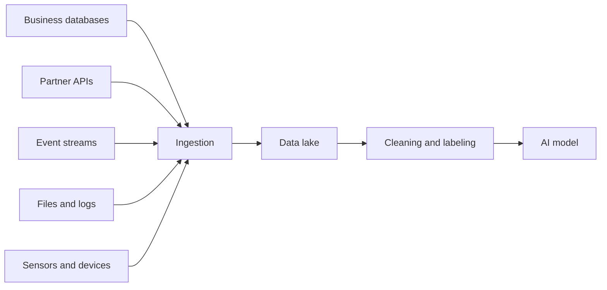

> [!crumbs] [[00 Start Here|🏠 Home]] › [[Part 2 AI System Design|Part 2]] › [[AI Building Blocks]] › Data Sources

> [!tldr] In one sentence
> An AI system is only as good as the data it learns from, and that data comes from a handful of places: **databases, APIs, live event streams, files and devices**.

## 🧠 Think of it like…

> [!analogy] A restaurant's suppliers
> A chef can only cook with what arrives at the back door. Some ingredients come in a weekly truck, some arrive fresh every hour, and a few are grown out back.

An AI model is the chef. Its **data sources** are the suppliers. Each delivers on its own schedule and at its own quality, so everything gets washed and checked before it goes in the pot.

## What it is

A **data source** is any place an AI system gets the examples it learns from or the facts it uses when answering. That can be numbers, text, images, audio or even other models' output.[^1]

Most sources fall into five families:

- **Databases** — records a business already keeps, like orders and support tickets.
- **APIs** — doors other companies open so your software can ask for their data, like weather.
- **Event streams** — a constant flow of "something just happened" messages, like clicks or payments.[^2]
- **Files** — logs, PDFs and photos, often piled into a **data lake** (one big store that keeps data in its original form).[^3]
- **Devices** — phones, cars and machines connected to the internet, called the **Internet of Things (IoT)**.[^4]

Many projects also need **labels**: the right answer attached to each example, such as "spam". People or software add them.[^5]

## Why it matters

- **The model learns only what the data shows.** If the data is missing, duplicated or mislabeled, the model learns those mistakes.[^1]
- **Fresh data means fresh answers.** Live event streams let a fraud check see today's scam.[^2]
- **Data problems hide.** A Google study of 53 AI practitioners found data problems that snowball later were nearly universal, with a **92% prevalence**.[^6]

## How it works

Data arrives in two rhythms. **Batch** data comes in big chunks on a schedule, like a nightly copy of sales. **Streaming** data trickles in one event at a time, seconds after it happens.[^2]

Everything lands in one central store first, so teams can reuse it. There it is cleaned: duplicates go, gaps are fixed or dropped, and wrong labels are caught.[^1]

## A real-world example

OpenAI trained GPT-3, an early large language model, mostly on **Common Crawl**, a free public archive of web pages collected since 2008.[^7][^8] The raw crawl was 45 terabytes of compressed text. After filtering for quality and duplicates, 570 gigabytes were kept.[^8] OpenAI mixed in cleaner sources such as books and Wikipedia, and showed them to the model more often.[^8]

## Myths and pitfalls

- **❌ Myth:** More data always beats better data. **✅ Reality:** GPT-3's builders found lightly filtered web text gave lower quality than curated text, so they threw most of it away.[^8]
- **❌ Myth:** Data is free once you have it. **✅ Reality:** Human labelers must be paid, make mistakes and often need a second reviewer.[^5]
- **❌ Myth:** Dumping everything in a data lake is enough. **✅ Reality:** Without a catalog and rules, a lake becomes a "data swamp" nobody can find things in or trust.[^3]

## Check yourself

> [!question]- What is the difference between batch and streaming data?
> Batch data arrives in large chunks on a schedule. Streaming data arrives continuously, one event at a time.

> [!question]- Why did GPT-3 keep only a small slice of the web data it downloaded?
> Unfiltered web text was low quality. Filtering kept the useful part and dropped the noise.

> [!question]- A model predicts machine breakdowns from factory sensors. Which source family is that?
> Devices, or the Internet of Things. Their readings usually arrive as a live stream.

## Key terms

- **Data source** — any place an AI system gets data from.
- **Batch** — data moved in large chunks on a schedule.
- **Streaming** — data moved continuously, one event at a time.
- **Data lake** — a central store that keeps raw data in its original form.
- **IoT** — physical devices connected to the internet that send data.
- **Label** — the correct answer attached to a training example.

## 🧱 Builds on

- [[Databases]] — a business's own tables are often its richest training data.
- [[API Design]] — partner data arrives through APIs, with their formats and limits.
- [[Message Queues]] — live events flow through queues like Kafka.
- [[Object Storage]] — files and raw dumps land here; most data lakes live on it.

> [!deepdive] Ready for the technical take?
> Change data capture, batch vs. streaming ingestion, offline and online paths, labeling and the failure modes that poison models.
> → [[Data Sources (Deep Dive)]]

## Related

- [[Data Engineering & Pipelines]] — the plumbing from sources to models.
- [[Feature Engineering]] — turning raw data into signals a model can use.
- [[AI Model Types]] — different models need different kinds of data.
- [[AI Security & Privacy]] — personal data in sources must be protected.
- [[Retrieval-Augmented Generation]] — company documents become a live source for chatbots.

> [!nav] Keep going
> ← [[AI Architecture Layers]] · [[AI Building Blocks|🧩 AI Building Blocks]] · [[AI Model Types]] →
> 🔬 Technical take: [[Data Sources (Deep Dive)]] · 🗺️ [[Glossary]]

## 📚 Sources

[^1]: 🎓 [Datasets, generalization, and overfitting: Data characteristics](https://developers.google.com/machine-learning/crash-course/overfitting/data-characteristics) — Google Machine Learning Crash Course. Course. Checked 2026-11.
[^2]: 📄 [Introduction](https://kafka.apache.org/intro) — Apache Kafka documentation. Official docs. Checked 2026-11.
[^3]: 📄 [What is a Data Lake?](https://aws.amazon.com/what-is/data-lake/) — Amazon Web Services. Official docs. Checked 2026-11.
[^4]: 📄 [What is AWS IoT?](https://docs.aws.amazon.com/iot/latest/developerguide/what-is-aws-iot.html) — AWS IoT Core Developer Guide. Official docs. Checked 2026-11.
[^5]: 🎓 [Datasets, generalization, and overfitting: Labels](https://developers.google.com/machine-learning/crash-course/overfitting/labels) — Google Machine Learning Crash Course. Course. Checked 2026-11.
[^6]: 🔬 ["Everyone wants to do the model work, not the data work": Data Cascades in High-Stakes AI](https://research.google/pubs/everyone-wants-to-do-the-model-work-not-the-data-work-data-cascades-in-high-stakes-ai/) — Sambasivan et al., Google Research, ACM SIGCHI 2021. Paper. Checked 2026-11.
[^7]: 📄 [Overview](https://commoncrawl.org/overview) — Common Crawl Foundation. Official docs. Checked 2026-11.
[^8]: 🔬 [Language Models are Few-Shot Learners (PDF)](https://arxiv.org/pdf/2005.14165) — Brown et al., OpenAI, 2020, section 2.2. Paper. Checked 2026-11.
